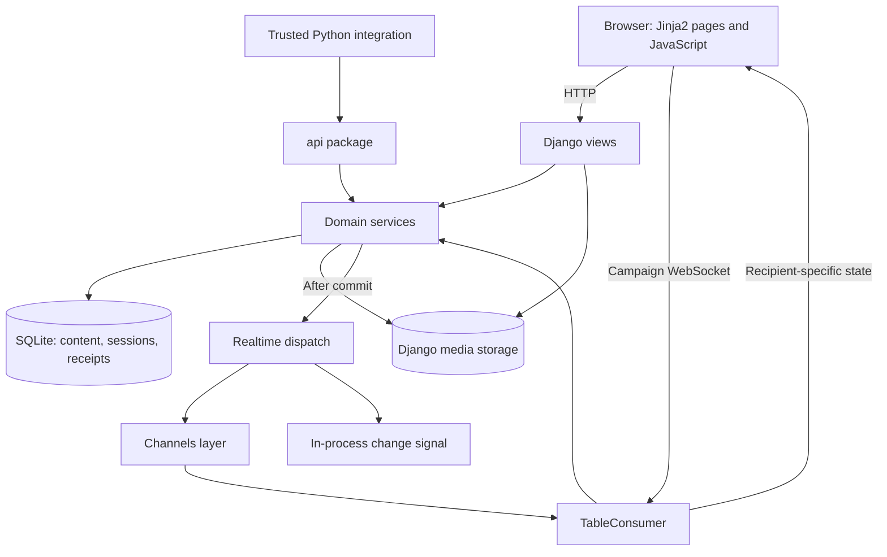

# Architecture

[Documentation](../README.md) · [Português](../pt-BR/architecture.md) · [Code map](code-map.md)

Gravewright is a Django virtual tabletop. The server owns campaign data, permissions,
command validation and persisted results. Jinja2 renders the application shell and
HTML fragments; browser JavaScript runs the interactive tabletop. Django Channels
connects each table socket to one campaign.

This document describes the implementation in this repository. For commands to run
it, see [Getting started](getting-started.md); for file-level navigation, see the
[code map](code-map.md). Extension authors should also read the
[API reference](api.md) and [module guide](modules.md).

## Runtime boundaries

- `config/asgi.py` starts Django and routes HTTP and WebSocket traffic.
  `config/proxy.py` restores forwarded schemes from trusted socket peers before
  routing. The socket stack checks the browser origin before resolving the session.
- `config/urls.py` composes app URL modules. HTTP paths beginning with `/api/` are
  view routes; the top-level `api/` directory is a **Python import interface**.
- `gravewright/<domain>/services.py` contains most business rules. Some upload,
  media and administration workflows live directly in view/helper modules, so a
  change should be traced through its actual URL or socket entry point.
- `gravewright/realtime/consumers.py` handles transport, subscriptions and transient
  connection state. It invokes synchronous services through
  `database_sync_to_async`; expensive dice evaluation uses `asyncio.to_thread`.
  Each socket runs commands, subscriptions and deliveries in order on its own
  thread, so commands from one connection stay ordered while a slow query cannot
  stall other players. Samples where only the newest value matters (cursor,
  viewport and token drag, whether sent by this socket or relayed from another)
  run in a second lane with a thread of its own: a newer sample replaces an
  unprocessed one, and each drag stream keeps its own end or cancel. Pongs renew
  the presence lease on a pool thread. A reader admits frames by their arrival
  time (size, cursor throttle and command rate), so frames that waited behind a
  slow command are not mistaken for a burst; more than 256 waiting frames close
  the socket with code 4429. Handlers log a payload-free warning when they reach
  `GRAVEWRIGHT_REALTIME_SLOW_MS` (see [Configuration](configuration.md)). Pings
  and liveness do not wait for the database, and a disconnect abandons pending
  handlers so presence cleanup finishes within Daphne's close timeout.
- `gravewright/realtime/dispatch.py` schedules committed resource invalidations,
  chat delivery and trusted Python extension signals. Each commit becomes one
  `room.changes` event listing the projections to refresh (`dispatch.refreshes`),
  so a socket authorizes once, delivers each projection once (board first,
  dependent resources last) and sends `api.changed` once per domain. Playback,
  item and compendium edits refresh only their own resource; combat, cards and
  other audio changes also refresh the map layers, which show them; compendium
  imports refresh everything an archive may touch. The
  `gravewright.realtime.tests.test_dispatch_dependencies` suite compares real
  projections before and after commands to keep this table complete. Modules
  therefore receive `api.changed` hints only for domains a commit can change.

This guide describes the current transport. The approved
[realtime design direction](realtime-direction.md) records planned changes to it and
the status of each stage.

The default database is SQLite with `transaction_mode='IMMEDIATE'`. Services express
serialization with atomic transactions and campaign/membership locks. SQLite does
not implement row-level `SELECT FOR UPDATE`; its write transaction controls
concurrency. Treat changes to transaction boundaries as behavioral changes.

Standard production settings require a Redis Channels layer. The in-memory layer is used
for one development process and by the dedicated [local runner](windows-runner.md);
it cannot carry notifications between workers. Redis
is the event transport, while campaign content, sessions and presence leases remain
in the database. See [Configuration](configuration.md). Each socket holds one
presence lease (`PresenceConnection`, valid for `GRAVEWRIGHT_PRESENCE_TTL`). A pong
renews it only during the second half of its lifetime, so most pongs write nothing;
a renewal recreates the lease if another socket's cleanup removed it while the
renewal was delayed. Heartbeat upkeep removes expired leases (left by crashed
workers) at most once per half TTL in each process, reading before it deletes.

The WebSocket origin check uses `GRAVEWRIGHT_PUBLIC_ORIGIN` when configured and
requires both the request Host and browser Origin to match its scheme, domain and
effective port. Without it, the check uses the ASGI `ws`/`wss` scheme, defaulting to
HTTP when absent. Pinning the public origin supports direct TLS with Daphne even
when its WebSocket adapter omits `scheme`. The
[proxy adapter](../../config/proxy.py) accepts one valid `X-Forwarded-Proto` value
only from a socket peer in `TRUSTED_PROXIES`, restoring the scheme for both HTTP and
WebSockets. See [Deployment](deployment.md) for TLS, proxy trust and static serving.

## Identity and authorization

There are two independent role systems:

| Scope | Roles | Meaning |
| --- | --- | --- |
| Host account (`accounts.User`) | `owner`, `participant` | Host administration and account bootstrap. A database constraint permits one owner. |
| Campaign (`campaigns.Membership`) | `gm`, `player`, `streamer` | Access to a particular table and its resources. |

The host owner creates campaigns and receives a GM membership for a new campaign.
Resource access checks campaign membership rather than assuming that a host role
grants access to every table. Actors/items additionally use per-user permission
maps; journals use `Access` rows and visibility rules.

`journals.services.member()` is shared across several domains. It reloads an active
user's membership and checks streamer expiration. `api.Context` holds normalized
campaign/user UUIDs only: constructing one does not grant authority or cache roles.
Public service entry points receive identifiers and resolve membership again.

The browser domain registry is generated from `modules/contracts/frontend.json`.
Its authenticated dispatch delegates transactions to owning services, so map
rendering is not held inside a transport transaction. Binary domain calls use a
separate multipart/byte route with the same campaign and module lease checks.
`maps/library_services.py` and `table/permission_services.py` share native library
and ownership rules with the public Python facades and browser methods.

`campaigns/system_api.py` provides an explicit callback registry for the active
campaign system. Trusted packages register descriptions and read/write handlers
at startup; membership, JSON bounds and streamer write restrictions remain host
checks. Resource access, revisions and receipts remain provider responsibilities.
The PDF package registers its own mapping, template and saved-roll operations;
the host dispatcher contains no PDF-system conditionals.

WebSocket authorization also rereads the live database session, its configured auth
backend and the user's session authentication hash. It checks membership when
receiving commands, in delivery handlers and during heartbeats. Removing a member,
expiring a streamer link or invalidating a session therefore affects existing
connections as they are rechecked. A socket may reuse its last successful check for
up to two seconds (`AUTHORIZATION_TTL` in `consumers.py`), never beyond the session or
streamer-link expiry. Logout, session deletion, password changes, membership removal
or role changes, user deactivation, streamer-link changes and campaign deletion
invalidate that cache before the next frame: after commit they advance a
process-wide epoch and send `room.access` to the affected campaign and user groups,
so sockets in other processes revalidate at once (`gravewright/realtime/access.py`
and `signals.py`). Code that changes those rows without model signals, such as
`QuerySet.update`, must call `access.revoke`; edits made directly in the database are
noticed when the cached result expires. Write commands are still authorized by their
services. See [stage 6 of the realtime direction](realtime-direction.md#stage-6-cached-transport-authorization).

Streamer access is read-only. The socket consumer permits a limited set of sync,
search, viewport and heartbeat messages; write boundaries also reject streamers.
Client-side controls are a convenience, not the permission boundary.

**Scene visibility has two requirements for non-GMs:** the scene must have
`visibility='players'` and be the recipient's current destination. A player's
`SceneAssignment` overrides the campaign `Broadcast`; other players and streamers
continue following that broadcast. Marking an inactive scene visible does not
make it readable. The same lookup protects manifests, tiles,
tokens and scene-context chat.

The GM's explicit `maps.activate` command sets player visibility and the broadcast
in the same transaction. With `playerIds`, it instead assigns the scene only to
those campaign players, preserving everyone else's destination and GM navigation.
Activation for everyone clears individual assignments and reunites the table.
Assignments persist across reconnects and disappear when their scene or membership
is deleted; they are separate from a GM's private `SceneNavigation`.
A visibility change advances the scene revision;
activating an already player-visible scene keeps its revision. Map Builder
generation and private navigation do not publish a scene.

## Commands, retries and revisions

Map pointer activity is ephemeral. `maps.cursor` accepts bounded scene positions
from players and GMs; the server supplies identity and the saved identification
color. Delivery rechecks the recipient's scene access and current subscription.
Pointer traffic has its own sampling limit and cannot exhaust the command budget.
Leaving or disconnecting publishes a clear event; no cursor position enters the
campaign database, receipts or archives.

Most persistent tabletop resource commands follow this sequence:

1. Parse the requested operation and request UUID.
2. Start an atomic transaction, lock the campaign and reload membership.
3. Check write permission and look for a previously committed receipt.
4. Validate the operation's payload, resource scope and relevant revision.
5. Change models and record the result under the request UUID.
6. Register post-commit notifications and return the acknowledgement.

The exact order and replay behavior vary by domain; follow the owning service.
Uploads and administrative operations do not all use this receipt protocol.

Work that does not need the write reservation stays outside it. Compendium reads
check live membership and grants without opening `BEGIN IMMEDIATE`, and create no
receipt or notification. Compendium imports read and validate their archives and
artwork first, then compare the entry's revision again inside the transaction and
fail with `conflict` if it changed. Token commands look for a receipt before taking
the lock (and again inside it), store only created IDs and teleport markers in the
transaction, and build the acknowledgement's visible tokens after commit; region
automation still commits with the move. Original SDK 1.0 operations stay inside a
transaction because every call renews its mount lease.

| Identity store | Used by | Retry behavior |
| --- | --- | --- |
| `maps.Receipt` | Maps, actors, tokens, items, combat, cards, audio, compendiums | Shared `(campaign, user, request_id)` namespace. Most return the saved result; tokens rebuild visible state and filter saved created IDs. |
| `journals.Receipt` | Journal commands | Journal-specific result receipts; additional access checks apply to particular results. |
| `chat.Message` and `dice.Submission` | Chat and dice | Message identity prevents duplicate delivery records; dice claims prevent rerolling. |

Generate a **fresh UUID for each new logical command** and reuse it only to retry
that same command. In particular, do not reuse a UUID between an actor command and
an audio command: they share the same receipt table. Receipts do not generally
compare the retried action or payload with the original one.

When SQLite reports a lock (`database is locked`) while a socket handles a command,
the consumer answers on that command's error channel with code `busy` and the same
request ID, and the socket stays open. The browser keeps the command pending and
silently resends the same payload after 1, 2, 4 and then every 8 seconds; the receipt
makes the retry safe. A roll whose completion meets a lock releases its claim, so the
retry rolls again; the rolled-back result never left the server. Subscriptions,
searches and lobby updates that meet a lock are replayed on the next heartbeat upkeep,
deliveries are queued again the same way, and samples that a newer one replaces are
dropped. Other database errors still close the socket. Each command also has a
45-second deadline, above the 30-second SQLite timeout: when it expires the browser
closes the socket and reconnects, resending pending commands with their original IDs.
Pings never resend pending chat messages or rolls; only a reconnection does.

Request identity and resource revision solve different problems. The request UUID
deduplicates a command; fields such as `version`, `sheetVersion` and
`expectedVersion` detect a stale editor. A conflict requires refreshed state and an
explicitly chosen new edit, not blindly changing a version number.

`transaction.on_commit()` prevents subscribers from being notified of rolled-back
changes. Dispatch uses robust callbacks and does not provide a durable event queue:
a committed mutation can survive a delivery failure. Clients should resynchronize
through state endpoints/subscriptions. Each refresh envelope carries a per-campaign
revision, incremented in the committing transaction (`realtime.CampaignRevision`).
A socket that sees a gap, for example because a full channel queue dropped an
envelope, refreshes every projection it subscribes to; a late or repeated envelope
is ignored. Each socket also remembers the projections it last sent: an unchanged
projection sends nothing, and tokens and map layers send `delta` frames
(`upserts`, `removes`, `order`, `unset`) computed from the recipient's own complete
projection, so they never carry data that projection would not. The first
projection after a subscription, scene change or reconnection is sent whole. A
`resources.sync` for one table module resets only that module's projections, so the
burst that subscribes every module does not make later envelopes resend the others.
Python `resource_changed` handlers are
trusted in-process callbacks; they are neither cross-process durable jobs nor an
untrusted-code sandbox.

## Domain behavior

### Campaigns and accounts

Account services rotate sessions on login, bound expensive password hashing and
store shared attempt windows under keyed hashes of client IP addresses. Campaign
services manage covers, hashed invitation/removal codes, redemption limits and
member removal. Streamer links create a dedicated guest identity with expiration
and revocation checks. The Inside interface composes these workflows in
`web/inside.py`.

Campaign preparation opens through `campaigns/management_views.py` without a
table socket, Pixi renderer or presence record. `management.py` authorizes current
campaign GMs; `preparation.py` validates session plans, timeline events, each GM's
dashboard and command receipts. Connections and player previews read native
documents rather than copying their state. Calendar dates are optional ISO dates;
in-world dates remain authored text. See [Campaign management](campaign-management.md).

### Actors, PDF sheets and tokens

An `Actor` is the reusable character source. `pdf_system/schema.py` normalizes its
sheet document, including PDF asset references, field values, bars, token settings
and active effects. Actor metadata and sheet data have separate revision counters.
The PDF system also owns optional `pdf.manualFields`: GM-authored, source-bound
overlay definitions for PDFs without form fields. Normalized page rectangles
survive zoom and page navigation; values use stable keys in `fields`. Only the
GM may alter the layout, while authorized players can fill its controls. Actor
and independent-token saves use the same schema and revision boundary.
Optional `pdf.fieldActions` binds GM-authored roll formulas to native or manual
fields by PDF source. The dice parser validates configuration without rolling;
execution resolves `@value` and uses the normal dice submission and chat flow.
The field-action modal saves an isolated candidate through the existing sheet
revision boundary, including token-bar value transfers.
`pdf.fieldBindings` records validated addresses for `@{field-key}` references;
`pdf.calculatedFields` uses deterministic formulas that the server recomputes
after validating dependencies and rejecting cycles. Layout history restores
definitions while preserving current character values. Campaign-scoped
`pdf_system.MappingTemplate` records hold portable mappings without PDFs or
character values, with GM-only revisioned operations and atomic batch application.
Campaign archives include these templates. Browser diagnostics compare mappings
with the active document, and filled-PDF export creates a separate flattened copy.

A `Token` places an actor in a scene. Linked tokens use `Actor.data`; unlinked tokens
use their own `snapshot` and `sheet_version`. The first placement is linked. Placing
the same actor again converts existing linked placements into snapshots and creates
another snapshot; duplication also creates an independent snapshot. Sheet saves
must target the correct source and invalidate affected linked tokens.

Token movement checks control, locked state, revision, map bounds and, for non-GMs,
wall intersections. Drag previews are ephemeral coordinates validated by the same
movement rules. A preview does not save the final position; the persistent `move`
command does that. Outgoing previews are filtered again for each recipient and
discarded when their token version no longer matches.

### Maps and scene layers

Scene uploads validate the source image and configured byte/dimension/pixel/tile
limits, then generate a pyramid of lossless WebP tiles. `Scene` stores raster
metadata; `SceneState` stores scene-wide environment documents; `SceneObject`
stores typed objects such as walls, lights, images, markers and zones.

`maps/objects.py` coordinates object commands and layer projections. Specialized
helpers cover drawings/effects/images, marker ownership and zone geometry. State is
projected for the recipient: GM-layer images and private drawings are filtered;
undiscovered secret/invisible barriers lose interactive door presentation. Wall
geometry is still transmitted when needed for visibility clipping, so do not
describe the renderer as hiding all GM geometry from the client.

`realtime/scene_stream.py` validates viewport dimensions and generations, schedules
tile hints with bounded budgets and rejects stale scene versions. GM viewport
samples travel through Channels to per-player prefetch brokers. WebSocket messages
schedule loading; the actual raster bytes remain authenticated HTTP resources.

### Journals and handouts

Journals combine type-specific JSON with explicit grants. `documents.py` validates
structured content and filters GM blocks; `data.py` normalizes document shapes;
`types.py` handles behavior such as boards and quests. Player edits preserve hidden
GM content and cannot link arbitrary assets. `presentations.py` issues and resolves
recipient-bound handout tickets rather than making the underlying files public.

`journals/history.py` stores bounded per-document `Revision` snapshots and deleted
documents. Restores validate visibility/default access, current quest dependency
graphs and physical attachment availability in the journal transaction. A restore
records the state it replaces so it can be undone. File cleanup checks both live
assets and retained revision ownership after commit. History and trash are GM-only;
ordinary journal projections do not include them.

### Progress clocks and clue discoveries

`table/clocks.py` and `table/clues.py` own persistent, versioned campaign/scene
records and command receipts. These are generic progress trackers, separate from
system-owned combat effect clocks. Table clients use projected realtime resource
states; campaign management reads the same records through HTTP.

Clock visibility and optional player advancement are server rules. Clue projections
omit all undiscovered records and private GM notes; only completed, player-visible
findings reach players and streamers. MapBuilder's `blueprint_clocks.py` and
`blueprint_clues.py` execute specific GM-authored bindings with campaign/scene
validation. Those bindings do not give the interacting participant general write
access or reveal private resource data. Simulation does not execute writes; server
rehearsal executes inside a rollback boundary. See [Clocks](clocks.md) and
[Clues](clues.md).

### Collaborative mind maps and resource identities

`table/mindmaps.py` owns campaign/scene graphs, selected player editors, private
visibility, structural validation and revision checks. Table clients and the GM
manager edit the same `MindMap` records. `table/domain.py` serializes mutations
with dedicated `MindMapReceipt` records; retries recheck current authority and
return fresh recipient projections. `api/mindmaps.py` and the browser `mindmaps`
domain expose these native operations without bypassing their checks.

`table/resource_links.py` registers 37 typed native resource identities and archive
metadata. One request-scoped `Resolver` reuses the owning domains' authorized
projections, never unrestricted resource names. Stored links contain identities;
live reads add permitted labels. Missing and denied resources share a neutral
opaque placeholder, allowing unrelated edits without exposing hidden targets.
Resource revocation remains authoritative even when an editor has an unsaved
draft. Topic text belongs to the whole map's audience. See [Mind maps](mindmaps.md)
and the [API contract](api.md#collaborative-mind-maps-and-typed-resource-links).

MapBuilder's `maps/blueprint_mindmaps.py` validates scene-bound targets and
delegates only the authored completion effect. Opening checks each recipient's
read permission; server rehearsal rolls back mutations and notifications.
`administration/mindmap_archives.py` consumes the typed registry to remap copied
resources without rewriting authored notes or local topic identities. Portable
copies clear selected editor grants; snapshots retain same-campaign access.

### Chat and dice

Chat history combines table-level messages and the selected/current broadcast scene,
then filters visibility and recipients. Supported message commands include whispers,
GM messages and emotes. Moderation removes content while retaining message identity
so a retry cannot recreate removed messages. Card chat attachments capture immutable
public faces instead of referencing a later-mutated deck.

Dice use `dice/engine.py` and the native Python grammar: parse, compile/validate,
then execute a bounded plan. Compilation consumes no randomness. The persistence
flow reserves a `Submission`, evaluates outside the database transaction, rechecks
authorization, and commits a `Message` with its result and fixed recipient audience.
A successful retry retrieves the stored result; an expired/interrupted claim
requires a new request rather than silently rerolling. The pure `api.dice.evaluate`
entry point does not persist or publish anything. See the existing
[grammar architecture](../../gravewright/dice/grammar/ARCHITECTURE.md) and
[notation specification](../../gravewright/dice/grammar/notation/GRAMMAR.md).

### Items, combat, cards, audio and compendiums

These five domains use `table/domain.py` for membership, transactions and receipts.
Their internal `state(who, ...)` and `command(who, ...)` helpers expect that boundary;
external callers use the public wrappers or `api.resources`.

| Domain | Responsibility and important boundary |
| --- | --- |
| Items | Versioned item documents with per-user grants. Players may create items and become their owner; filing, duplication, sharing and deletion remain GM-only. The native PDF implementation currently returns no item types, so ordinary item creation is unavailable until that capability is implemented. |
| Combat | A scene's encounter, initiative, current turn and bounded turn history. Turn order changes preserve combatant identity; progression can advance effects on actor documents. |
| Cards | Reusable definitions and mutable deck instances; draw/hand/scene/discard zones, ownership and face visibility. A GM's control permission does not automatically expose another player's hidden face. |
| Audio | Track uploads, playlists, playback transport and soundtrack scheduling. State projects positions using server time and spatial gain using controlled listener tokens and acoustic walls. HTTP file delivery remains separately authorized. |
| Compendiums | Campaign packs and native content catalog access. Portable bundles capture an allowlisted dependency graph and import documents/assets into a compatible campaign system. Native item and spell packs are readable by players until the GM hides them; actor, journal, scene and card packs and campaign packs stay hidden until shared. Only the GM imports. |

The older declarative formula helper in `combat/formula_engine.py` is distinct from
the chat dice grammar. Current combat initiative calls `dice.engine.evaluate`;
changing one engine does not automatically change the other.

The bundled PDF System supplies its own combat defaults and initiative evaluator
through the system registry. Its default formula is `1d20 + @initiative`, where
`@initiative` reads the PDF mapping's canonical `init` value. Linked tokens use
the actor sheet; independent tokens use their snapshot. The combat API supports
per-scene formulas and rolls before combat starts. The PDF System tracker exposes
manual numeric initiative, without roll or formula controls. Tokens are added
through their context menu. Reordering during combat preserves the current
combatant. Other systems do not inherit these PDF rules. Current and next tokens
have green and yellow expanding indicators, mirrored in the tracker sidebar.

Token conditions accept an optional `duration: {type: "turns" | "rounds",
value: 1..10000, expires: "start" | "end"}`. The server initializes `remaining`;
turn clocks follow the affected token, and round clocks follow encounter round
boundaries. Only participating tokens in that scene advance. Expired conditions
are removed; permanent conditions remain. Backward navigation and stopping combat
do not change clocks. Retry receipts prevent duplicate ticking. Both condition
layouts show remaining time and expiry phase in their tooltips.

The native compendium directory filters its metadata locally by name, document
kind and collection. Previews fetch only the selected authorized entry and display
plain text in the shared modal. GMs can import from the entry, preview, or by
dragging to the matching document directory. Drag payloads carry campaign, pack,
entry and kind; the receiver verifies them against its visible catalog before
using the existing authorized import command. Players can preview readable packs
but cannot import. Imports retain the existing archive and dependency handling.

## Archives and host administration

`administration/archives.py` explicitly allowlists native content models. Exports
include a content document, checksummed manifest and optional files. Portable exports
remove user-specific permissions and omit chat; snapshots additionally include
access/chat records for restoration. New-campaign imports and merges remap resource
identifiers and file paths. Restoration into the same campaign preserves resource
identifiers and replaces native content while retaining members, codes and snapshot
history. These archives are not complete host backups: accounts, sessions, host
settings and installed packages are separate operational state.

`administration/preparation_archives.py` validates and remaps preparation records,
dashboards, journal revisions and retained attachment files. Portable imports
assign one source dashboard to the importing GM without creating memberships;
snapshots restore each current GM's own dashboard. Legacy archives without
preparation metadata preserve existing preparation/history on restoration.
Resource-only compendium exports omit this private preparation and history.
Clocks and clues retain campaign or scene scope, and Blueprint references remap
to copied targets rather than the source campaign.

Import validates paths, archive size, expanded size, model/field allowlists and
checksums before creating content. Adding a model or file relationship requires
reviewing the archive selection, dependency graph and import rules, not only the
model definition.

`administration/updates.py` discovers configured source release metadata and caches
status. `administration/automatic_updates.py` hands owner-requested updates to
`scripts/update_supervisor.py`, which replaces project files and manages backup,
migration, restart and recovery. The same supervisor activates marketplace Django
apps in isolated Python environments. Host preferences and audit
records are separate models; feature toggles come from configuration. See
[Deployment](deployment.md) and [Development](development.md) before extending
these workflows.
