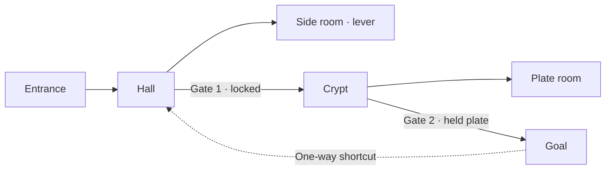

# Procedural dungeons: design direction

[Documentation](../README.md) · [Português](../pt-BR/procedural-dungeons-direction.md) · [Map Builder](map-builder.md) · [Smart Objects direction](smart-objects-direction.md)

## Status and purpose

This document proposes how Map Builder generates dungeons whose layout, doors and
mechanisms are ordinary editable project content, and whose puzzles, gates and
hazards are ordinary Smart Objects. It was drafted on 2026-11-09 from an analysis of
this checkout. **Nothing described here is implemented.** The project owner has not
yet approved it; the decisions listed under [Pending decisions](#pending-decisions)
gate stage 1.

## Invariants

Every stage preserves these rules:

- **The generator is an authoring assistant, not a runtime system.** Its output is
  an ordinary schema-3 Map Builder document with version-2 blueprints. It adds no
  node type, event, execution rule or live state store. Play uses the existing
  engine, permissions, receipts, automation log and scene-update policy.
- **The document is the source of truth.** Generated content is saved through
  `builder_services.save` and validated by `builder_services.clean_document`, like
  any hand-authored edit. The stored recipe is provenance; nothing requires running
  the generator again to read, render, update or archive a project.
- **Deterministic.** The same recipe, generator version, project ID and asset
  classifications produce the same document. A retry never yields another dungeon.
- **Solvable by construction and verified.** Every generated lock has a reachable
  key; a generation that cannot prove this fails with a diagnostic instead of
  returning a partial or unsolvable map.
- **Independent of RPG systems.** Core patterns use generic nodes: doors, regions,
  messages, dice requests, teleport. Damage, checks, monsters and loot belong to
  system packages through a future authorized contract.
- **No bundled content.** Core ships no dungeon artwork, monster lists, treasure
  tables or rulebook text. Art-dependent patterns use the campaign's own images.
- **GM-only and bounded.** Generation, recipes and provenance are visible only to
  campaign GMs. Input size, work, object counts and attempts are bounded before
  any expensive operation.

## What already exists

The generator composes existing capabilities rather than adding parallel ones.

| Need | Existing capability |
| --- | --- |
| Editable output, validation and limits | `MapBuilderProject` source schema 3, `builder_services.clean_document`, `LIMITS` |
| Saving, conflicts, retries and undo | Project `save` with `request_id`/`expected_version`, client autosave and undo history |
| Scene creation and later edits | **Generate scene** / **Update scene**, ownership manifest, live-state preservation |
| Rooms and corridors | Floors (rectangles, `shape` contours), walls, independent door segments, wall joins |
| Secret doors | Wall/door `presentation: "secret"` with `discovered: false`, filtered from players; **Reveal** node |
| Gates | Door `locked` state; **Change state** with `players: true`; `interactionEnabled: false` |
| Keys and triggers | Levers, composed torches (image + required light), Empty Objects, presence regions |
| Logic | Condition, Switch, Random, All/Any, Get property, variables, named signals |
| Persistence and time | Counter, Once, Cooldown, Delay, Timer |
| Presentation | Show message, Show handout, Request roll, Camera focus |
| Shortcuts | Same-scene **Teleport** with return gating |
| Reusable behavior with bindings | `BlueprintTemplate` definitions: `blueprint_templates.clean_definition` and `resolve_definition` |
| Proof through the real engine | `blueprint_testing.run_draft`: rehearses an unsaved document, then rolls back |
| Existing preset graphs | `builder/interactive-presets.js` (pressure plate, switch, trap, chest and others) |

Two constraints shape the design. Levers and torches require an image
(`clean_document` rejects them without `assetId`), and a torch also requires a
light. Empty Objects need no image but are GM-layer controllers that players cannot
click; their area events still work. Doors and regions need no artwork. The
builder also caps output at 16,777,216 pixels (or the lower
`GRAVEWRIGHT_MAP_MAX_PIXELS`), so a 64 px cell allows about 64 × 64 cells.

## Pipeline

Generation is a chain of pure, separately testable stages. Each stage reads only
its inputs and its own random stream.


| Stage | Input | Output |
| --- | --- | --- |
| Recipe | GM settings | Normalized, bounded recipe |
| Mission graph | Recipe | Rooms with roles; open, gated, secret, one-way and teleport connections |
| Spatial layout | Mission graph, size | Room rectangles, corridors and door sockets on the cell grid |
| Geometry | Layout, theme | Layers, floors, walls, doors, lights |
| Mechanism patterns | Mission gates, sockets, theme | Levers, torches, regions, Empty Objects and their blueprints |
| Verification | Everything above | Proof of solvability and limits, or a diagnostic |
| Emission | Verified result | Schema-3 document, `procedural` provenance and a GM report |

### Recipe

| Field | Meaning |
| --- | --- |
| `seed` | Text of up to 64 characters; the editor offers a random one |
| `size` | `columns`, `rows`, `cellSize`, checked against builder and pixel limits |
| `rooms` | Minimum and maximum room count |
| `loops` | Number of cycles added to the mission graph |
| `secrets` | Number of secret connections |
| `patterns` | Allowed pattern IDs and their maximum counts |
| `theme` | Project-local asset family names per slot (`floor`, `corridor`, `wall`, `door`, `lever`, `torch`, `chest`), or `null` for the builder default |
| `lighting` | `dark`, `sparse` or `lit` |

The theme refers to families by their project-local names, never to raw asset IDs.
Family names live in the project's own `assets` classifications, so campaign
copies and archives need no new remapping rule. A slot with no remaining family
members disables the patterns that need it and is reported.

**Randomness.** The generator uses its own versioned PRNG (for example PCG32),
not the helpers of Python's `random` module, whose sequences are guaranteed across
Python versions only for `random()`. Each stage draws from a named stream derived
from `seed` and the stage name, so changing the allowed patterns does not move the
rooms. Changing an algorithm increments the generator version.

**Identifiers.** Element, layer and node IDs are UUIDv5 values derived from the
project ID and a stable generation path such as `room/3/door/north`. The same seed
in two projects yields the same layout with distinct identities.

### Mission graph

The mission graph decides what the dungeon asks of players before any geometry
exists.

- Rooms have a role: `entrance`, `goal`, `hub`, `ordinary`, `key`, `secret` or
  `reward`. Connections are `open`, `gated` (by one lock), `secret`, `one-way`
  or `teleport`.
- A main path joins entrance and goal. Side branches hold keys. Loops reconnect
  later rooms to earlier ones, usually through a one-way shortcut, so players
  return without backtracking.
- **Lock-and-key invariant:** every gate's key lies in a room reachable from the
  entrance using only gates that open earlier. A fixed-point search (open what is
  reachable, collect keys, open their gates, repeat) must reach the goal, and its
  order becomes the report's walkthrough.



### Spatial layout and geometry

The first layout is rooms and corridors on the cell grid. Rooms are placed from
the mission graph outward; corridors join them; loop connections route around
existing rooms. Attempts are bounded. When the rooms cannot fit, generation fails
with a diagnostic that names the size and room count instead of dropping rooms.
The algorithm can change between generator versions; the contract is the output:
room rectangles, corridor cells and one door socket per mission connection.

Geometry emission writes:

- Named layers: **Floors**, **Walls and doors**, **Mechanisms**, **Regions** and
  **Lights**, so the GM can hide, lock or select each group.
- One floor per room or corridor run, with one family member chosen per floor.
  One floor per cell would exceed the 2,000-object limit on ordinary maps.
- Merged straight wall segments along the outline, relying on existing wall joins.
- One door segment per socket. Collinear wall intervals under a door are already
  omitted from the raster and native walls.
- Lights according to `lighting`. With torch art, room lights become composed
  torches.

## Mechanism patterns

A pattern turns one mission element (gate, shortcut, hazard, secret or reward) into
scene elements and behaviors. Each pattern declares:

| Part | Content |
| --- | --- |
| `id`, `role` | Stable ID; one of `lock`, `loop`, `secret`, `hazard`, `flavor`, `reward` |
| `requires` | Theme slots it needs, such as `lever` |
| `sockets` | Placements: a door on a gated connection, a wall position in the key room, a floor area |
| `elements` | Element rows to create, with their authored state and interaction setting |
| `behaviors` | `BlueprintTemplate` definitions with typed bindings resolved to socket elements |
| `effect` | The abstract result used by verification, such as “interacting with `key` opens `gate`” |

Behaviors use the existing template format, so built-in patterns are validated by
`clean_definition` and instantiated by `resolve_definition`. Pattern data lives in
the maps domain as JSON; it is not ported from the browser presets. A later stage
may let GMs tag their own campaign templates as patterns.

### Initial catalog

All graphs use existing nodes and fit within 32 nodes and 64 edges per graph.

| Pattern | Role | Art | Elements | Behavior |
| --- | --- | --- | --- | --- |
| One-way shortcut | Loop | None | Locked door; region on the far side | On area enter → Once → Change state: Open on the door Target, with **Players may lock or unlock** |
| Held plate | Lock | None | Closed door with interaction disabled; region | Pressure-plate graphs: entry opens; exit with Event context count = 0 closes |
| Teleport pads | Loop | None | Two regions | On area enter → Teleport to the other region; existing arrival gating prevents bounce |
| Warning trap | Hazard | None | Region | On area enter → Cooldown → Show message (trigger) → Request roll with a configured expression |
| Secret door | Secret | None | Secret door (`discovered: false`) | None; the GM reveals it with native controls |
| Area message | Flavor | None | Region at an entrance or goal | On area enter → Once → Show message |
| Lever gate | Lock | Lever | Locked door; lever in the key room | Lever On interaction → Check state: Off → Change state: On → Change state: Open on the door Target, with **Players may lock or unlock** |
| Counter lever | Lock | Lever | Locked door; lever | On interaction → Counter (target *n*) → Reached → Once → open the door as above |
| Torch trio | Lock | Torch | Three composed torches; locked door | Each torch turns and emits a signal to the door. The door's signal graph checks All over three Get property inputs and opens |
| Torch passage | Secret | Torch | Secret door; torch | Torch On interaction → Change state → Reveal (door Target) → Change state: Open |
| Chest | Reward | Chest | Lever-kind object | Existing chest graph: toggle and Once message; contents remain GM or system content |

The torch trio places its check on the door's signal graph because a graph reads the
state snapshot taken when its own event started. The signal runs as a queued
operation after the torch commits its new state, within the existing chain bounds.

Lock patterns must not be bypassable through direct play. A locked door already
rejects players; a held-plate door sets `interactionEnabled: false`. The GM keeps
native manual override, and automation keeps its authority rules.

## Verification

1. **Mission solvability**, always: the fixed-point search above, producing the
   walkthrough.
2. **Geometric checks**, always: flood fill over cells with walls and door states,
   applying each pattern's declared `effect` in walkthrough order. It proves
   every room and every key's interaction point is reachable, and that elements
   lie inside the map without overlapping sockets.
3. **Budgets**, always: object, presence-area, layer, node and document-size totals,
   with headroom left for the GM's own additions.
4. **Engine proof**, in tests and as an optional GM action: `run_draft` rehearses
   each key's trigger on the unsaved document and confirms that the predicted
   changes match the declared `effect`. Every built-in pattern has such a test, so
   catalog drift is caught by the real engine rather than by a second model of it.

A failed check returns a diagnostic naming the stage and element. It never returns
a document that skipped the failed part.

## Output, provenance and re-roll

The result replaces the content of the current project as one undoable edit and
is saved by the normal autosave. The document gains one optional schema-3 field:

```json
"procedural": {
  "generator": {"id": "gravewright.dungeon", "version": 1},
  "recipe": {},
  "rooms": [{"id": "…", "name": "Hall", "role": "hub", "x": 4, "y": 6, "width": 8, "height": 6}],
  "elements": {"<element id>": {"room": "…", "pattern": "lever-gate", "socket": "key"}},
  "contentDigest": "…"
}
```

- `elements` lets the editor say “Gate 2: opened by the lever in Crypt”. Rows whose
  element the GM deleted are ignored and pruned on the next save.
- Source element IDs survive campaign copies and theme entries are family names, so
  provenance needs no archive remapping.
- `contentDigest` records the generated content. Re-rolling over a project whose
  content changed since generation asks for confirmation in the application modal.
- Re-roll is intended before play. **Update scene** after a re-roll follows the
  existing update rules; tokens already placed are not moved.
- A newer generator may produce another dungeon from an old seed. The stored
  document is unaffected, and the editor shows which version generated it.

## Editor experience

- **Builder tools → Generate dungeon** opens an application modal with keyboard,
  focus, scrolling and small-viewport support.
- The form offers seed (with a random-seed button), size presets bounded by the
  pixel limit, room count, loops, secrets, allowed patterns and a family picker
  for each theme slot. A pattern whose art is missing stays visible with the slot
  it needs, and cannot be selected.
- **Preview** shows the returned document in the workspace with editing paused,
  like the existing Preview. **Apply**, **Re-roll** and **Back to settings**
  remain available. Discarding writes nothing.
- The report lists rooms, gates and their keys, the walkthrough, skipped patterns
  with reasons, and budget use.
- Text goes through the builder string catalog and host translations for `en`,
  `pt-BR` and `es`. Authored messages from patterns are ordinary editable text.

## Server contract

Proposed layout inside the maps domain:

| Module | Responsibility |
| --- | --- |
| `gravewright/maps/dungeons/recipe.py` | Recipe validation, normalization and limits |
| `gravewright/maps/dungeons/rng.py` | Versioned PRNG, named streams, UUIDv5 derivation |
| `gravewright/maps/dungeons/mission.py` | Mission graph, lock-and-key placement, solvability search |
| `gravewright/maps/dungeons/layout.py` | Rooms, corridors and sockets on the grid |
| `gravewright/maps/dungeons/geometry.py` | Layers, floors, walls, doors and lights as builder rows |
| `gravewright/maps/dungeons/patterns.py` and `patterns/*.json` | Pattern registry, sockets and template resolution |
| `gravewright/maps/dungeons/verify.py` | Reachability, budgets and optional engine proof |
| `gravewright/maps/dungeons/services.py` | GM authority, preview service and report |

`POST /api/containers/<campaign_id>/map-builder/dungeons/preview` accepts
`{projectId, recipe, assets}` and returns `{document, report}`. It checks GM
membership through `builder_services.authority`, verifies that classified assets
belong to the campaign, bounds the request body and work, and writes nothing.
Because it is deterministic and read-only, it needs no receipt. Applying the result
uses the existing project save with its own `request_id` and `expected_version`.
`api/map_builder.py` exports the same preview service for Python callers. The
browser SDK contract in `gravewright/modules/contracts/frontend.json` does not
change until the extension stage.

## Limits

Proposed values, checked before layout begins:

| Bound | Proposed value |
| --- | --- |
| Recipe body | 16 KB |
| Rooms | 2–32 |
| Pattern instances | 24 |
| Generated objects | 1,500 of the 2,000 builder objects |
| Generated presence areas | 64 of the 128 allowed per scene |
| Layout attempts | 64 per request |
| Map size | Builder dimension, cell-size and pixel limits |

## Delivery stages

Each stage delivers a reviewable, playable result before the next begins.

| Stage | Delivery | Dependency |
| --- | --- | --- |
| 1 | Deterministic core, layout and geometry | Approval of this direction |
| 2 | Lock-and-key with art-free patterns | Stage 1 |
| 3 | Art-dependent patterns and theme slots | Stage 2 |
| 4 | Engine proof and provenance inspection | Stage 2 |
| 5 | Partial re-roll and pinned rooms | Stages 3 and 4 |
| 6 | Extension contracts | Stage 3 and its pending decision |

### Stage 1 — Deterministic core, layout and geometry

**Scope:** recipe, PRNG streams and ID derivation; mission graph with entrance,
goal, branches and loops but no gates; rooms-and-corridors layout; layers, floors,
walls, closed doors and lights; `procedural` provenance; preview service,
endpoint and Python export; modal with seed, size, rooms, loops and floor, wall and
door families; workspace preview; Apply as one undo step.

**Acceptance:** the same recipe and project produce an identical document; another
project gets the same layout with different IDs. Every output passes
`clean_document`, saves, generates a scene and lets a token reach every room with
doors opened. Oversized recipes fail before layout; an impossible fit fails with a
diagnostic and no document. Players and streamers cannot call the endpoint.

### Stage 2 — Lock-and-key with art-free patterns

**Scope:** gated, secret, one-way and teleport connections; one-way shortcut, held
plate, teleport pads, warning trap, secret door and area message; geometric
verification with effects; walkthrough report.

**Acceptance:** a Django test proves each pattern through `run_draft`. A generated
dungeon is solvable in its reported order. Players cannot open a gate by direct
interaction, while the GM's manual override still works. Generation and editing run
no gameplay events.

### Stage 3 — Art-dependent patterns and theme slots

**Scope:** lever gate, counter lever, torch trio, torch passage and chest; lever,
torch and chest theme slots; availability and skip reasons in the form and report.

**Acceptance:** with art, each pattern is placed, proven and playable at the table;
without it, the pattern is unavailable and the dungeon is still solvable.

### Stage 4 — Engine proof and provenance inspection

**Scope:** a GM **Verify mechanisms** action that rehearses every gate; Selection
panel provenance with a locate action; a mission overview of rooms and gates.

**Acceptance:** verification reports each gate's result without changing the
project or scene. Deleting a key element makes verification report the broken gate.

### Stage 5 — Partial re-roll and pinned rooms

**Scope:** re-roll mechanisms or lighting alone through their streams; pin rooms;
preserve objects that are not in provenance.

**Acceptance:** re-rolling mechanisms leaves geometry and the GM's own objects
unchanged; pinned rooms keep their contents; conflicts are explained, never
resolved silently.

### Stage 6 — Extension contracts

**Scope (pending decision):** GM campaign templates tagged as patterns with role and
sockets; a validated host contract through which system packages contribute
patterns and fill encounter or treasure slots; prefab rooms from **My objects**.

## Pending decisions

1. **Entry point.** Recommended: **Builder tools → Generate dungeon** inside a
   project, reusing its library, autosave and undo. Alternative: an additional
   **New scene → Procedural dungeon** shortcut that creates the project first.
2. **Provenance storage.** Recommended: the optional `procedural` document field,
   which archives and copies carry without new code. Alternative: a separate model,
   which needs its own migration and archive support.
3. **Re-roll after manual edits.** Recommended for stages 1–4: full replacement after
   confirmation; selective preservation waits for stage 5.
4. **Default art.** Recommended: no bundled object art; art-free patterns cover the
   first deliveries. Bundling any images requires a licensing review first.
5. **System-package participation.** Whether, and in which stage, system packages
   may add patterns or fill encounter and treasure slots.

## Out of scope

- Generation during play or endless dungeons; generation is an authoring step.
- Caves and organic layouts through Painting mode and floor shapes; a later layout
  algorithm can emit them under the same contract.
- Multi-level dungeons; they depend on cross-scene transfer (Smart Objects stage 8B).
- Monsters, damage, checks and loot; they belong to system packages.
