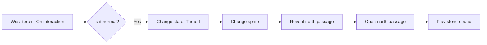

# Smart Objects: design direction

[Documentation](../README.md) · [Português](../pt-BR/smart-objects-direction.md) · [Map Builder](map-builder.md)

## Status and purpose

This document records the agreed direction for Smart Objects in the Map Builder.
It combines the delivered baseline with proposed extensions; each stage below
states its current scope and status.
The goal is a visual network of scene elements, events, conditions and actions,
with draggable connections inspired by ComfyUI and behavior composition inspired
by Unreal Engine Blueprints.

Stage 1 is implemented: the modal focuses the real element instance, showing
its name and current state. Mechanisms offer **On interaction** (`onInteract`)
and **On destroy**; regions offer area entry/exit and destruction, and named
signals share the instance node. These events only start a sequence: conditions
compare values, and actions change state, images or other supported properties.
There is no state filter or automatic comparison on an event.

The current blueprint format is version 2, with typed execution/data edges and
ordered fan-out. Loading older data discards `onChange` and state-specific event
graphs rather than preserving or converting their actions. Scene elements,
assets and supported base/signal sequences remain in place.

Stage 2 is also implemented. A wire follows the
pointer from a door port or another output; releasing on empty canvas opens a
node chooser, and choosing a type creates the connected node at the drop point.
Dropping on an existing input connects it directly. The chooser offers **Set
light**, **Play sound**, **Change state**, **Change sprite**, **Check state**,
**Sequence**, **Get property** and **Compare state**, with typed value wires, a
click/keyboard alternative and local simulation. Stage 3 adds cross-element
references, typed light/sound references, groups, barriers, sound control and map
picking. Stage 4 has a lever adapter and composed torches, with states, image appearances, cross-element
references and native table interaction. Stage 5 adds named regions, pressure
plates, filters, runtime region enablement and typed Event context derived from
authoritative commands. Move/Rotate and direct-player interaction gates use
native validation and GM override.
Stage 6 now delivers All/Any over current element conditions, typed element/scene
variables, named signals between scene elements, typed Switch, weighted Random
and ordered typed element/resource groups.
Stage 7 delivers persistent Counter, Once, event-driven Cooldown, durable Delay
continuations and named, one-shot Timer events.
Stage 8 now delivers optional dynamic floor/wall artwork and same-scene Teleport
(8A). Stage 9 delivers campaign snapshot templates with explicit typed bindings,
the GM scene network and authorized message/handout/camera presentation. Further
adapters, animation, cross-scene transfer (8B), group/navigation policy (8C) and
visual node groups remain future work. See
[Map Builder](map-builder.md#door-smart-objects) for current behavior and limits.

The builder also authors the VTT's native lights, particles and shaders, using
its preset catalogs and animated renderer. Generated scenes keep these as native
editable objects. These supply composed torches: linked images, lights and effects,
with independent flame and mechanism state. Other element adapters remain planned.

## Editor experience

Double-clicking an editable door opens the application's **Smart object** modal,
focused on the node representing that actual door instance. Its name, current
state and labeled event outputs appear together. Main ports are verbs:

| Port | Meaning |
| --- | --- |
| On interaction (`onInteract`) | Start the connected sequence when someone interacts; make decisions in logic nodes |
| On destroy (`onDestroy`) | Run before an authorized explicit in-game removal; failure rolls back the removal and its effects |
| On area enter / On area exit (`onAreaEnter` / `onAreaExited`) | Region only: run for each eligible token crossing the area boundary |
| On signal (`onSignal`) | Receive an authored name from Emit event or the matching one-shot timer |

For a complete torch sequence, start **On interaction → Check state: Normal**.
Its True branch can continue **Change state: Turned → Change sprite → Change
state: Opened**, with a door reference on the final action. The False branch can
return the mechanism and choose its other image. Lighting or extinguishing the
flame remains an explicit action. Conditions read the initial event snapshot.
An empty blueprint interaction performs no automatic toggle.

No state-specific event section remains. **Default appearance by state** is a
separate visual configuration, independent of event execution. Region occupancy
comes from validated token commands; checks for first arrival or last departure
are explicit comparison nodes in a presence sequence.

Destruction is a gameplay event. Builder edits, generated-scene updates, asset
cleanup and campaign deletion do not run it. Pausing automation also skips its
graph. Timers and waits owned by the removed element are cancelled; send a signal
to another surviving element when delayed work must continue. Rehearsal predicts
removal under rollback and preserves the real scene and project. Area port codes
retain the existing `presence:enter` / `presence:exit` graph IDs; named timers
continue to use `signal:<name>`, without a separate synthetic timer event.

Drag from a port to a compatible port to connect nodes. Dropping a wire on empty
canvas opens a compatible-node menu and connects the chosen node automatically.
The editor should support moving nodes, pan, zoom, selection, connection removal,
undo/redo and a keyboard alternative for creating and editing connections.
It uses existing application modals, focus handling, scrolling and close behavior,
including smaller viewports. Valid edits apply and save automatically; Close
waits for pending changes. Undo/Redo revises acknowledged edits. Invalid fields
block closing, and save failures retain pending work with explicit recovery.

## Elements are instances composed from capabilities

An element node references one existing scene element. Bringing the same element
into another graph view does not create another scene object or another copy of
its state. Ready-made element templates combine capabilities:

| Capability | Responsibility |
| --- | --- |
| Appearance | Image, visibility, position and orientation |
| Interaction | Available interactions and who may request them |
| States | Named state values and authorized state actions |
| Barrier | Movement, vision, light and sound blocking |
| Light | Enabled state, color, intensity and range |
| Sound | Playback, volume and repetition |
| Region | Area shape, occupancy and entry/exit events |
| Content | A reference to supported inventory or content services |
| Destination | A validated transport target |
| Mechanism | Authored properties such as normal/turned or inserted/removed |

Each capability exposes the events, actions and values it actually supports.
All elements should be able to participate in the network; a node offers only
connections its capabilities can execute. This does not make every property of
every scene object automatically writable.

## Initial element catalog

The following is the proposed adapter catalog. Each row describes intended
semantics; it does not imply that the adapter or its underlying service exists.

| Element | States or properties | Events | Actions |
| --- | --- | --- | --- |
| Door | Open, closed, locked | Opened, closed, locked, unlocked, interacted | Open, close, lock, unlock |
| Wall | Appearance, visibility and independent blocking settings | Passage released/blocked, revealed, appearance changed | Set blocking, reveal, hide, change appearance |
| Torch | Lit/unlit; optional normal/turned mechanism | Lit, extinguished, turned, interacted | Light, extinguish, turn, set light color/intensity |
| Chest | Lid, lock and content status | Opened, closed, unlocked, content accessed | Open, close, lock, unlock, reveal content |
| Floor region | Appearance, surface and associated area | Entered, exited, interacted | Change appearance, enable region, reveal, hide |
| Lever / switch | Active/inactive | Activated, deactivated, interacted | Activate, deactivate, toggle |
| Pressure plate | Pressed/released; enabled/disabled | Pressed, released, occupancy changed | Enable, disable, press, release |
| Trap | Armed, triggered, disarmed | Detected, triggered, disarmed, reset | Arm, trigger, disarm, reset |
| Bridge / platform | Retracted/extended; position | Retracted, extended, movement completed | Retract, extend, move, set passage blocking |
| Portal / access | Active/inactive; destination | Activated, entered, transported | Activate, deactivate, set destination, transport |
| Light | Enabled, color, intensity and range | Enabled, disabled, property changed | Enable, disable, set supported properties |
| Sound emitter | Stopped/playing; volume and repetition | Started, finished, stopped | Play, stop, set volume |
| Generic object | Authored states, appearance and orientation | Interacted, selected property changed | Move, rotate, change appearance, change state |

Keep independent properties separate. A torch can be lit and turned at the same
time: changing illumination must not implicitly change its mechanism. A revealed
secret wall can still block movement; visibility and blocking are separate.
A chest's lid, lock and content have distinct meanings, while valid transitions
still prevent opening a locked chest without an authorized unlock operation.
Opening a chest does not automatically empty its content.

Doors retain the native three-state `door_state` as their canonical live state.
The graph must not introduce a second open/closed/locked state store.

Floor behavior attaches to named regions such as **Entrance floor** or
**Trap area**, rather than automatically creating a node for each painted tile.
A region can cover tiles from different asset families; visual variation does
not create separate behavior instances. Smaller regions allow local mechanisms.

## Node and connection model

| Node category | Purpose | Examples |
| --- | --- | --- |
| Element | Reference an instance and expose its capabilities | North door, west torch |
| Event | Start execution; common events appear on element ports | Opened, interacted, property changed |
| Action | Perform one supported operation on a target | Open door, extinguish light |
| Condition | Select a branch | Is locked? Is the mechanism turned? |
| Flow | Organize execution | Sequence, once, wait |
| Value / reference | Supply a parameter or target | Element reference, state, number, sound |

Execution connections express “when this happens, do this.” Data and reference
connections supply targets or values. Distinct port shapes, labels and styling
must make those roles clear. Reject incompatible connections before execution.
An output may start multiple effects; when their order matters, a Sequence node
makes that order explicit.

An event carries its source element and, when available, the original triggering
token. Context values are inputs to explicit logic nodes; the event does not
compare them. Runtime interaction and editor configuration remain separate, so
moving or configuring a mechanism does not start a gameplay sequence.

A state action does not emit an automatic state event or start another graph.
Reopening a scene or reconnecting does not replay the sequence. The starting
event owns execution; conditions and actions describe all decisions and effects.

## Proposed global node catalog

Node types belong to a shared registry. Each placed node is an instance of one
type, with its own configuration, connections and target references. A door,
torch or chest reuses the same **Play Sound**, **Set State** or **Condition** type
when its capabilities support the requested operation. The editor filters the
catalog by compatible ports and available capabilities.

This catalog combines implemented nodes with future capabilities, as marked in
the delivery stages below. It carries forward image and sound effects as
**Change Sprite** and **Play Sound**; it does not imply that all listed types are
implemented or that every element accepts every action.

### Actions

| Node | Responsibility |
| --- | --- |
| Change Sprite | Change the target's image through its appearance capability |
| Play Sound | Play a selected sound with configured volume and repetition policy |
| Set State | Request a supported state transition on the target |
| Set Visibility | Set the target's visual visibility |
| Reveal Object | Change discovery of a hidden or secret element for an authorized audience |
| Set Barrier | Set supported movement, vision, light or sound blocking |
| Move Object | Move a target to a configured position or destination |
| Rotate Object | Set or change the target's orientation |
| Set Light | Set enabled state, color, intensity or range supported by the light |
| Set Interaction | Enable or disable a supported interaction on the target |
| Set Region | Enable or disable a region and its supported behavior |
| Control Sound | Stop, pause, resume or change supported playback properties |
| Animate | Animate supported properties over a configured interval |
| Teleport | Transport the selected token to a validated destination |

**Change Sprite** changes presentation; **Set State** uses the target's canonical
state and valid transitions. Changing a closed door's image does not open it.
**Set Visibility** controls appearance, while **Reveal Object** controls discovery;
neither implicitly removes a barrier or grants access to private data.

Two branches from **Closed** can change the image and play the closing sound.
A direct branch to **Set State: Open** reopens the door immediately after closing.
Opening in response to a player starts from **On interaction**, checking the
current state and applicable conditions. A sprite change can accompany Locked
while the server still validates the actual state transition.

### Conditions and flow

| Node | Responsibility |
| --- | --- |
| Condition | Compare values or test a condition and select True or False |
| Switch | Select a branch matching one value or a default branch |
| Sequence | Execute connected steps in an explicit order |
| All / Any | Combine current conditions using all or any of their results |
| Random | Choose one configured branch using nonnegative integer weights |
| Delay | Continue the flow after a configured interval |
| Timer | Start, stop or reset a timer that emits an event after an interval |
| Once | Allow a flow through once within its configured reset scope |
| Cooldown | Allow activation only when the configured cooldown has elapsed |
| Counter | Count activations and select Reached or Below target execution branches |

**All / Any** evaluates current conditions; it does not wait for several events
to arrive. **Counter**, **Once** and **Cooldown** now keep private per-element,
event/node progress with transactional persistence and a GM reset; see
[Persistent execution controls](map-builder.md#persistent-execution-controls).
**Delay** now pauses and durably resumes the remaining event, with cancellation
and restart recovery; see [Persistent Delay](map-builder.md#persistent-delay).
**Timer** starts, stops or restarts a named countdown and immediately continues
through Next. Expiry runs a fresh signal on its owning element; see
[Persistent Timer](map-builder.md#persistent-timer). Persistent progress does not
reset when an editor or participant reconnects.
Switch matches a typed input or fallback against unique cases and otherwise
chooses Default. Random draws across every configured branch once per event
visit, including unconnected outputs, and preserves the draw when its command
is retried. See [Switch and weighted Random](map-builder.md#switch-and-weighted-random).

### Data, references and events

| Node | Responsibility |
| --- | --- |
| Element Reference | Supply a stable reference to one existing element |
| Element Group | Supply a configured set of element references |
| Get Property | Read a supported property from a referenced element |
| Set Variable | Assign a value to a variable scoped to an element or scene |
| Get Variable | Read a variable from that scope |
| Compare Value | Compare Boolean, number or text values and produce a Boolean result |
| Event Context | Read original trigger/user/token metadata and this graph's event/state snapshot |
| Emit Event | Emit a named event within its configured scope; custom payloads remain future work |
| On Event | Start a flow when the matching named event is received |

**Event Context** exposes the actual triggering token/actor for typed conditions;
token-targeted actions remain separate work. Variables and named events need types, scope and
access rules; they must not expose private element data to unauthorized clients.
The current variable and signal implementation is documented under
[Variables and named signals](map-builder.md#variables-and-named-signals).
Signals carry a name without custom payloads. Event Context is implemented with
bounded server-derived fields that survive signals and timed work; custom
payload-bearing signals remain planned. See
[Trigger context](map-builder.md#trigger-context).

### Presentation

| Node | Responsibility |
| --- | --- |
| Show Message | Present a configured message to an authorized audience |
| Show Handout | Present an existing handout through its access controls |
| Camera Focus | Request focus on a target using existing permissions and participant preferences |

RPG-specific **Damage**, **Heal**, **Check** and **Apply Condition** nodes belong
to their system package, using authorized extension contracts. They are not
generic core actions.

### Initial priority and composition

Prioritize **Set State**, **Condition**, **Sequence**, **Element Reference**,
**Get Property**, **Set Barrier** and **Set Light**, alongside **Change Sprite**
and **Play Sound**. This is enough to build the first linked mechanisms without
requiring variables, timers or the complete catalog.

A counter-based mechanism can use:

**Torch turned → Counter (target 3) · Reached → Once · First time → Set State
(passage: open) → Play Sound.**

Place **Once** before the effects it gates. Its server-persisted state belongs to
the rule instance and its defined reset scope; placing it after **Play Sound**
would not prevent the preceding effects from repeating. A locked passage still
requires an explicitly authorized unlock transition before opening.

The counter records activations. A puzzle requiring three distinct torches
instead identifies those elements and checks their states with **Get Property**
and **All / Any**.

## Examples

The **West torch** has a mechanism property separate from illumination:

1. Interaction starts the sequence, and a condition checks the initial mechanism.
2. State and image actions turn the torch and choose its artwork.
3. An action reveals **North secret passage**.
4. Another action opens that passage through its supported door/barrier operation.
5. A sound action plays stone movement.

The passage can own a second sequence: **On interaction → Check state → Open
passage → extinguish west torch → enable secret-room lights**. Changing the torch's flame color does not turn its mechanism.

Other initial scenarios are **On interaction → Open door → enable room light** and
**Token enters entrance region → press plate → close north door**. The event's
token reference allows a condition or transport action to use the correct token.

## Ownership, references and reuse

The scene has one network organized into behaviors owned by elements.
The torch owns its interaction sequence that turns it and opens the passage;
the passage owns its own interaction sequence that opens it and enables lights. The focused modal and the GM's **Scene network** overview
edit the same rules. Multiple views must not duplicate rules or execute them twice.

Targets are selected by clicking an element on the map or searching its name.
Persist references by stable IDs; renaming a target preserves its connections.
Validate campaign, scene and resource scope on the server.

Group duplication remaps references between copied elements to their copies;
references outside the copied group keep their existing targets. New typed
references and group members whose targets disappear remain inert with repair
diagnostics, never reverting to Self. Legacy image/sound/light actions use the
documented cleanup rules; broader rule-disabling review controls remain future work.

Reusable behavior templates now expose bindings such as
**Controlled door** and **Room light** instead of retaining another instance's
private IDs. Applying a campaign template resolves those bindings for the new
instance and creates an independent draft. Linked templates remain a future proposal.

## Portals, teleportation and scene travel

Same-scene transport (8A) is implemented through the **Teleport** catalog entry.
The broader cross-scene/group design below remains proposed; its settings do not
imply an approved navigation policy. The implemented basic flow is:

**Area X · Token entered → Teleport (token from Event Context, destination Area Y).**

In 8A, Area Y belongs to the same scene. A future 8B route may name another scene.
The trigger must identify
the token that actually entered, rather than using whichever token happens to be
selected in a browser. Configure each route explicitly:

| Setting | Purpose |
| --- | --- |
| Source | The source region or interactive element |
| Destination scene | The same scene or a validated different scene |
| Destination | A named region or placement anchor in that scene |
| Travelers | The triggering token or an explicitly configured group |
| Trigger | Automatic entry or an authorized interaction |
| Who follows | Proposed policy: the travelers' controllers or an explicitly authorized whole-table transition; decision pending |
| Return route | A separately configured route; an outbound connection does not imply a return |

Store stable scene, region, anchor and token IDs, using names only for selection
and display. A server-authoritative token movement produces the area-entry event;
drag previews do not. Existing zone notifications alone do not provide this
movement/transport contract.

Teleport transfers the same token identity, actor reference, conditions and
ownership to its validated placement; it must not leave a clone at the source.
The server checks the trigger, actor permissions, destination access, scene
revision, bounds, the token's footprint and available placement capacity before
changing either scene. An unavailable or invalid destination leaves the original
token unchanged, with a useful diagnostic and no partial transfer.

Group travel needs an explicit capacity and failure policy before delivery. The
design must validate placements for the complete selected group and specify
what happens when space is insufficient; the group-failure policy remains to
be defined rather than an assumed existing behavior.

Persist the chosen placement with the logical operation so a retry keeps the
same result. Emit departure and arrival once, without repeating them on reload
or retry. Arrival may run appearance, sound or light effects, but an automatic
return portal remains gated for that token until it leaves and re-enters the
destination region. This prevents an Area X ↔ Area Y loop without requiring the
later cooldown scheduler; optional cooldown behavior can be added afterward.

Moving a token, loading a destination view for selected participants and changing
the campaign's broadcast scene are three separate operations. Current players
and streamers access the broadcast scene; individual scene views require a new
navigation and access contract. A token transfer must not silently replace the
whole table's broadcast or expose hidden destination data.

**Pending decision:** whether the party may split between scene views, which
participants follow a traveler and whether each portal chooses its navigation
policy. No individual/group following default is approved. This decision gates
that navigation feature; it does not block same-scene teleportation. An
authorized whole-party scene transition must be explicit and preserve the
existing broadcast rules for all other cases.

## VTT integration and execution

The server owns validation, permissions, transitions and persistence. Actions use
existing domain services, transactions, revisions, command receipts and realtime
notifications. Retrying one logical operation must not repeat its effects.
Clients receive only the presentation and interactions their role may access;
private graphs and undiscovered secret targets remain server-filtered.

GM-authored automation that can unlock a door or alter a protected target needs
an explicit authorization contract for that fixed action and target. A player's
interaction does not grant general write access or bypass native door permissions.
Keep authored configuration distinct from live state when updating a generated
scene, and preserve existing ownership/conflict checks.

Detect and bound execution across object references, including cycles that span
several graphs. Report the triggering chain and failed action. Doors already do
this in the GM's **Automation** window, which lists each run's events, branches,
values, actions and failure reason; cross-element chains extend that record.
Delay preserves remaining DFS/Sequence order and event read snapshots while
committing each execution segment separately; cancellation and failure never
undo effects already committed before a wait.
Simulation should show the path and resolved targets without changing the scene.

Static floor and wall artwork retains its generated base image. Explicit dynamic
surfaces use native image planes and masks, omitting that artwork from the base
and preserving paint/erase composition. Set Visibility/Set Appearance change
artwork without runtime files; barriers remain independently controlled. Existing
projects keep their static default and native geometry.

Damage, checks, character rules and system-specific inventory belong to the
installed RPG system package. Core nodes expose generic events and authorized
extension contracts rather than embedding a particular game's rules.

## Delivery order and acceptance

Stages 1, 2, 4, 5, 6 and 7 have delivered the scoped behavior described below.
Stage 3 delivers typed element/resource references and groups; generic non-image
visibility remains pending. Stage 8 delivers dynamic surfaces and same-scene 8A;
stage 9 delivers snapshot reuse, the scene network and presentation. Their other
adapters, visual node groups and cross-scene/navigation proposals remain pending.
The current event contract replaces the former state-event design; removed graph
actions are not migrated. Each stage delivers a
reviewable interaction before dependent capabilities are added; the complete
catalog remains a design direction.

| Stage | Delivery | Dependency |
| --- | --- | --- |
| 1 | Instance node and essential contracts — implemented | Current door implementation |
| 2 | Connections and first flows — implemented | Stage 1 |
| 3 | Typed element/resource references and groups — delivered; generic visibility pending | Stage 2 |
| 4 | Composed mechanisms, transforms and interaction gates — implemented | Stage 3 |
| 5 | Presence regions, filters and trigger context — implemented | Stage 4 |
| 6 | Data, conditions, signals and groups — implemented | Stage 3; can proceed alongside stages 4 and 5 |
| 7 | Persistent execution and time — implemented | Stage 6 |
| 8 | Dynamic surfaces and same-scene Teleport (8A) — delivered; other adapters and 8B/8C pending | Stages 3 and 4 plus rendering contracts; transport also needs 5; timed behavior needs 7 |
| 9 | Presentation, snapshot reuse and scene network — delivered; visual node groups pending | Stages 3 and 6; advanced template capabilities require their own delivered stage |

### Stage 1 — Instance node and essential contracts (implemented)

**Dependency:** the current door implementation.

**Scope:** focus the native modal on the real instance. Show interaction and
destruction ports, plus region presence and named signal ports where supported.
Events only start a sequence; comparisons and changes belong to their nodes.
Establish typed capabilities, context, stable identifiers and bounded execution.
Discard removed state-event graphs when loading older data, retaining elements
and assets. Multiple execution branches and typed data/reference links remain
separate; a reference to the owner is not an execution cycle.

**Delivered contract:** a transient instance descriptor carries `sourceId`, name,
native state and output events without saving another door object. The internal
registry exposes only implemented node types. Current version 2 requires
`kind: "execution"`,
accepts ordered branches and executes shared descendants once per event.
Ports expose only implemented capabilities. Loaded data uses the current
version; removed event graphs are discarded rather than converted into new
sequences. An absent blueprint remains absent until behavior is authored.

**New catalog nodes:** none.

**Acceptance:** double-clicking a door selects the correct instance and displays
the labeled base-event ports. Opening or closing the editor executes no game
actions. Loading earlier examples removes obsolete graphs while retaining their
elements, assets and supported sequences, without another live state store.

### Stage 2 — Connections and first flows (implemented)

**Dependency:** stage 1.

**Scope:** drag wires between compatible ports; dropping on empty canvas offers
compatible node types and creates the chosen node already connected. Support
fan-out, explicit ordering, keyboard editing, undo/redo, automatic saving and a local
execution trace. Initial state changes target the owning door.

**Nodes:** **Change Sprite**, **Play Sound**, **Set State**, **Condition**,
**Sequence**, **Get Property**.

**Delivered interaction:** drag from an instance event port or an
action/condition output. The wire follows the pointer; release it on empty canvas
to choose a node type and create that node already connected. Release on an
existing input to connect it directly. Multiple branches, cancellation without
creating a node, camera-aware placement, touch input and a click/keyboard
alternative are supported. The current chooser offers **Set light**, **Play
sound**, **Change state** and **Check state** with search, using the existing
resource and graph validation. The editor lists only base events and named
signals with their node counts, pans and zooms around the pointer, and keeps an undo/redo
history for the open draft. Valid edits persist automatically; Close waits for
pending work and does not undo acknowledged changes.

**Delivered nodes:** **Change sprite** sets a live appearance as an action in the
sequence, including after Change state. Default appearance is configured separately.
**Sequence** runs outputs 1–4 in order. **Get property** reads the current or
previous state and **Compare state** turns a state into True or False; both are
pure value nodes joined by typed `kind: "data"` edges, and **Check state** accepts
a boolean **Test** input. Condition stays the stage's name for Check state; the
other global catalog types remain in their later stages.

**Acceptance:** connect an interaction to opening its own door and configure a
closed-state appearance and sound. Connections persist automatically; undo
restores a removed connection. Reading, reconnecting,
requesting the same state and retrying one logical command do not replay a
transition event. Simulation traces the path without operating the live scene.
Verify two branches from Closed, wire removal/reconnection and explicit Sequence
ordering when needed.

### Stage 3 — References between elements (partially implemented)

**Dependency:** stage 2.

**Delivered for doors:** the **Element reference** value node and a typed
**Target** input on **Change state**, **Reveal** (new) and **Get property**; the
bounded chain, missing-target diagnostics and player authority rule described in
[Revised execution model](#revised-execution-model); generation and update
remapping and copy remapping; cross-door steps in the automation log. Then
**Set barrier** (with Target), **Control sound** (stop or volume) and the
explicit authorization contract: a **Change state** action marked **Players may
lock or unlock** lets a player-started chain perform that lock change. Element
reference and **Set light** targets can be picked by clicking the door or light
on the builder map. Light/Sound reference nodes and typed groups now connect to
resource-specific Target inputs. Element references also include live images and
presence regions. Ordered groups keep explicit UUIDs; deleted targets remain
inert with diagnostics rather than reverting to Self. Copies remap internal
references, while resources outside the selection remain shared. See
[Groups and typed resource references](map-builder.md#groups-and-typed-resource-references).
**Set Visibility** now supports compatible artwork, including dynamic surfaces;
generic visibility for elements without artwork remains pending.

**Scope:** pick targets on the map or by name and expose only their supported
native capabilities. Preserve stable references through rename, group cloning,
deletion diagnostics, generation and source-to-native ID remapping on updates.
Remap copied internal targets while preserving external targets; disable broken
rules for review. Define server authorization for GM-authored actions on fixed
targets and bound execution across object graphs, with a useful execution trace.

**Nodes:** **Element Reference**, **Set Light**, **Set Barrier**, **Set Visibility**,
**Reveal Object**, **Control Sound**.

**Acceptance:** opening door A reveals and opens door B, then changes the selected
light and sound. GM and player observe the same permitted result while private
graphs and secret references remain filtered. Copying the mechanism targets the
correct copies; deleting a target reports the broken rule. A cross-object cycle
stops with a diagnostic. Optional dynamic floor/wall appearance is delivered by
stage 8; existing static pixels keep their original rendering.

### Stage 4 — Composed mechanisms (implemented)

**Dependency:** stage 3.

**Delivered:** decorations can be configured as levers with `off/on` states,
per-state object images and enter/exit/interaction graphs in the shared editor.
Doors and levers reference and change each other's states in the same bounded
transactional chain. GMs and players double-click the native image to interact;
streamers remain read-only and private graphs stay with the GM. The Automation
window covers both adapters. Copies, archives, scene updates and asset deletion
preserve valid references and runtime state. Configuration edits do not run
gameplay events. See [Levers](map-builder.md#levers).
Torches are also implemented: an image owns a required light and optional
particles and shader, edited through the native windows. Normal/Turned mechanism
state and flame illumination are independent. Turning adds 90 degrees;
extinguishing preserves the mechanism. **Set flame** controls its owning torch
or a torch Target, including from doors and levers. Transforms and copies preserve
the group; generation, updates and campaign archives preserve its links. See
[Composed torches](map-builder.md#composed-torches). Move object and Rotate object
now apply validated relative transforms to live images, doors, lights and presence
rectangles, including typed groups and linked torch components. Rectangles accept
only quarter turns. Set interaction blocks direct player controls/requests while
keeping GM manual override and authored automation. Source defaults and runtime
flags follow the documented update policy. See
[Move, rotate and interaction during play](map-builder.md#move-rotate-and-interaction-during-play).

**Scope:** introduce generic interactive objects, torches and levers by composing
shared capabilities. Keep torch illumination separate from mechanism position;
use supported native image transforms and explicitly enabled interactions.

**Nodes:** **Move Object**, **Rotate Object**, **Set Interaction**.

**Acceptance:** turning a wall torch reveals and opens the selected secret
passage through authorized commands. Extinguishing or recoloring the flame leaves
the mechanism position intact. Disabling interaction prevents further activation,
and changing configuration in the editor does not activate the mechanism.

### Stage 5 — Regions, filters and trigger context (implemented)

**Dependency:** stage 4.

**Scope:** add named floor regions and pressure plates with token entry, exit and
occupancy events. Carry the actual instigator through the flow. Define boundary
crossing, overlapping regions, teleport entry/exit and token filters before
enabling triggers. Derive events from authoritative token movement, distinguishing
runtime movement from editor configuration.

**Nodes:** **Set Region**, **Event Context**.

**Delivered:** named rectangular regions in Builder and native GM zone editing,
first-arrival/last-departure states, per-token entry/exit Blueprint graphs,
door pressure-plate preset, private occupancy, movement-path crossings and
configuration baselines without replay. Runtime logs include the source region,
instigating token and count. See [Regions and pressure plates](map-builder.md#regions-and-pressure-plates).
Set Region quietly enables/disables presence and establishes a baseline. Token
filters combine token IDs, actor IDs, disposition and hidden state, with OR inside
lists and AND between criteria. Event Context exposes trusted original identity,
presence transition and occupancy count, plus the current graph's event/state
values; signals and timed work preserve trigger metadata. Configuration edits
produce no synthetic presence events. Current presence uses token centers and
elevation, including eligible hidden tokens, and evaluates overlapping regions in
creation order. Teleport/transport actions remain stage-8 work.

**Acceptance:** a token entering a region presses a plate and operates its linked
door. Two tokens on the plate keep it pressed when only one leaves; the release
event occurs when occupancy becomes empty. The event identifies the correct token,
and region editing, scene reload or reconnecting does not replay entry events.

### Stage 6 — Data, conditions, signals and groups (implemented)

**Dependency:** stage 3; can proceed alongside stages 4 and 5.

**Delivered:** All/Any are pure Boolean value nodes with two to four connected
inputs and a Boolean result. The editor, local simulation and server evaluate
current referenced element states; the GM log shows their results. Fewer than
two inputs is a valid editable draft returning False. Three distinct torches
can control one passage, and repeatedly activating one cannot satisfy the
others. See [Composite conditions](map-builder.md#composite-conditions).
Typed **Get variable**, **Set variable** and **Compare value** are delivered,
with private element/scene memory. Each event reads its initial snapshot;
assignments become visible to subsequent events. **Emit event** queues a named
signal for Self, a typed element Target or matching listeners in the scene;
**On event** selects the corresponding receiving graph. The same transaction,
permissions, receipts and bounded event queue govern the whole chain. The GM can
inspect memory and reset one entry with a comparison against its displayed value,
without triggering events. Linked updates and archives preserve progress, while
native element copies start their own memory empty. Local simulation previews
one graph and lists emissions without executing receivers. See
[Variables and named signals](map-builder.md#variables-and-named-signals).
Switch and Random are delivered in version 2. Switch accepts a typed Boolean,
number or text Value or configured fallback and selects one unique matching
case or Default. One to four cases retain stable IDs; Boolean has at most two.
Retyping prunes incompatible wires and discarded case outputs as one undoable
edit. Random has two to four integer weights from 0 to 1,000, with a positive
sum. Zero-weight branches never run; an unconnected selected branch ends its
path without rerolling. Shared choice nodes execute once on reconvergence.
Server choices keep command permissions, atomic rollback and receipt behavior;
private keyed draws retain the same result when the same request is retried,
including after rollback. Delay preserves chosen continuations; Delay/Timer
chains retain the draw ordinal. Simulation draws locally without running server
effects or receiving events. See
[Switch and weighted Random](map-builder.md#switch-and-weighted-random).

Typed groups now supply ordered explicit element/light/sound sets to compatible
actions, bounded to 32 members. Trigger context is delivered in stage 5. Richer
custom signal payloads remain separate future work. Typed variables, named events
and current-condition evaluation remain
bounded by the event chain; none waits for a collection of independent events.

**Nodes:** **Switch**, **All / Any**, **Random**, **Element Group**, **Set Variable**,
**Get Variable**, **Emit Event**, **On Event**.

**Acceptance:** three distinct torches must all be turned before a passage opens.
Repeatedly turning one torch cannot satisfy the other two. The combined condition
evaluates their current states on each authorized occurrence. Scoped signals do
not reach unauthorized targets, and retries neither choose another random result nor repeat
the effects of the original operation.
Torches and other supported adapters now share this composition contract; verify
the three distinct torch states and the authorized signal recipient together.

### Stage 7 — Persistent execution and time (implemented)

**Dependency:** stage 6.

**Delivered:** Counter, Once and Cooldown are version-2 execution controls with
separate accepted/rejected branches and private progress per element, event and
node ID. Counter increments before checking an integer target of 1–1,000,000,
with count capped at 1,000,000. Once protects subsequent effects until the GM
resets it. Cooldown accepts 0.1–86,400 seconds and checks an absolute UTC deadline
only when another event visits it; blocked attempts do not extend that deadline.
The command transaction/receipt covers progress and effects, including rollback
and retries. Reconnection, restart, linked updates and campaign archives preserve
progress; native element copies clear it. Removed events/nodes and changed node
types prune it, while parameters, layout and wires preserve it. Duration changes
apply at the next allowed activation after the existing deadline. The local
simulation has temporary starting values; the GM's Node memory view inspects and
resets one row using its displayed value, without firing events. See
[Persistent execution controls](map-builder.md#persistent-execution-controls).

Delay is also delivered: version 2 accepts 0.1–86,400 seconds, persists the
remaining event traversal and resumes through an automatic server worker without
depending on browser requests. Preceding effects and the checkpoint commit
together; each resumed segment commits atomically with completion and its own
receipt, without holding a transaction open during the wait. Original event
state, previous state, reference states and variables remain fixed, while gate
memory is current at resume. Sequence order, visited nodes and root-chain limits
survive waits; resuming a continuation does not consume another element-operation
slot. The root additionally permits at most 32 timed resumptions, with Delay
and Timer sharing 64 pending jobs per scene and 256 per campaign.

Semantic blueprint edits and deletion of element targets used by the continuation
cancel affected work. Missing light, sound or image bindings anywhere in the
owning blueprint also cancel it, including resources used only before a wait;
card-layout edits preserve it. Resume rechecks the actor's current access with
the original role as a ceiling. GM Waiting inspection/cancellation uses the
displayed deadline to reject stale requests and fires no gameplay events.
Scene pause holds overdue work until resume; changing the visible scene or
disconnecting every browser does not stop it. Pending continuations survive
server restart but are omitted from campaign archives and copies. See
[Persistent Delay](map-builder.md#persistent-delay).

Timer is also delivered in version 2. Start preserves an existing countdown's
identity, deadline, actor and chain budget; Stop cancels it without an event;
Restart replaces it using the current event's actor and budget. Names use the
same case-sensitive ASCII format as signals and belong to one element, across
its nodes and graphs. Start/Restart require 0.1–86,400 seconds; Stop omits duration.
Next runs immediately. Expiry emits a fresh `signal:name` on that element with
current state, references and variables; a missing receiver completes harmlessly.
It uses the same durable queue, worker, pause, cancellation, authority and
private archive/copy boundary as Delay. Timer expiry consumes a new element
operation; Delay continuation does not. All timed work keeps the inherited
32-resumption and per-element limits, including graphs that rearm a timer.

The GM Waiting view can stop or restart a displayed timer with identity/deadline
checks. A GM restart counts from now with the stored duration and preserves the
original actor, role ceiling and budget. Local simulation lists Timer actions
without scheduling or running expiry receivers. See
[Persistent Timer](map-builder.md#persistent-timer).
Recurring/global timers are not part of this delivery. Elapsed Cooldown time
alone still does not schedule or execute work.

**Nodes:** **Counter**, **Once**, **Cooldown**, **Delay**, **Timer**.

**Acceptance:** the three-activation example opens the passage and plays its
sound once, with its gate before those effects. Reconnecting, reopening the
editor or retrying a command does not reset the count or duplicate execution.
Only an authorized, configured reset clears persistent state. Delay resumes or
cancels according to its documented policy through retries, reconnects and server
restart. Timer continues the source graph immediately and emits its named event
once at expiry, with fresh reads and original authority; Stop prevents that
event and stale GM controls cannot replace newer work. Counted activations remain
distinct from the three separate elements whose current states are combined in
stage 6.

### Stage 8 — Dynamic world and additional adapters (dynamic surfaces and 8A delivered)

**Dependency:** static/composed adapters follow stages 3 and 4; dynamic appearance
also requires its rendering contract. Same-scene transport follows stages 3 and 5
plus the placement contract; cross-scene transfer also needs destination
authorization and atomic scene updates. Only timed animation and delayed
behaviors require stage 7; independent adapters need not wait for the scheduler.

**Scope:** provide a separate visual representation for dynamic walls and floors
while preserving unrelated base artwork and keeping native barriers synchronized.
Artwork promoted to a dynamic layer must be removed from the generated raster,
so hiding the new layer does not reveal its original baked pixels. Add chests,
traps, bridges and portals as independent playable deliveries. Chest
content waits for an appropriate generic or system-package contract; RPG damage
and checks remain in the system package.

**Nodes:** **Animate**, **Teleport**.

**Delivered scope:** optional dynamic floor/wall source becomes native composed
artwork with stable target IDs and private generated masks/recipes. Set Visibility
and Set Appearance accept an element or ordered group, reuse native image/door
artwork when compatible and do not change barriers. Runtime material changes write
no files. Same-scene Teleport uses only the authenticated Event Context token,
bounded deterministic placement, transactional revisions/receipts and once-only
departure/arrival. Durable private arrival gates prevent bounce until leaving;
one token travels at most once per logical command. Read
[Dynamic surfaces](map-builder.md#dynamic-surfaces) and
[Same-scene teleport](map-builder.md#same-scene-teleport) for current behavior.
Animate, dedicated chest/trap/bridge adapters, 8B and 8C are not delivered here.

Transport has three subdeliveries without adding new catalog types:

- **8A — Same-scene teleport:** move the triggering token from Area X to Area Y,
  preserving identity, stable placement and one arrival event, with return gating.
- **8B — Cross-scene transfer:** implement authorized transfer of that same token,
  scene revisions and atomic state changes without implicitly changing broadcast.
- **8C — Individual/group navigation:** pending the party-splitting and following
  policy decision, then its access/navigation contract and dedicated tests.

**Acceptance:** a dynamic wall or floor changes presentation without rebaking the
scene during play or losing unrelated background content. Its old appearance
does not remain beneath the dynamic layer. Visible changes and collision agree
for all authorized participants. Same-scene Area X → Area Y preserves token
identity, emits departure/arrival once and does not bounce back automatically.
Insufficient capacity leaves the original token in place. Cross-scene transfer
keeps the legacy broadcast unchanged unless a whole-party transition is explicitly
authorized, and does not leak hidden destination data. Chest locking remains valid
and an opened chest retains its content. Each adapter has its own complete scenario.

### Stage 9 — Presentation, reuse and scene overview (scoped delivery implemented)

**Dependency:** stages 3 and 6. A template may expose advanced capabilities only
after their corresponding stages have been delivered.

**Scope:** add authorized presentation actions, parameterized reusable behaviors,
node groups and a scene overview. The overview and focused modal edit
the same rules. Bind targets per instance, and respect audience permissions and
participant camera preferences.

**Nodes:** **Show Message**, **Show Handout**, **Camera Focus**.

**Delivered scope:** GMs save campaign-owned snapshot templates with explicit
typed resource bindings and scalar parameters. Applying produces an independent
draft, not a live link. Scene network reads the existing element-owned graphs and
atomically saves native/source definitions with both revisions and receipt checks.
Presentation validates every recipient after commit: plain text, existing handout
read access without grants and camera requests only in the current scene, with
focus disabled by default per profile/device. Messages/handouts can reach a
recipient viewing another authorized scene. Local bounded identity deduplication
prevents repeated display. Visual node grouping remains pending. See
[Reusable behavior templates](map-builder.md#reusable-behavior-templates),
[Scene network](map-builder.md#scene-network) and
[Messages, handouts and camera focus](map-builder.md#messages-handouts-and-camera-focus).

**Acceptance:** create two mechanisms from one template and bind them to different
doors without retaining the original target IDs. Editing or viewing the same rule
in multiple views does not execute it twice. Messages and handouts reach only the
configured authorized audience, and camera requests respect existing permissions
and participant preferences.

### Shared acceptance criteria

Every stage preserves project elements, doors without graphs, authored appearance,
native state, revisions, private projections and scene ownership. Generation and
updates keep references valid and protect manually authored scene content.
Removed event graphs are discarded; they are not retained as an execution path.

Verify pointer and keyboard interaction, focus, smaller viewports, save/cancel,
undo/redo, explicit language choices and available English, Portuguese and Spanish
translations. Exercise GM/player synchronization, authorization, retries, cycles,
duplication and missing resources as relevant. Use focused Django, JavaScript
and Playwright checks proportional to each stage, and document what actually
ships instead of treating this complete catalog as implemented.

## Revised execution model

Stage 3 and later stages follow these rules, recorded before references between
elements were implemented.

- **One chain per command.** A door command starts a chain: the operated door
  runs its graphs, and every action aimed at another element is queued. Queued
  operations run in order after the current element finishes, and each one runs
  only the explicitly requested actions; a state change emits no event. A chain is bounded: at most 32
  element operations, 256 scene-signal deliveries, 4 operations on the same
  element and 1,024 actions.
  Exceeding a bound, such as two doors that keep reopening each other, fails the
  whole chain: nothing persists, and the automation log records the chain that
  repeated.
- **Snapshots, not mid-graph updates.** Nodes read element state as it was when
  their event started. A change made by an action reaches other graphs through
  the queued operation, never halfway through the graph that requested it.
- **Pure values and typed inputs.** Value nodes without execution ports are the
  general model. Actions take an optional typed **Target** input; when nothing is
  connected the target is the element that owns the graph ("Self"). An
  **Element reference** node supplies another element as a value, and
  **Get property** reads that element's state when its Target is connected.
- **Stable references, diagnosed when missing.** References use the authored
  project ID in the builder and the native object ID in a scene; generation and
  updates remap one to the other. A reference may outlive its target: the editor
  marks it as missing, and at run time the action that needs it is skipped and
  logged as **Missing target** instead of failing the chain or silently acting
  on another element.
- **Authority.** Chains run the GM's authored behavior, with one exception kept
  from direct play: a chain started by a player cannot lock or unlock any door,
  unless the GM marks that **Change state** action **Players may lock or
  unlock**. The authorization belongs to the action, not to the player or door.
- **Capabilities (planned).** Elements will declare their events, actions and
  properties in a registry that generates the node catalog. Doors, levers and
  torches have adapters; their catalog is still written by hand.

## Current limitations and pending work

This section records what the shipped door, lever, torch and region implementation
described in the delivery stages and GM automation log does not do yet. Update it as
each item is delivered.

### Node editor

- Doors, levers, torches and regions have adapters and instance nodes. References
  also reach ordinary live images, native lights and campaign sounds, and typed
  groups feed compatible Target inputs. The GM scene network views and edits those
  same element-owned rules without duplicating their execution.
  Targets are chosen from scoped lists or by clicking an element or light on the
  builder map; picking works only in the builder, not on the play table.
- Value wires carry **State**, **True or False**, **Element**, **Number**, **Text**,
  **Light**, **Sound** and their supported typed sets. **Get property** reads only
  current or previous state; **Event context** supplies trigger metadata. **Test** also
  accepts Boolean variables, Compare value and All/Any results. Wires stay within
  one event graph; typed memory carries values across events, and pure nodes read
  the snapshot taken at the start of each event. Simulation does not execute
  signal receivers. Switch selects one typed case or Default; Random selects a
  weighted branch. Explicit typed groups supply ordered targets to compatible
  actions; dynamic searches and arbitrary property access remain unavailable.
- **Sequence** has exactly four outputs; there is no way to add or remove them.
- Still missing from ComfyUI-style editing: node groups and comments, reroutes,
  bypassing a node, collapsing nodes and automatic layout. A created node keeps
  its drop point and only moves down or right to avoid covering another card.
  Multi-selection, group moves, copy/paste and duplication, a minimap and fuzzy
  search are available.
- The clipboard lasts for the page: it survives closing the modal and can paste
  into another door, but not into another browser tab, and pasted nodes must
  retain valid legacy resource bindings where they land. New missing references
  and group members remain inert with diagnostics for repair.
- The camera pans within a fixed margin around the 5,400 px plane. Undo/redo
  covers only the open modal and ends when it closes; project undo still records
  one step per save.
- Value wires can be started from the keyboard with **Shift+Enter**, but there is
  no keyboard way to start a wire from an input or to draw a selection rectangle.

### Runtime

- **Change sprite** uses project images classified as **Door** for doors or
  **Object** for levers and keeps its live appearance until another visual action. The GM
  can clear it from Automation; geometry edits preserve it.
- Event values describe the snapshot at the start of the sequence; comparisons
  are explicit nodes rather than event filters.
- A connected **Test** input replaces the condition's state parameter, which stays
  saved and disabled in the editor.
- Blueprint version 2 is the current executable contract. Loading older
  containers promotes the format and discards removed event graphs.

### Automation log

- It covers door, lever, torch and region blueprints, and only commands that pass through the map
  command service. Elements without a blueprint are not logged.
- Each scene keeps its last 50 runs with no paging, search or export. Runs are
  identified by time, actor and state because native doors have no names; the
  locate ping uses the door position recorded when the run happened.
- Failure messages are shown translated only when the host catalog contains them.
- The GM can pause a scene's automation, run the current state's interaction
  graph, clear a live image, inspect stored variables or control-node memory and reset one entry without
  events. Running other events directly or assigning arbitrary variable values
  is not available; pausing is stored in the scene settings,
  which every member's client receives, although only GMs can change it.

### Pending work

1. Introduce the capability registry that generates the node catalog. The server
   execution record, bounded cross-element queue and pure value model exist.
2. Extend references and actions to future adapters and add explicitly typed
   custom signal payloads. Live image/light/sound references, ordered groups and
   bounded Event Context and same-scene trigger-token Teleport are implemented;
   arbitrary token targets, group travel and cross-scene navigation remain separate.
3. Editor features listed above, prioritising comments and groups, then
   reroutes, bypass and collapsing nodes.
4. Further GM play controls: committing a chosen event directly and assigning
   variable values manually. Chosen-event rehearsal with full rollback, native
   element controls, and memory inspection/reset are available.
5. Product proposals not yet scheduled: a form-based quick mode that writes the
   same graph, named player interactions ("Pull lever") and linked behaviour
   templates with an explicit detach.
6. New format features: comments, node bypass and a Sequence with a chosen
   number of outputs (currently four).

Interaction reference: [ComfyUI node documentation](https://github.com/Comfy-Org/docs/blob/main/basic-concepts/nodes.mdx).
