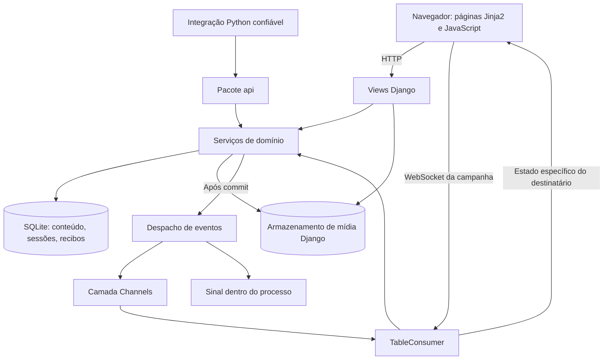

# Arquitetura

[Documentação](../README.pt-BR.md) · [English](../en/architecture.md) · [Mapa do código](code-map.md)

Gravewright é uma mesa virtual de RPG construída com Django. O servidor controla os
dados das campanhas, permissões, validação de comandos e resultados persistidos.
Jinja2 renderiza a estrutura da aplicação e fragmentos HTML; JavaScript no navegador
implementa a mesa interativa. Django Channels vincula cada conexão da mesa a uma
campanha.

Este documento descreve a implementação deste repositório. Para executá-la, consulte
[Primeiros passos](getting-started.md); para localizar arquivos, use o
[mapa do código](code-map.md). Autores de extensões também devem consultar a
[referência da API](api.md) e o [guia de módulos](modules.md).

## Divisões da aplicação em execução

- `config/asgi.py` inicializa Django e encaminha HTTP e WebSocket.
  `config/proxy.py` restaura esquemas encaminhados por pares confiáveis antes do
  roteamento. A pilha do socket verifica a origem antes de resolver a sessão Django.
- `config/urls.py` reúne as rotas dos apps. Caminhos HTTP iniciados por `/api/` são
  rotas de views; o diretório `api/` da raiz é uma **interface de importação Python**.
- `gravewright/<domínio>/services.py` contém a maior parte das regras de negócio.
  Alguns fluxos de upload, mídia e administração ficam nas próprias views ou em
  auxiliares; uma alteração deve ser acompanhada desde sua rota ou mensagem real.
- `gravewright/realtime/consumers.py` cuida do transporte, inscrições e estado
  temporário da conexão. Chama serviços síncronos com `database_sync_to_async`; a
  avaliação de dados usa `asyncio.to_thread` para o trabalho mais custoso.
  Cada socket executa comandos, inscrições e entregas em ordem na sua própria
  thread: os comandos de uma conexão continuam ordenados e uma consulta lenta não
  trava os demais jogadores. Amostras em que só o valor mais novo importa (cursor,
  viewport e arrasto de token, enviadas pelo próprio socket ou repassadas de
  outro) rodam numa segunda faixa com thread própria: uma amostra mais nova
  substitui outra ainda não processada, e cada stream de arrasto mantém o seu fim
  ou cancelamento. Pongs renovam o lease de presença numa thread do pool. Um leitor
  admite os frames pela hora de chegada (tamanho, limite do cursor e taxa de
  comandos), então frames que esperaram atrás de um comando lento não são tomados
  por rajada; mais de 256 frames esperando fecham o socket com o código 4429. Os
  manipuladores registram um aviso sem payload ao atingir
  `GRAVEWRIGHT_REALTIME_SLOW_MS` (veja [Configuração](configuration.md)). Pings e
  sinais de vida não esperam o banco, e uma desconexão abandona manipuladores
  pendentes para que a limpeza de presença termine dentro do limite de
  encerramento do Daphne.
- `gravewright/realtime/dispatch.py` agenda invalidações de recursos, entrega de
  chat e sinais para extensões Python após o commit. Cada commit vira um único
  evento `room.changes` com a lista de projeções a atualizar (`dispatch.refreshes`):
  o socket autoriza uma vez, entrega cada projeção uma vez (tabuleiro primeiro,
  recursos dependentes por último) e envia `api.changed` uma vez por domínio.
  Reprodução de áudio, itens e compêndios atualizam só o próprio recurso; combate,
  cartas e as demais mudanças de áudio também atualizam as camadas do mapa, que os
  exibem; importações de compêndio atualizam tudo o que um arquivo pode alterar. A
  suíte `gravewright.realtime.tests.test_dispatch_dependencies` compara projeções
  reais antes e depois dos comandos para manter essa tabela completa. Assim, os
  módulos só recebem avisos `api.changed` dos domínios que um commit pode alterar.

Este guia descreve o transporte atual. A
[direção do tempo real](realtime-direction.md) aprovada registra as mudanças
planejadas e a situação de cada etapa.

O banco padrão é SQLite com `transaction_mode='IMMEDIATE'`. Os serviços expressam a
serialização com transações atômicas e bloqueios de campanha ou vínculo. SQLite não
implementa `SELECT FOR UPDATE` por linha; a transação de escrita controla a
concorrência. Alterar os limites dessas transações muda o comportamento.

A configuração padrão de produção exige uma camada Channels com Redis. A camada em memória
serve para um único processo de desenvolvimento e para o [executor local](windows-runner.md);
não entrega eventos entre processos. Redis transporta eventos; conteúdo, sessões e registros de presença ficam
no banco. Consulte [Configuração](configuration.md). Cada socket mantém um lease de
presença (`PresenceConnection`, válido por `GRAVEWRIGHT_PRESENCE_TTL`). Um pong só o
renova na segunda metade da validade, então a maioria dos pongs não grava nada; a
renovação recria o lease se a limpeza de outro socket o removeu enquanto a renovação
atrasava. A manutenção do heartbeat remove leases vencidos (deixados por workers que
caíram) no máximo uma vez a cada meio TTL em cada processo, lendo antes de apagar.

A verificação de origem WebSocket usa `GRAVEWRIGHT_PUBLIC_ORIGIN` quando configurada
e exige que Host da requisição e Origin do navegador correspondam ao esquema,
domínio e porta efetiva. Sem ela, usa o esquema ASGI `ws`/`wss`, assumindo HTTP quando
ausente. Fixar a origem pública permite TLS direto no Daphne mesmo quando seu
adaptador WebSocket omite `scheme`. O [adaptador de proxy](../../config/proxy.py)
aceita um único valor válido de `X-Forwarded-Proto` apenas de um par conectado em
`TRUSTED_PROXIES`, restaurando o esquema para HTTP e WebSockets. Veja
[Implantação](deployment.md) para TLS, confiança em proxies e arquivos estáticos.

## Identidade e autorização

Existem dois sistemas de papéis independentes:

| Escopo | Papéis | Significado |
| --- | --- | --- |
| Conta do servidor (`accounts.User`) | `owner`, `participant` | Administração do servidor e configuração inicial. Uma restrição do banco permite um proprietário. |
| Campanha (`campaigns.Membership`) | `gm`, `player`, `streamer` | Acesso a uma mesa específica e aos seus recursos. |

O proprietário do servidor cria campanhas e recebe um vínculo de mestre (`gm`) ao
criar uma. Os recursos verificam o vínculo na campanha, sem pressupor que um papel
do servidor concede acesso a todas as mesas. Atores e itens também usam mapas de
permissões por usuário; diários usam registros `Access` e regras de visibilidade.

`journals.services.member()` é compartilhado por vários domínios. Recarrega o vínculo
de um usuário ativo e verifica a validade de acesso de streamers. `api.Context`
contém somente UUIDs normalizados de campanha e usuário: construí-lo não concede
permissões nem armazena papéis em cache. Os serviços públicos recebem identificadores
e resolvem novamente o vínculo.

O registro de domínios do navegador é gerado de `modules/contracts/frontend.json`.
O despacho autenticado delega transações aos serviços, mantendo a renderização de
mapas fora de uma transação global do transporte. Chamadas binárias usam rota
separada de multipart/bytes com as mesmas verificações de campanha e montagem.
`maps/library_services.py` e `table/permission_services.py` compartilham as regras
nativas da biblioteca e de permissões com as fachadas Python e o navegador.

`campaigns/system_api.py` fornece registro explícito de callbacks do sistema ativo
na campanha. Pacotes confiáveis registram descrições e handlers de leitura/escrita
na inicialização; participação, limites JSON e bloqueio de escritas de streamers
continuam no host. Recursos, revisões e recibos continuam sob responsabilidade
do provedor. O pacote PDF registra suas próprias operações de mapeamento,
modelos e ações salvas; o despacho do host não contém condições do PDF System.

A autorização WebSocket também relê a sessão no banco, o backend de autenticação
configurado e o hash de autenticação de sessão do usuário. Verifica vínculos ao
receber comandos, nos manipuladores de entrega e durante heartbeats. Remover um
participante, expirar um link de streamer ou invalidar uma sessão afeta conexões
existentes conforme essas verificações voltam a ocorrer. Um socket pode reutilizar a
última verificação bem-sucedida por até dois segundos (`AUTHORIZATION_TTL` em
`consumers.py`), nunca além da expiração da sessão ou do link de streamer. Logout,
exclusão da sessão, troca de senha, remoção ou mudança de papel do participante,
desativação do usuário, mudanças no link de streamer e exclusão da campanha invalidam
esse cache antes do próximo frame: após o commit, avançam uma época do processo e
enviam `room.access` aos grupos da campanha e do usuário afetados, para que sockets em
outros processos revalidem na hora (`gravewright/realtime/access.py` e `signals.py`).
Código que altere essas linhas sem sinais de modelo, como `QuerySet.update`, precisa
chamar `access.revoke`; edições feitas direto no banco são percebidas quando o
resultado em cache expira. Os comandos de escrita continuam autorizados pelos seus
serviços. Veja a [etapa 6 da direção do tempo real](realtime-direction.md#etapa-6-autorização-do-transporte-em-cache).

Streamers têm acesso somente de leitura. O consumidor permite um conjunto limitado
de mensagens de sincronização, busca, viewport e heartbeat; os pontos de escrita
também os rejeitam. Controles no navegador são conveniências, não a autorização.

**A visibilidade de cenas exige duas condições para quem não é mestre:** a cena deve
ter `visibility='players'` e ser o destino atual do destinatário. Um
`SceneAssignment` do jogador substitui o `Broadcast` da campanha; os demais
jogadores e streamers continuam seguindo a transmissão. Marcar uma cena
inativa como visível não a torna acessível. A mesma resolução protege manifestos,
blocos de imagem, tokens e chat associado à cena.

O comando explícito `maps.activate` do mestre define a visibilidade para jogadores
e a transmissão na mesma transação. Com `playerIds`, define o destino somente
dos jogadores selecionados da campanha, preservando os demais destinos e a
navegação do mestre. Ativar para todos remove os destinos individuais e reúne
a mesa. As atribuições persistem ao reconectar e são removidas com a cena ou a
participação; são separadas da `SceneNavigation` privada do mestre.
A mudança de visibilidade avança a revisão
da cena; ativar uma cena já visível mantém sua revisão. Gerar no Map Builder
e navegar em particular não publicam a cena.

## Comandos, tentativas repetidas e revisões

A atividade de ponteiros é transitória. `maps.cursor` aceita posições limitadas
à cena de jogadores e mestres; o servidor fornece a identidade e a cor de
identificação salva. A entrega verifica novamente o acesso do destinatário à cena
e sua assinatura atual. O tráfego de ponteiros possui limite próprio e não consome
o orçamento de comandos. Sair ou desconectar envia um evento de remoção; posições
de cursores não entram no banco da campanha, em recibos ou em arquivos exportados.

A maioria dos comandos persistentes de recursos da mesa segue esta sequência:

1. Interpretar a operação solicitada e o UUID da requisição.
2. Iniciar uma transação atômica, bloquear a campanha e recarregar o vínculo.
3. Verificar permissão de escrita e procurar um recibo já confirmado.
4. Validar o conteúdo, o escopo do recurso e a revisão aplicável.
5. Alterar os modelos e registrar o resultado com o UUID da requisição.
6. Agendar notificações após o commit e retornar a confirmação.

A ordem exata e a repetição variam por domínio; siga o serviço responsável. Uploads
e operações administrativas nem sempre utilizam esse protocolo de recibos.

O trabalho que não precisa da reserva de escrita fica fora dela. Leituras de
compêndio verificam vínculo e permissões atuais sem abrir `BEGIN IMMEDIATE`, e não
criam recibo nem notificação. Importações de compêndio leem e validam primeiro os
arquivos e as artes, depois conferem de novo a revisão da entrada dentro da
transação e falham com `conflict` se ela mudou. Comandos de token procuram o recibo
antes de pegar o lock (e de novo dentro dele), gravam na transação só os IDs criados
e os marcadores de teleporte, e montam os tokens visíveis da confirmação depois do
commit; as automações de região continuam sendo confirmadas junto com o movimento.
As operações originais do SDK 1.0 continuam dentro de uma transação porque toda
chamada renova o lease de montagem.

| Registro de identidade | Usado por | Comportamento da repetição |
| --- | --- | --- |
| `maps.Receipt` | Mapas, atores, tokens, itens, combate, cartas, áudio e compêndios | Compartilham `(campaign, user, request_id)`. A maioria retorna o resultado salvo; tokens recompõem o estado visível e filtram os IDs criados anteriormente. |
| `journals.Receipt` | Comandos de diários | Recibos próprios de diários; alguns resultados exigem verificações adicionais de acesso. |
| `chat.Message` e `dice.Submission` | Chat e dados | A identidade da mensagem evita registros duplicados; a reserva de dados impede rolar novamente. |

Gere um **UUID novo para cada comando lógico novo** e reutilize-o somente para
repetir o mesmo comando. Não reutilize, por exemplo, o UUID de um comando de ator em
um comando de áudio: ambos compartilham a tabela de recibos. Em geral, os recibos não
comparam a ação ou o conteúdo repetido com o original.

Quando o SQLite informa um lock (`database is locked`) enquanto o socket trata um
comando, o consumidor responde no canal de erro desse comando com o código `busy` e o
mesmo ID de requisição, e o socket continua aberto. O navegador mantém o comando
pendente e reenvia em silêncio o mesmo payload após 1, 2, 4 e depois a cada 8
segundos; o recibo torna a retentativa segura. Uma rolagem cuja conclusão encontra um
lock libera a reserva, e a retentativa rola de novo; o resultado revertido nunca saiu
do servidor. Inscrições, buscas e atualizações do lobby que encontram lock são
repetidas na próxima manutenção do heartbeat, entregas voltam para a fila do mesmo
jeito, e amostras substituídas por uma mais nova são descartadas. Os demais erros de
banco continuam fechando o socket. Cada comando também tem prazo de 45 segundos,
acima do timeout de 30 segundos do SQLite: ao expirar, o navegador fecha o socket e
reconecta, reenviando os comandos pendentes com os IDs originais. Pings nunca
reenviam mensagens de chat ou rolagens pendentes; só a reconexão faz isso.

Identidade da requisição e revisão do recurso resolvem problemas distintos. O UUID
evita duplicação; campos como `version`, `sheetVersion` e `expectedVersion` detectam
edições com estado desatualizado. Um conflito exige atualizar os dados e escolher
explicitamente uma nova edição, não apenas trocar o número da versão.

`transaction.on_commit()` evita notificações sobre alterações revertidas. O despacho
usa callbacks robustos, mas não oferece uma fila durável: uma alteração confirmada
pode permanecer mesmo se sua notificação falhar. Clientes devem sincronizar novamente
pelos endpoints ou inscrições de estado. Cada envelope de atualização leva uma
revisão por campanha, incrementada na transação que faz o commit
(`realtime.CampaignRevision`). Um socket que percebe uma lacuna, por exemplo porque
uma fila cheia do channel layer descartou um envelope, atualiza todas as projeções
em que está inscrito; um envelope atrasado ou repetido é ignorado. Cada socket também
guarda as projeções que enviou por último: uma projeção sem mudança não envia nada,
e tokens e camadas do mapa enviam frames `delta` (`upserts`, `removes`, `order`,
`unset`) calculados a partir da projeção completa do próprio destinatário, então
nunca levam dados que essa projeção não levaria. A primeira projeção após uma
inscrição, troca de cena ou reconexão é enviada inteira. Um `resources.sync` de um
módulo da mesa reinicia só as projeções desse módulo, então a rajada que inscreve
todos os módulos não faz os envelopes seguintes reenviarem os outros.
Manipuladores Python de `resource_changed`
são callbacks confiáveis dentro do processo; não são tarefas duráveis entre processos
nem uma sandbox para código não confiável.

## Comportamento dos domínios

### Campanhas e contas

Os serviços de contas renovam a identidade da sessão no login, limitam o trabalho de
hash de senha em paralelo e armazenam janelas de tentativas sob hashes autenticados
dos endereços IP. Os serviços de campanhas controlam capas, códigos de convite e
remoção armazenados como hash, limites de resgate e remoção de participantes. Links
de streamer criam uma identidade visitante específica com validade e revogação.
A interface Inside reúne esses fluxos em `web/inside.py`.

O gerenciamento abre por `campaigns/management_views.py` sem socket da mesa,
renderizador Pixi ou registro de presença. `management.py` autoriza os mestres
atuais; `preparation.py` valida planos de sessão, eventos, painel de cada mestre
e recibos das operações. Conexões e prévias de jogadores leem documentos nativos
sem copiar seu estado. Datas do calendário são datas ISO opcionais; datas do
mundo permanecem texto autoral. Veja [Gerenciar uma campanha](campaign-management.md).

### Atores, fichas PDF e tokens

Um `Actor` é a fonte reutilizável do personagem. `pdf_system/schema.py` normaliza a
ficha, incluindo referências a PDFs, campos, barras, configurações de token e efeitos
ativos. Metadados do ator e dados da ficha têm contadores de revisão distintos.
O PDF System também controla `pdf.manualFields` opcional: definições de áreas
editáveis criadas pelo mestre e vinculadas ao PDF de origem. Retângulos normalizados
por página preservam posições no zoom e na navegação; os valores usam chaves
estáveis em `fields`. Somente o mestre altera o mapeamento, enquanto jogadores
autorizados preenchem seus controles. Fichas de atores e tokens independentes usam
o mesmo esquema e as mesmas verificações de revisão.
O campo opcional `pdf.fieldActions` vincula fórmulas de rolagem criadas pelo mestre
a campos nativos ou manuais por origem do PDF. O parser de dados valida a
configuração sem rolar; a execução resolve `@value` e usa o fluxo normal de
rolagem e chat. A modal salva um candidato isolado pela revisão existente da
ficha, incluindo transferências dos valores das barras do token.
`pdf.fieldBindings` registra endereços validados para referências `@{field-key}`;
`pdf.calculatedFields` usa fórmulas determinísticas que o servidor recalcula
após validar dependências e rejeitar ciclos. O histórico restaura definições
preservando os valores atuais do personagem. Registros de
`pdf_system.MappingTemplate` por campanha guardam mapeamentos portáteis sem PDFs
ou valores dos personagens, com operações revisionadas exclusivas do mestre e
aplicação em lote atômica. Arquivos de campanha incluem esses modelos. O
diagnóstico no navegador compara o mapeamento com o documento atual, e a
exportação preenchida cria uma cópia achatada separada.

Um `Token` posiciona o ator em uma cena. Tokens vinculados usam `Actor.data`; tokens
desvinculados usam `snapshot` e `sheet_version` próprios. A primeira colocação é
vinculada. Colocar o mesmo ator novamente converte as colocações vinculadas em
snapshots e cria outro snapshot; duplicar também gera um snapshot independente. O
salvamento da ficha precisa atingir a fonte correta e invalidar os tokens vinculados
afetados.

Movimentar um token verifica controle, bloqueio, revisão, limites do mapa e, para
quem não é mestre, interseções com paredes. Pré-visualizações de arraste são
coordenadas temporárias validadas pelas mesmas regras. Elas não salvam a posição
final; o comando persistente `move` faz isso. Cada destinatário recebe novamente uma
versão filtrada dessas prévias, que são descartadas se a versão do token mudou.

### Mapas e camadas das cenas

Uploads de cenas validam a imagem e os limites configurados de bytes, dimensões,
pixels e quantidade de blocos; depois geram uma pirâmide de blocos WebP sem perdas.
`Scene` armazena metadados da imagem, `SceneState` guarda documentos do ambiente da
cena e `SceneObject` registra objetos tipados, como paredes, luzes, imagens,
marcadores e zonas.

`maps/objects.py` coordena comandos de objetos e projeções de camadas. Auxiliares
especializados tratam desenhos, efeitos, imagens, propriedade de marcadores e
geometria de zonas. O estado é preparado para cada destinatário: imagens na camada
do mestre e desenhos privados são filtrados; barreiras secretas ou invisíveis ainda
não descobertas perdem a apresentação de porta interativa. A geometria das paredes
ainda é transmitida quando necessária ao recorte de visibilidade; portanto, o
renderizador não esconde toda a geometria do mestre do cliente.

`realtime/scene_stream.py` valida dimensões e gerações do viewport, agenda sugestões
de blocos com orçamentos limitados e rejeita versões de cena antigas. Amostras do
viewport do mestre passam por Channels para preditores de pré-carregamento por
jogador. WebSocket agenda o carregamento; os bytes das imagens continuam em recursos
HTTP autenticados.

### Diários e materiais apresentados

Diários combinam JSON específico do tipo com concessões explícitas de acesso.
`documents.py` valida conteúdo estruturado e filtra blocos do mestre; `data.py`
normaliza os formatos; `types.py` trata comportamentos como quadros e missões.
Edições de jogadores preservam conteúdo oculto do mestre e não podem associar
arquivos arbitrários. `presentations.py` emite e resolve tickets vinculados ao
destinatário, sem tornar públicos os arquivos originais.

`journals/history.py` armazena snapshots `Revision` limitados por documento e
documentos excluídos. Restaurar revalida visibilidade/acesso padrão, dependências
de missões e disponibilidade física dos anexos na transação do diário. A versão
substituída fica registrada para permitir desfazer a restauração. A limpeza de
arquivos confere tanto assets ativos quanto versões retidas após o commit.
Histórico e lixeira são exclusivos dos mestres e não integram as projeções comuns.

### Relógios de progresso e descobertas de pistas

`table/clocks.py` e `table/clues.py` controlam registros persistentes e versionados
de campanha/cena e seus recibos. São marcadores genéricos de progresso, separados
dos relógios de efeitos de combate pertencentes ao sistema. Clientes da mesa usam
estados projetados em tempo real; o gestor lê os mesmos registros por HTTP.

Visibilidade e avanço opcional por jogadores são regras do servidor. Projeções de
pistas omitem registros não descobertos e notas privadas; somente descobertas
concluídas e visíveis a jogadores chegam a jogadores e streamers. Os auxiliares
`blueprint_clocks.py` e `blueprint_clues.py` do MapBuilder executam vínculos
específicos criados pelo mestre, validando campanha e cena. Eles não concedem
edição geral ao participante nem revelam dados privados. Simulação não escreve;
o ensaio no servidor executa dentro de uma transação revertida. Veja
[Relógios](clocks.md) e [Pistas](clues.md).

### Mapas mentais colaborativos e identidades de recursos

`table/mindmaps.py` controla grafos de campanha/cena, jogadores editores,
visibilidade privada, validação estrutural e revisões. Mesa e gestor editam os
mesmos registros `MindMap`. `table/domain.py` serializa escritas com recibos
`MindMapReceipt` separados; novas tentativas revalidam a autorização e retornam
projeções atuais. `api/mindmaps.py` e o domínio `mindmaps` do navegador expõem
essas operações nativas sem contornar suas verificações.

`table/resource_links.py` registra 37 identidades nativas tipadas e metadados de
arquivos. Um `Resolver` por requisição reaproveita projeções autorizadas dos
domínios, sem buscar nomes irrestritos. Vínculos armazenam identidades; leituras
atuais acrescentam rótulos permitidos. Recursos ausentes e negados usam o mesmo
marcador opaco para permitir outras edições sem revelar os destinos. Revogar
acesso ao recurso continua valendo mesmo com um rascunho não salvo. O texto dos
tópicos pertence ao público do mapa inteiro. Veja [Mapas mentais](mindmaps.md)
e o [contrato da API](api.md#mapas-mentais-colaborativos-e-vínculos-tipados).

O auxiliar `maps/blueprint_mindmaps.py` valida destinos de cena e delega somente
o efeito de conclusão criado pelo mestre. Abrir verifica a leitura de cada
destinatário; o ensaio no servidor reverte escritas e notificações.
`administration/mindmap_archives.py` usa o registro tipado para remapear recursos
copiados sem reescrever notas autorais ou identidades locais dos tópicos.
Cópias portáteis limpam editores selecionados; snapshots mantêm o acesso na
mesma campanha.

### Chat e dados

O histórico combina mensagens da mesa e da cena selecionada ou transmitida,
filtrando visibilidade e destinatários. Há comandos para sussurros, mensagens ao
mestre e ações narrativas. A moderação remove o conteúdo e mantém a identidade da
mensagem, evitando que uma repetição a recrie. Anexos de cartas no chat capturam
faces públicas imutáveis, em vez de apontar para um baralho que pode mudar depois.

Os dados usam `dice/engine.py` e a gramática Python nativa: análise, compilação e
validação, seguidas da execução de um plano limitado. A compilação não consome
aleatoriedade. O fluxo persistente reserva um `Submission`, avalia fora da transação
do banco, verifica novamente a autorização e confirma um `Message` com o resultado
e destinatários definidos. Uma repetição bem-sucedida recupera o resultado salvo;
uma reserva expirada ou interrompida exige outra requisição, sem rolar novamente de
forma silenciosa. A função pura `api.dice.evaluate` não persiste nem publica dados.
Consulte a [arquitetura da gramática](../../gravewright/dice/grammar/ARCHITECTURE.pt-BR.md)
e a [especificação da notação](../../gravewright/dice/grammar/notation/GRAMMAR.pt-BR.md)
disponíveis em português.

### Itens, combate, cartas, áudio e compêndios

Esses cinco domínios usam `table/domain.py` para vínculos, transações e recibos. Seus
auxiliares internos `state(who, ...)` e `command(who, ...)` pressupõem esse ponto de
entrada; integrações usam os wrappers públicos ou `api.resources`.

| Domínio | Responsabilidade e restrição relevante |
| --- | --- |
| Itens | Documentos versionados com permissões por usuário. Jogadores podem criar itens e se tornam donos deles; pastas, duplicação, compartilhamento e exclusão continuam exclusivos do mestre. A implementação PDF nativa atualmente não retorna tipos de item; a criação comum fica indisponível até que essa capacidade seja implementada. |
| Combate | Encontro da cena, iniciativa, turno atual e histórico limitado. Mudanças de ordem preservam a identidade do combatente; a progressão pode avançar efeitos nos documentos dos atores. |
| Cartas | Definições reutilizáveis e instâncias mutáveis; zonas de compra, mão, cena e descarte, propriedade e visibilidade. O controle do mestre não revela automaticamente a face oculta de outro jogador. |
| Áudio | Uploads, playlists, reprodução e trilhas sonoras. O estado calcula posições pelo horário do servidor e ganho espacial pelos tokens controlados e paredes acústicas. A entrega HTTP do arquivo tem autorização própria. |
| Compêndios | Pacotes da campanha e acesso ao catálogo nativo. Arquivos portáteis capturam um grafo permitido de dependências e importam documentos e arquivos para uma campanha de sistema compatível. Pacotes nativos de itens e magias ficam legíveis para jogadores até o mestre ocultá-los; pacotes de atores, diários, cenas e cartas e pacotes da campanha ficam ocultos até serem compartilhados. Só o mestre importa. |

O auxiliar declarativo de fórmulas em `combat/formula_engine.py` é distinto da
gramática de dados do chat. A iniciativa atual chama `dice.engine.evaluate`; alterar
um interpretador não altera automaticamente o outro.

O PDF System fornece seus próprios padrões de combate e cálculo de iniciativa
pelo registro de sistemas. A fórmula padrão é `1d20 + @initiative`; a variável
`@initiative` lê o valor canônico `init` alimentado pelo mapeamento do PDF.
Tokens vinculados usam a ficha do personagem; tokens independentes usam sua
cópia. A API de combate permite fórmulas por cena e rolagens antes do início.
O gerenciador do PDF System oferece iniciativa numérica manual, sem controles
de rolagem ou fórmula. Tokens são adicionados pelo menu de contexto. Alterações
na ordem preservam o combatente do turno atual. Outros sistemas não herdam
essas regras do PDF System. Os tokens atual e próximo recebem indicadores
expansivos verde e amarelo, também usados na lateral do gerenciador.

Condições de tokens aceitam `duration: {type: "turns" | "rounds",
value: 1..10000, expires: "start" | "end"}` opcional. O servidor inicializa
`remaining`; turnos seguem o token afetado e rodadas seguem as mudanças de rodada
do combate. Apenas tokens participantes daquela cena avançam. Condições expiradas
são removidas; permanentes continuam. Voltar turnos e encerrar o combate não
alteram os contadores. Recibos evitam contagem duplicada em reenvios. Os dois modos
de condições exibem o tempo restante e o momento de expiração nos tooltips.

O diretório nativo de compêndios filtra os metadados localmente por nome, tipo de
documento e coleção. A prévia busca somente a entrada autorizada selecionada e
exibe texto na modal compartilhada. O mestre pode importar pela entrada, pela
prévia ou arrastando ao diretório correspondente. O arrasto informa campanha,
compêndio, entrada e tipo; o destino confere esses dados no catálogo visível antes
de usar o comando de importação autorizado existente. Jogadores podem visualizar
compêndios acessíveis, mas não importar. Arquivos e dependências continuam usando
o mecanismo de importação existente.

## Arquivos portáteis e administração

`administration/archives.py` define explicitamente os modelos de conteúdo permitidos.
Exportações incluem documento de conteúdo, manifesto com hashes e arquivos opcionais.
Exportações portáteis removem permissões específicas de usuários e omitem chat;
snapshots também incluem registros de acesso e chat para restauração. Importações
em campanha nova e mesclagens remapeiam identificadores e caminhos de arquivos.
Restaurações na mesma campanha preservam identificadores e substituem o conteúdo
nativo, mantendo participantes, códigos e histórico de snapshots. Esses arquivos
não são backups completos do servidor: contas, sessões, configurações e pacotes
instalados são dados operacionais separados.

`administration/preparation_archives.py` valida e remapeia preparação, painéis,
versões dos diários e arquivos de anexos retidos. Importações portáteis atribuem
um painel da origem ao mestre importador sem criar participantes; snapshots
restauram o painel de cada mestre atual. Arquivos antigos sem metadados de
preparação preservam preparação/histórico existentes ao restaurar. Exportações
de recursos para compêndios omitem esses dados privados. Relógios e pistas mantêm
escopo de campanha/cena, e referências Blueprint apontam aos destinos copiados,
sem controlar a campanha de origem.

A importação valida caminhos, tamanho do ZIP, tamanho descompactado, modelos, campos
e hashes antes de criar conteúdo. Adicionar um modelo ou relacionamento de arquivo
exige revisar a seleção, o grafo de dependências e as regras de importação, além da
definição do modelo.

`administration/updates.py` consulta metadados de versões de código-fonte do
repositório configurado e armazena o estado em cache. `administration/automatic_updates.py`
encaminha atualizações solicitadas pelo proprietário ao supervisor, que substitui
arquivos e gerencia backup, migrações, reinício e recuperação. O mesmo supervisor
ativa apps Django do marketplace em ambientes Python isolados.
Preferências do servidor e auditoria usam modelos separados; recursos
habilitados dependem da configuração. Leia [Implantação](deployment.md) e
[Desenvolvimento](development.md) antes de ampliar esses fluxos.
