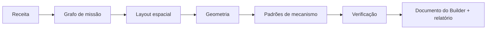
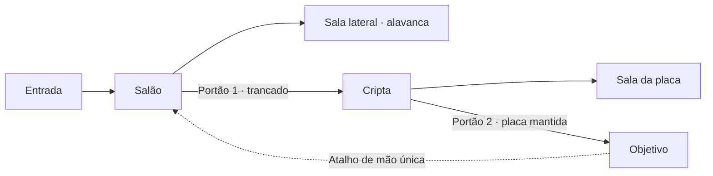

# Masmorras procedurais: direção de design

[Documentação](../README.pt-BR.md) · [English](../en/procedural-dungeons-direction.md) · [Map Builder](map-builder.md) · [Direção dos Objetos Inteligentes](smart-objects-direction.md)

## Situação e objetivo

Este documento propõe como o Map Builder gera masmorras cujo layout, portas e
mecanismos são conteúdo comum e editável do projeto, e cujos enigmas, portões e
perigos são Objetos Inteligentes comuns. Ele foi redigido em 2026-11-09 a partir de
uma análise deste checkout. **Nada descrito aqui está implementado.** O responsável
pelo projeto ainda não o aprovou; as decisões listadas em
[Decisões pendentes](#decisões-pendentes) condicionam a etapa 1.

## Invariantes

Toda etapa preserva estas regras:

- **O gerador é um assistente de autoria, não um sistema de execução.** Sua saída
  é um documento comum do Map Builder no esquema 3, com blueprints versão 2. Ele não
  acrescenta tipo de nó, evento, regra de execução nem armazenamento de estado ao
  vivo. O jogo usa o motor, as permissões, os recibos, o registro de automação e a
  política de atualização de cena existentes.
- **O documento é a fonte da verdade.** O conteúdo gerado é salvo por
  `builder_services.save` e validado por `builder_services.clean_document`, como
  qualquer edição feita à mão. A receita armazenada é proveniência; nada exige
  executar o gerador de novo para ler, renderizar, atualizar ou arquivar um projeto.
- **Determinístico.** A mesma receita, versão do gerador, ID do projeto e
  classificações de assets produzem o mesmo documento. Uma nova tentativa nunca
  resulta em outra masmorra.
- **Solucionável por construção e verificado.** Toda fechadura gerada tem uma chave
  alcançável; uma geração que não consegue provar isso falha com um diagnóstico em
  vez de devolver um mapa parcial ou insolúvel.
- **Independente de sistemas de RPG.** Os padrões do núcleo usam nós genéricos:
  portas, regiões, mensagens, pedidos de rolagem, teletransporte. Dano, testes,
  monstros e tesouro pertencem aos pacotes de sistema, por meio de um futuro
  contrato autorizado.
- **Nenhum conteúdo embutido.** O núcleo não distribui arte de masmorra, listas de
  monstros, tabelas de tesouro nem texto de livros de regras. Padrões que dependem
  de arte usam as imagens da própria campanha.
- **Somente para o mestre e limitado.** Geração, receitas e proveniência ficam
  visíveis apenas para os mestres da campanha. Tamanho da entrada, trabalho,
  contagem de objetos e tentativas são limitados antes de qualquer operação cara.

## O que já existe

O gerador compõe capacidades existentes em vez de criar equivalentes paralelos.

| Necessidade | Capacidade existente |
| --- | --- |
| Saída editável, validação e limites | Esquema 3 da fonte de `MapBuilderProject`, `builder_services.clean_document`, `LIMITS` |
| Salvamento, conflitos, novas tentativas e desfazer | `save` do projeto com `request_id`/`expected_version`, salvamento automático e histórico de desfazer no cliente |
| Criação de cena e edições posteriores | **Gerar cena** / **Atualizar cena**, manifesto de propriedade, preservação do estado ao vivo |
| Salas e corredores | Pisos (retângulos, contornos em `shape`), paredes, segmentos de porta independentes, junções de parede |
| Portas secretas | `presentation: "secret"` com `discovered: false` em paredes/portas, filtradas dos jogadores; nó **Revelar** |
| Portões | Estado `locked` da porta; **Mudar estado** com `players: true`; `interactionEnabled: false` |
| Chaves e gatilhos | Alavancas, tochas compostas (imagem + luz obrigatória), Objetos Vazios, regiões de presença |
| Lógica | Condição, Switch, Aleatório, All/Any, Obter propriedade, variáveis, sinais nomeados |
| Persistência e tempo | Counter, Once, Cooldown, Delay, Timer |
| Apresentação | Mostrar mensagem, Mostrar handout, Pedir rolagem, Foco da câmera |
| Atalhos | **Teletransporte** na mesma cena, com bloqueio de retorno |
| Comportamento reutilizável com bindings | Definições de `BlueprintTemplate`: `blueprint_templates.clean_definition` e `resolve_definition` |
| Prova pelo motor real | `blueprint_testing.run_draft`: ensaia um documento não salvo e depois desfaz |
| Grafos de presets existentes | `builder/interactive-presets.js` (placa de pressão, interruptor, armadilha, baú e outros) |

Duas restrições moldam o design. Alavancas e tochas exigem uma imagem
(`clean_document` as rejeita sem `assetId`), e uma tocha também exige uma luz.
Objetos Vazios não precisam de imagem, mas são controladores na camada do mestre
que os jogadores não conseguem clicar; seus eventos de área continuam funcionando.
Portas e regiões não precisam de arte. O builder também limita a saída a 16.777.216
pixels (ou ao `GRAVEWRIGHT_MAP_MAX_PIXELS`, se menor), então uma célula de 64 px
permite cerca de 64 × 64 células.

## Pipeline

A geração é uma cadeia de etapas puras, testáveis separadamente. Cada etapa lê
apenas suas entradas e seu próprio fluxo aleatório.



| Etapa | Entrada | Saída |
| --- | --- | --- |
| Receita | Configurações do mestre | Receita normalizada e limitada |
| Grafo de missão | Receita | Salas com papéis; conexões abertas, com portão, secretas, de mão única e de teletransporte |
| Layout espacial | Grafo de missão, tamanho | Retângulos de sala, corredores e encaixes de porta na grade de células |
| Geometria | Layout, tema | Camadas, pisos, paredes, portas, luzes |
| Padrões de mecanismo | Portões da missão, encaixes, tema | Alavancas, tochas, regiões, Objetos Vazios e seus blueprints |
| Verificação | Tudo acima | Prova de solucionabilidade e de limites, ou um diagnóstico |
| Emissão | Resultado verificado | Documento no esquema 3, proveniência `procedural` e um relatório para o mestre |

### Receita

| Campo | Significado |
| --- | --- |
| `seed` | Texto de até 64 caracteres; o editor oferece um aleatório |
| `size` | `columns`, `rows`, `cellSize`, conferidos contra os limites do builder e de pixels |
| `rooms` | Quantidade mínima e máxima de salas |
| `loops` | Número de ciclos acrescentados ao grafo de missão |
| `secrets` | Número de conexões secretas |
| `patterns` | IDs de padrões permitidos e suas quantidades máximas |
| `theme` | Nomes de famílias de assets locais ao projeto por slot (`floor`, `corridor`, `wall`, `door`, `lever`, `torch`, `chest`), ou `null` para o padrão do builder |
| `lighting` | `dark`, `sparse` ou `lit` |

O tema se refere às famílias pelos nomes locais ao projeto, nunca por IDs brutos de
assets. Os nomes de família ficam nas próprias classificações `assets` do projeto,
então cópias e arquivos da campanha não precisam de nova regra de remapeamento. Um
slot sem membros restantes na família desativa os padrões que dependem dele, e isso
aparece no relatório.

**Aleatoriedade.** O gerador usa seu próprio PRNG versionado (por exemplo, PCG32),
e não os auxiliares do módulo `random` do Python, cujas sequências só são garantidas
entre versões do Python para `random()`. Cada etapa sorteia de um fluxo nomeado,
derivado de `seed` e do nome da etapa, para que mudar os padrões permitidos não
mova as salas. Mudar um algoritmo incrementa a versão do gerador.

**Identificadores.** IDs de elementos, camadas e nós são UUIDv5 derivados do ID do
projeto e de um caminho de geração estável, como `room/3/door/north`. A mesma seed
em dois projetos produz o mesmo layout com identidades distintas.

### Grafo de missão

O grafo de missão decide o que a masmorra exige dos jogadores antes que exista
qualquer geometria.

- As salas têm um papel: `entrance`, `goal`, `hub`, `ordinary`, `key`, `secret` ou
  `reward`. As conexões são `open`, `gated` (por uma fechadura), `secret`,
  `one-way` ou `teleport`.
- Um caminho principal liga a entrada ao objetivo. Ramos laterais guardam chaves.
  Ciclos religam salas posteriores a anteriores, normalmente por um atalho de mão
  única, para que os jogadores voltem sem refazer o caminho.
- **Invariante de fechadura e chave:** a chave de cada portão fica em uma sala
  alcançável a partir da entrada usando apenas portões que abrem antes. Uma busca de
  ponto fixo (abrir o que é alcançável, coletar chaves, abrir seus portões, repetir)
  precisa chegar ao objetivo, e sua ordem vira o passo a passo do relatório.



### Layout espacial e geometria

O primeiro layout é de salas e corredores na grade de células. As salas são
posicionadas a partir do grafo de missão para fora; corredores as ligam; conexões de
ciclo contornam as salas existentes. As tentativas são limitadas. Quando as salas
não cabem, a geração falha com um diagnóstico que informa o tamanho e a quantidade
de salas, em vez de descartar salas. O algoritmo pode mudar entre versões do
gerador; o contrato é a saída: retângulos de sala, células de corredor e um encaixe
de porta por conexão da missão.

A emissão de geometria grava:

- Camadas nomeadas: **Pisos**, **Paredes e portas**, **Mecanismos**, **Regiões** e
  **Luzes**, para que o mestre possa ocultar, travar ou selecionar cada grupo.
- Um piso por sala ou trecho de corredor, com um membro da família escolhido por
  piso. Um piso por célula ultrapassaria o limite de 2.000 objetos em mapas comuns.
- Segmentos retos de parede mesclados ao longo do contorno, contando com as junções
  de parede existentes.
- Um segmento de porta por encaixe. Os intervalos de parede colineares sob uma
  porta já são omitidos do raster e das paredes nativas.
- Luzes conforme `lighting`. Com arte de tocha, as luzes das salas viram tochas
  compostas.

## Padrões de mecanismo

Um padrão transforma um elemento da missão (portão, atalho, perigo, segredo ou
recompensa) em elementos de cena e comportamentos. Cada padrão declara:

| Parte | Conteúdo |
| --- | --- |
| `id`, `role` | ID estável; um entre `lock`, `loop`, `secret`, `hazard`, `flavor`, `reward` |
| `requires` | Slots do tema de que precisa, como `lever` |
| `sockets` | Posicionamentos: uma porta numa conexão com portão, uma posição de parede na sala da chave, uma área de piso |
| `elements` | Linhas de elementos a criar, com estado autoral e configuração de interação |
| `behaviors` | Definições de `BlueprintTemplate` com bindings tipados resolvidos para os elementos dos encaixes |
| `effect` | O resultado abstrato usado pela verificação, como “interagir com `key` abre `gate`” |

Os comportamentos usam o formato de template existente, então os padrões embutidos
são validados por `clean_definition` e instanciados por `resolve_definition`. Os
dados dos padrões ficam no domínio de mapas como JSON; não são portados dos presets
do navegador. Uma etapa posterior pode permitir que o mestre marque seus próprios
templates da campanha como padrões.

### Catálogo inicial

Todos os grafos usam nós existentes e cabem em 32 nós e 64 arestas por grafo.

| Padrão | Papel | Arte | Elementos | Comportamento |
| --- | --- | --- | --- | --- |
| Atalho de mão única | Ciclo | Nenhuma | Porta trancada; região do lado de lá | Ao entrar na área → Once → Mudar estado: Aberta no Alvo porta, com **Jogadores podem trancar ou destrancar** |
| Placa mantida | Fechadura | Nenhuma | Porta fechada com interação desativada; região | Grafos de placa de pressão: a entrada abre; a saída com contagem do Contexto do evento = 0 fecha |
| Plataformas de teletransporte | Ciclo | Nenhuma | Duas regiões | Ao entrar na área → Teletransporte para a outra região; o bloqueio de chegada existente impede o ricochete |
| Armadilha de aviso | Perigo | Nenhuma | Região | Ao entrar na área → Cooldown → Mostrar mensagem (gatilho) → Pedir rolagem com expressão configurada |
| Porta secreta | Segredo | Nenhuma | Porta secreta (`discovered: false`) | Nenhum; o mestre a revela pelos controles nativos |
| Mensagem de área | Ambientação | Nenhuma | Região na entrada ou no objetivo | Ao entrar na área → Once → Mostrar mensagem |
| Portão de alavanca | Fechadura | Alavanca | Porta trancada; alavanca na sala da chave | Alavanca Ao interagir → Verificar estado: Off → Mudar estado: On → Mudar estado: Aberta no Alvo porta, com **Jogadores podem trancar ou destrancar** |
| Alavanca com contador | Fechadura | Alavanca | Porta trancada; alavanca | Ao interagir → Counter (alvo *n*) → Atingido → Once → abrir a porta como acima |
| Trio de tochas | Fechadura | Tocha | Três tochas compostas; porta trancada | Cada tocha gira e emite um sinal para a porta. O grafo de sinal da porta verifica All sobre três entradas de Obter propriedade e abre |
| Passagem da tocha | Segredo | Tocha | Porta secreta; tocha | Tocha Ao interagir → Mudar estado → Revelar (Alvo porta) → Mudar estado: Aberta |
| Baú | Recompensa | Baú | Objeto do tipo alavanca | Grafo de baú existente: alternar e mensagem com Once; o conteúdo continua sendo do mestre ou do sistema |

O trio de tochas coloca sua verificação no grafo de sinal da porta porque um grafo lê
o snapshot de estado tirado quando seu próprio evento começou. O sinal roda como uma
operação enfileirada depois que a tocha grava seu novo estado, dentro dos limites
de cadeia existentes.

Padrões de fechadura não podem ser contornados pelo jogo direto. Uma porta trancada
já rejeita jogadores; a porta de uma placa mantida usa `interactionEnabled: false`.
O mestre mantém o controle manual nativo, e a automação mantém suas regras de
autoridade.

## Verificação

1. **Solucionabilidade da missão**, sempre: a busca de ponto fixo acima, que produz
   o passo a passo.
2. **Verificações geométricas**, sempre: preenchimento por inundação sobre as
   células com paredes e estados de porta, aplicando o `effect` declarado de cada
   padrão na ordem do passo a passo. Isso prova que toda sala e todo ponto de
   interação de chave são alcançáveis, e que os elementos ficam dentro do mapa sem
   sobrepor encaixes.
3. **Orçamentos**, sempre: totais de objetos, áreas de presença, camadas, nós e
   tamanho do documento, deixando folga para os acréscimos do próprio mestre.
4. **Prova pelo motor**, nos testes e como ação opcional do mestre: `run_draft`
   ensaia o gatilho de cada chave no documento não salvo e confirma que as mudanças
   previstas correspondem ao `effect` declarado. Todo padrão embutido tem um teste
   assim, então divergências no catálogo são detectadas pelo motor real, e não por
   um segundo modelo dele.

Uma verificação que falha devolve um diagnóstico que nomeia a etapa e o elemento.
Ela nunca devolve um documento que pulou a parte que falhou.

## Saída, proveniência e nova rolagem

O resultado substitui o conteúdo do projeto atual como uma única edição desfazível e
é salvo pelo salvamento automático normal. O documento ganha um campo opcional do
esquema 3:

```json
"procedural": {
  "generator": {"id": "gravewright.dungeon", "version": 1},
  "recipe": {},
  "rooms": [{"id": "…", "name": "Hall", "role": "hub", "x": 4, "y": 6, "width": 8, "height": 6}],
  "elements": {"<element id>": {"room": "…", "pattern": "lever-gate", "socket": "key"}},
  "contentDigest": "…"
}
```

- `elements` permite que o editor diga “Portão 2: aberto pela alavanca na Cripta”.
  Linhas cujo elemento o mestre excluiu são ignoradas e removidas no próximo
  salvamento.
- Os IDs dos elementos da fonte sobrevivem a cópias da campanha e as entradas do
  tema são nomes de família, então a proveniência não precisa de remapeamento em
  arquivos.
- `contentDigest` registra o conteúdo gerado. Rolar de novo sobre um projeto cujo
  conteúdo mudou desde a geração pede confirmação no modal da aplicação.
- A nova rolagem é pensada para antes do jogo. **Atualizar cena** depois de uma nova
  rolagem segue as regras de atualização existentes; tokens já posicionados não são
  movidos.
- Um gerador mais novo pode produzir outra masmorra a partir de uma seed antiga. O
  documento armazenado não é afetado, e o editor mostra qual versão o gerou.

## Experiência no editor

- **Ferramentas do Builder → Gerar masmorra** abre um modal da aplicação com
  suporte a teclado, foco, rolagem e telas menores.
- O formulário oferece seed (com botão de seed aleatória), predefinições de tamanho
  limitadas pelo teto de pixels, quantidade de salas, ciclos, segredos, padrões
  permitidos e um seletor de família para cada slot do tema. Um padrão sem a arte
  necessária continua visível, com o slot de que precisa, e não pode ser selecionado.
- **Prévia** mostra o documento devolvido no espaço de trabalho com a edição pausada,
  como a Prévia existente. **Aplicar**, **Rolar de novo** e **Voltar às
  configurações** continuam disponíveis. Descartar não grava nada.
- O relatório lista salas, portões e suas chaves, o passo a passo, padrões pulados
  com os motivos e o uso dos orçamentos.
- Os textos passam pelo catálogo de strings do builder e pelas traduções do host
  para `en`, `pt-BR` e `es`. Mensagens autorais dos padrões são texto editável comum.

## Contrato do servidor

Organização proposta dentro do domínio de mapas:

| Módulo | Responsabilidade |
| --- | --- |
| `gravewright/maps/dungeons/recipe.py` | Validação, normalização e limites da receita |
| `gravewright/maps/dungeons/rng.py` | PRNG versionado, fluxos nomeados, derivação de UUIDv5 |
| `gravewright/maps/dungeons/mission.py` | Grafo de missão, posicionamento de fechaduras e chaves, busca de solucionabilidade |
| `gravewright/maps/dungeons/layout.py` | Salas, corredores e encaixes na grade |
| `gravewright/maps/dungeons/geometry.py` | Camadas, pisos, paredes, portas e luzes como linhas do builder |
| `gravewright/maps/dungeons/patterns.py` e `patterns/*.json` | Registro de padrões, encaixes e resolução de templates |
| `gravewright/maps/dungeons/verify.py` | Alcance, orçamentos e prova opcional pelo motor |
| `gravewright/maps/dungeons/services.py` | Autoridade do mestre, serviço de prévia e relatório |

`POST /api/containers/<campaign_id>/map-builder/dungeons/preview` aceita
`{projectId, recipe, assets}` e devolve `{document, report}`. Ele verifica a
participação como mestre por `builder_services.authority`, confirma que os assets
classificados pertencem à campanha, limita o corpo da requisição e o trabalho, e não
grava nada. Por ser determinístico e somente leitura, não precisa de recibo. Aplicar
o resultado usa o salvamento de projeto existente, com seu próprio `request_id` e
`expected_version`. `api/map_builder.py` exporta o mesmo serviço de prévia para
chamadas em Python. O contrato do SDK do navegador em
`gravewright/modules/contracts/frontend.json` não muda até a etapa de extensões.

## Limites

Valores propostos, verificados antes do início do layout:

| Limite | Valor proposto |
| --- | --- |
| Corpo da receita | 16 KB |
| Salas | 2–32 |
| Instâncias de padrões | 24 |
| Objetos gerados | 1.500 dos 2.000 objetos do builder |
| Áreas de presença geradas | 64 das 128 permitidas por cena |
| Tentativas de layout | 64 por requisição |
| Tamanho do mapa | Limites de dimensão, tamanho de célula e pixels do builder |

## Etapas de entrega

Cada etapa entrega um resultado revisável e jogável antes que a próxima comece.

| Etapa | Entrega | Dependência |
| --- | --- | --- |
| 1 | Núcleo determinístico, layout e geometria | Aprovação desta direção |
| 2 | Fechadura e chave com padrões sem arte | Etapa 1 |
| 3 | Padrões dependentes de arte e slots do tema | Etapa 2 |
| 4 | Prova pelo motor e inspeção da proveniência | Etapa 2 |
| 5 | Nova rolagem parcial e salas fixadas | Etapas 3 e 4 |
| 6 | Contratos de extensão | Etapa 3 e sua decisão pendente |

### Etapa 1 — Núcleo determinístico, layout e geometria

**Escopo:** receita, fluxos do PRNG e derivação de IDs; grafo de missão com entrada,
objetivo, ramos e ciclos, mas sem portões; layout de salas e corredores; camadas,
pisos, paredes, portas fechadas e luzes; proveniência `procedural`; serviço de
prévia, endpoint e exportação em Python; modal com seed, tamanho, salas, ciclos e
famílias de piso, parede e porta; prévia no espaço de trabalho; Aplicar como um
único passo de desfazer.

**Aceite:** a mesma receita e o mesmo projeto produzem um documento idêntico; outro
projeto recebe o mesmo layout com IDs diferentes. Toda saída passa por
`clean_document`, é salva, gera uma cena e permite que um token alcance todas as
salas com as portas abertas. Receitas grandes demais falham antes do layout; um
encaixe impossível falha com diagnóstico e sem documento. Jogadores e streamers não
conseguem chamar o endpoint.

### Etapa 2 — Fechadura e chave com padrões sem arte

**Escopo:** conexões com portão, secretas, de mão única e de teletransporte; atalho
de mão única, placa mantida, plataformas de teletransporte, armadilha de aviso,
porta secreta e mensagem de área; verificação geométrica com efeitos; relatório com
passo a passo.

**Aceite:** um teste Django prova cada padrão por `run_draft`. Uma masmorra gerada é
solucionável na ordem relatada. Jogadores não conseguem abrir um portão por
interação direta, enquanto o controle manual do mestre continua funcionando. Gerar
e editar não executa eventos de jogo.

### Etapa 3 — Padrões dependentes de arte e slots do tema

**Escopo:** portão de alavanca, alavanca com contador, trio de tochas, passagem da
tocha e baú; slots de tema para alavanca, tocha e baú; disponibilidade e motivos de
omissão no formulário e no relatório.

**Aceite:** com arte, cada padrão é posicionado, provado e jogável na mesa; sem ela,
o padrão fica indisponível e a masmorra continua solucionável.

### Etapa 4 — Prova pelo motor e inspeção da proveniência

**Escopo:** uma ação do mestre **Verificar mecanismos** que ensaia cada portão;
proveniência no painel Seleção com ação de localizar; uma visão geral da missão com
salas e portões.

**Aceite:** a verificação relata o resultado de cada portão sem alterar o projeto
nem a cena. Excluir um elemento de chave faz a verificação apontar o portão quebrado.

### Etapa 5 — Nova rolagem parcial e salas fixadas

**Escopo:** rolar de novo apenas mecanismos ou iluminação por meio de seus fluxos;
fixar salas; preservar objetos que não estão na proveniência.

**Aceite:** rolar de novo os mecanismos deixa a geometria e os objetos do próprio
mestre inalterados; salas fixadas mantêm seu conteúdo; conflitos são explicados,
nunca resolvidos em silêncio.

### Etapa 6 — Contratos de extensão

**Escopo (decisão pendente):** templates da campanha marcados pelo mestre como
padrões, com papel e encaixes; um contrato validado do host pelo qual pacotes de
sistema contribuem padrões e preenchem espaços de encontro ou tesouro; salas
pré-montadas a partir de **Meus objetos**.

## Decisões pendentes

1. **Ponto de entrada.** Recomendado: **Ferramentas do Builder → Gerar masmorra**
   dentro de um projeto, reaproveitando sua biblioteca, salvamento automático e
   desfazer. Alternativa: um atalho adicional **Nova cena → Masmorra procedural** que
   cria o projeto antes.
2. **Armazenamento da proveniência.** Recomendado: o campo opcional `procedural` do
   documento, que arquivos e cópias carregam sem código novo. Alternativa: um modelo
   separado, que precisa de migração própria e suporte nos arquivos.
3. **Nova rolagem após edições manuais.** Recomendado para as etapas 1–4:
   substituição completa após confirmação; a preservação seletiva fica para a
   etapa 5.
4. **Arte padrão.** Recomendado: nenhuma arte de objeto embutida; os padrões sem
   arte cobrem as primeiras entregas. Embutir qualquer imagem exige antes uma revisão
   de licenciamento.
5. **Participação de pacotes de sistema.** Se, e em qual etapa, pacotes de sistema
   podem acrescentar padrões ou preencher espaços de encontro e tesouro.

## Fora do escopo

- Geração durante o jogo ou masmorras infinitas; a geração é uma etapa de autoria.
- Cavernas e layouts orgânicos pelo modo Pintura e pelas formas de piso; um
  algoritmo de layout posterior pode emiti-los sob o mesmo contrato.
- Masmorras de vários níveis; dependem da transferência entre cenas (etapa 8B dos
  Objetos Inteligentes).
- Monstros, dano, testes e tesouro; pertencem aos pacotes de sistema.
