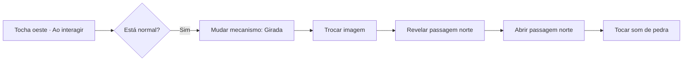

# Direção dos Objetos Inteligentes

[Documentação](../README.pt-BR.md) · [English](../en/smart-objects-direction.md) · [Map Builder](map-builder.md)

## Objetivo e situação atual

Esta direção orienta a evolução do Map Builder para uma rede visual de elementos,
eventos, ações e referências. Cada elemento pode possuir seu blueprint e participar
dos comportamentos da cena. O ComfyUI é a referência para manipular nós e arrastar
conexões; o conceito de blueprint continua organizando os comportamentos.

A etapa 1 está implementada: a modal mostra a instância real, seu nome e estado
atual. Mecanismos oferecem **Ao interagir** (`onInteract`) e **Ao destruir**;
regiões oferecem entrada/saída da área e destruição, e sinais nomeados compartilham
a instância. Esses eventos apenas iniciam uma sequência: condições comparam
valores e ações alteram estado, imagem ou outras propriedades disponíveis.
Nenhum evento possui filtro de estado ou comparação automática.

O formato atual é blueprint versão 2, com conexões tipadas de execução/dados e
ramos ordenados. Carregar dados anteriores descarta `onChange` e os grafos de
eventos por estado, sem preservar ou converter suas ações. Elementos, assets e
sequências válidas de eventos básicos ou sinais continuam no lugar.

A etapa 2 também está implementada. A linha
acompanha o ponteiro a partir de um conector da porta ou de outra saída; soltar
no vazio abre o seletor de nós, e escolher um tipo cria o nó conectado no ponto
de soltura. Soltar numa entrada existente conecta diretamente. O seletor oferece
**Controlar luz**, **Tocar som**, **Mudar estado**, **Trocar imagem**, **Verificar
estado**, **Sequência**, **Ler propriedade** e **Comparar estado**, com conexões de
valor tipadas, alternativa por clique/teclado e simulação local. O
[guia do Map Builder](map-builder.md) descreve esses recursos e os limites atuais.
A etapa 3 acrescenta referências entre elementos, referências tipadas de luz/som,
grupos ordenados, barreiras, controle de som e escolha no mapa. A etapa 4 possui
adaptadores de alavanca e tocha composta, com
estados, aparências, referências entre elementos e interação na mesa.
A etapa 5 acrescenta regiões nomeadas, placas de pressão e eventos individuais
de presença derivados dos comandos de token validados pelo servidor, filtros,
ativação de regiões e Contexto do evento tipado. Mover/Girar e a configuração de
interação direta usam validação nativa e operação manual pelo mestre.
A etapa 6 entrega All/Any sobre as condições atuais dos elementos, variáveis
tipadas por elemento/cena, sinais nomeados entre elementos, Escolher caminho
tipado, Aleatório com pesos e grupos ordenados de elementos/recursos.
A etapa 7 acrescenta Contador, Uma vez, Recarga por eventos, continuações Delay
persistentes e eventos únicos de Temporizador nomeado.
A etapa 8 entrega arte opcional de chão/parede dinâmica e Teleporte na mesma cena
(8A). A etapa 9 entrega modelos independentes da campanha com vínculos tipados,
rede da cena do mestre e apresentação autorizada de mensagem/diário/câmera.
Outros adaptadores, animação, transferência entre cenas (8B), políticas de
grupo/navegação (8C) e grupos visuais de nós continuam futuros.

O builder também edita luzes, partículas e shaders nativos do VTT, usando seus
catálogos de predefinições e renderizador animado. Cenas geradas conservam esses
elementos como objetos nativos editáveis. Esses recursos fornecem os componentes
visuais das tochas compostas: imagem, luz e efeitos vinculados, com chama e
mecanismo independentes. Os demais adaptadores permanecem planejados.

## Experiência do editor

Dois cliques sobre um elemento editável abrem a modal existente de **Objeto
Inteligente**, com o nó daquela instância em foco. Nome e estado atual identificam
o elemento real do mapa. Trazer uma referência ao canvas preserva sua identidade.

Os conectores principais usam verbos e possuem rótulos e identificação acessível:

| Conector | Significado |
| --- | --- |
| Ao interagir (`onInteract`) | Iniciar a sequência conectada quando alguém interage; decisões ficam nos nós de lógica |
| Ao destruir (`onDestroy`) | Executar antes de uma remoção explícita autorizada no jogo; uma falha reverte a remoção e seus efeitos |
| Ao entrar na área / Ao sair da área (`onAreaEnter` / `onAreaExited`) | Apenas regiões: executar para cada token elegível que atravessa o limite da área |
| Ao receber sinal (`onSignal`) | Receber um nome autoral de Emitir evento ou de um temporizador único correspondente |

Para uma sequência completa da tocha, comece em **Ao interagir → Verificar
estado: Normal**. O ramo Verdadeiro pode continuar em **Mudar estado: Girada →
Trocar imagem → Mudar estado: Aberta**, com uma referência à porta na última
ação. O ramo Falso pode retornar o mecanismo e escolher a outra imagem.
Acender ou apagar a chama continua sendo uma ação explícita. Condições leem o
retrato inicial do evento. Uma interação vazia não alterna automaticamente.

Não existe mais seção de eventos por estado. **Aparência padrão por estado** é
configuração visual separada da execução. A ocupação da região vem de comandos
de token validados; verificar primeira chegada ou última saída exige nós de
comparação explícitos na sequência de presença.

Destruição é um evento de jogo. Edições no Builder, atualizações de cenas geradas,
limpeza de assets e exclusão da campanha não o executam. Pausar a automação também
ignora seu grafo. Temporizadores e esperas do elemento removido são cancelados;
envie um sinal a outro elemento que permanecerá na cena para continuar ações mais
tarde. O teste prevê a remoção sob rollback e conserva a cena real e o projeto.
Os códigos de área mantêm os IDs existentes `presence:enter` / `presence:exit`;
temporizadores nomeados continuam usando `signal:<nome>`, sem evento sintético
separado de temporizador.

O usuário arrasta de um conector para uma entrada compatível. Soltar no vazio
abre uma busca de nós compatíveis e permite criar o próximo nó já conectado.
Escolher outro elemento no mapa ou pelo nome adiciona sua referência ao canvas.
O editor oferece mover nós, navegar, ampliar, enquadrar, remover conexões e
desfazer/refazer. Operações essenciais também devem funcionar pelo teclado,
preservando foco, fechamento e rolagem da modal padrão, inclusive em telas menores.
Edições válidas são aplicadas e salvas automaticamente; Fechar aguarda mudanças
pendentes. Desfazer/refazer revisa alterações confirmadas. Campos inválidos
impedem o fechamento, e falhas conservam o trabalho pendente com recuperação
explícita.

## Vocabulário dos nós e conexões

| Tipo de nó | Responsabilidade | Exemplos |
| --- | --- | --- |
| Elemento | Representar uma instância real e expor suas capacidades | Porta norte, Tocha oeste, Passagem secreta |
| Evento | Iniciar um fluxo; eventos comuns aparecem nos conectores do elemento | Ao abrir, ao interagir, ao mudar uma propriedade |
| Ação | Solicitar uma alteração em um alvo | Abrir porta, apagar luz, revelar elemento |
| Condição | Escolher um caminho com base em valores ou estados | Mecanismo está girado? Porta está trancada? |
| Controle | Organizar a execução | Sequência, executar uma vez, aguardar |
| Valor ou referência | Fornecer um parâmetro ou alvo | Estado, número, som, referência a um elemento |

`onOpen` identifica o acontecimento da abertura. A ação ligada à saída verde
descreve o efeito desejado, como **Tocar som** ou **Acender luz**.

Há conexões de **execução**, que determinam quando uma ação acontece, e conexões
de **dados/referência**, que fornecem alvos ou parâmetros. Os conectores indicam
seus tipos e aceitam combinações compatíveis. Uma saída pode originar mais de um
efeito; quando a ordem importa, um nó Sequência a torna explícita.

Um evento transporta o elemento de origem e, quando disponível, o token original
que o acionou. Valores de contexto alimentam nós de lógica explícitos; o evento
não os compara. Interação de jogo e configuração no editor são separadas, então
mover ou configurar um mecanismo não inicia uma sequência de jogo.

Uma ação de estado não emite evento automático nem inicia outro grafo. Reabrir a
cena ou reconectar não repete a sequência. O evento de início controla a execução;
condições e ações descrevem todas as decisões e efeitos.

## Catálogo global de nós proposto

O catálogo reúne tipos reutilizáveis em diferentes elementos e cenas. Cada nó
criado possui seus próprios parâmetros e alvos; referências permitem atuar no
próprio elemento ou em outro objeto autorizado. Modelos de comportamento completos
continuam sendo a etapa posterior de reutilização descrita neste documento.

Os tipos abaixo são propostas para a evolução do editor. A disponibilidade de
cada ação depende da capacidade do alvo e do contrato do domínio responsável.

### Aparência, áudio e alterações no mapa

| Nó | Função |
| --- | --- |
| Change Sprite | Escolher a imagem exibida por um elemento. |
| Play Sound | Tocar um som com volume e política de repetição configurados. |
| Set State | Definir um estado permitido do elemento, como aberta, fechada ou ativado. |
| Set Visibility | Mostrar ou ocultar a aparência de um elemento. |
| Reveal Object | Revelar um elemento secreto aos participantes autorizados. |
| Set Barrier | Alterar bloqueios de movimento, visão, luz e som suportados pelo alvo. |
| Move Object | Mover um elemento para uma posição ou marcador. |
| Rotate Object | Girar um elemento, como uma estátua ou mecanismo. |
| Set Light | Ligar, desligar ou alterar cor, intensidade e alcance de uma luz. |
| Set Interaction | Habilitar ou desabilitar a interação com um elemento. |
| Set Region | Habilitar ou desabilitar uma região de gatilho. |
| Control Sound | Parar, pausar ou ajustar o volume de um som. |
| Animate | Animar propriedades suportadas durante um intervalo. |
| Teleport | Transportar um token para um destino definido e validado. |

Change Sprite controla a aparência; Set State solicita a transição nativa e seus
efeitos, incluindo os bloqueios da porta. Set Visibility controla apresentação;
Reveal Object altera a descoberta do segredo conforme a autorização disponível.

Em **Ao interagir**, um nó Verificar estado pode escolher o ramo que fecha a
porta, troca sua imagem e toca o som de fechamento.
Para abrir em resposta ao jogador, o fluxo deve começar em **Ao interagir** e
verificar o estado e as condições aplicáveis. A troca de imagem pode acompanhar
o estado Trancada mantendo a validação da transição no servidor.

### Decisão e controle da execução

| Nó | Função |
| --- | --- |
| Condition | Comparar valores ou estados e escolher verdadeiro/falso. |
| Switch | Escolher entre vários caminhos conforme um valor. |
| Sequence | Executar ações em uma ordem definida. |
| All / Any | Verificar se todas ou alguma das condições atuais são verdadeiras. |
| Random | Sortear um caminho configurado usando pesos inteiros não negativos. |
| Delay | Aguardar um intervalo antes de continuar. |
| Timer | Iniciar, parar ou reiniciar um temporizador. |
| Once | Permitir a execução uma vez até ser reiniciado. |
| Cooldown | Impedir novas ativações durante um intervalo. |
| Counter | Contar ativações e escolher os ramos Atingido ou Abaixo da meta. |

All / Any combina condições atuais; a espera por vários eventos exige uma regra
de controle própria. Contador, Uma vez e Recarga já mantêm progresso privado por
elemento/evento/nó, com persistência transacional e redefinição pelo mestre; veja
[Controles de execução persistentes](map-builder.md#controles-de-execução-persistentes).
Delay já suspende e retoma o restante do evento de forma persistente, com
cancelamento e recuperação após reinício; veja
[Delay persistente](map-builder.md#delay-persistente). Temporizador inicia, para
ou reinicia uma contagem nomeada e continua imediatamente por Próximo. Ao vencer,
executa um novo sinal no elemento proprietário; veja
[Temporizador persistente](map-builder.md#temporizador-persistente).
Reconectar ou reabrir o editor não reinicia o progresso. Escolher caminho compara
uma entrada tipada ou valor de reserva com casos únicos e, sem correspondência,
escolhe Padrão. Aleatório sorteia entre todos os caminhos configurados uma vez
por visita no evento, inclusive saídas desconectadas, e conserva o sorteio
quando o mesmo comando é repetido. Veja
[Escolher caminho e Aleatório com pesos](map-builder.md#escolher-caminho-e-aleatório-com-pesos).

### Informações, referências e comunicação entre mecanismos

| Nó | Função |
| --- | --- |
| Element Reference | Referenciar uma porta, tocha, região ou outro elemento. |
| Element Group | Referenciar um conjunto, como Todas as tochas da sala. |
| Get Property | Ler uma propriedade, como estado, orientação ou iluminação. |
| Set Variable | Guardar um valor no contexto do elemento ou da cena. |
| Get Variable | Consultar esse valor em outro ponto do fluxo. |
| Compare Value | Comparar booleanos, números ou textos e produzir um resultado booleano. |
| Event Context | Ler dados originais de origem/usuário/token e o retrato de evento/estado deste grafo. |
| Emit Event | Emitir um sinal nomeado com escopo; dados personalizados continuam futuros. |
| On Event | Iniciar um fluxo ao receber um sinal próprio compatível. |

Referências individuais e grupos seguem as mesmas regras de identidade e
permissão. Variáveis e sinais precisam de escopo definido; a inscrição em um
evento segue a idempotência e os limites de execução da cadeia.
A implementação atual está descrita em
[Variáveis e sinais nomeados](map-builder.md#variáveis-e-sinais-nomeados).
Sinais transportam somente um nome. Contexto do evento está implementado com
campos limitados derivados pelo servidor, preservados por sinais e trabalho
temporizado; dados personalizados nos sinais continuam planejados. Veja
[Contexto da origem do evento](map-builder.md#contexto-da-origem-do-evento).

### Apresentação aos participantes

| Nó | Função |
| --- | --- |
| Show Message | Mostrar uma mensagem ao público escolhido. |
| Show Handout | Apresentar uma página ou imagem de diário autorizada. |
| Camera Focus | Sugerir ou aplicar um enquadramento conforme permissões e preferências. |

### Prioridades e exemplo de composição

O primeiro conjunto deve priorizar **Set State, Condition, Sequence, Element
Reference, Get Property, Set Barrier e Set Light**, junto de Change Sprite e
Play Sound. Controles persistentes, temporização, apresentação e transporte
entram conforme seus contratos forem definidos.

Um mecanismo com três acionamentos pode seguir:

**Tocha girada → Contador (meta 3) · Atingido → Uma vez · Primeira vez → Mudar
estado: passagem aberta → Tocar som.**

Uma vez fica antes das ações que deve proteger. O contador registra acionamentos;
um enigma que exige três tochas distintas deve identificar suas referências e
consultar seus estados, por exemplo com Get Property e All / Any.
Uma passagem trancada exige uma transição de destrancamento explicitamente
autorizada antes da abertura.

Nós de dano, cura, testes e condições de personagem serão fornecidos pelo pacote
do sistema de RPG por contratos públicos apropriados.

## Elementos compostos por capacidades

Os nomes do catálogo representam modelos montados com capacidades compartilhadas.
Cada elemento expõe os eventos, ações e propriedades das capacidades que possui.

| Capacidade | Responsabilidade |
| --- | --- |
| Aparência e transformação | Imagem, visibilidade, posição e orientação |
| Interação | Forma de acionamento e contexto de quem interagiu |
| Estados | Estados próprios e transições permitidas |
| Barreira | Bloqueios de movimento, visão, luz e som, conforme o contrato nativo |
| Iluminação | Estado ligado/desligado, cor, intensidade e alcance |
| Áudio | Reprodução, volume e repetição |
| Região | Área nomeada, entrada/saída de tokens e ocupação |
| Conteúdo | Referência a serviços disponíveis de inventário ou conteúdo |
| Destino | Alvo de transporte validado, como outro elemento ou cena |
| Mecanismo | Propriedades configuradas como normal/girado ou encaixado/removido |

Uma tocha reúne aparência, iluminação e interação; um mecanismo pode ser
adicionado. Uma vela ou fogueira reutiliza essas capacidades. Um baú combina
aparência, abertura, tranca e conteúdo opcional. Estados personalizados e ações
continuam limitados pelas capacidades e pelos serviços disponíveis.

## Catálogo proposto

| Elemento | Estados ou propriedades | Eventos | Ações recebidas |
| --- | --- | --- | --- |
| Porta | Aberta, fechada, trancada | Abrir, fechar, trancar, destrancar, interagir | Abrir, fechar, trancar, destrancar |
| Parede | Bloqueios, aparência e visibilidade | Mudar bloqueio, revelar, mudar aparência; interagir se habilitado | Alterar bloqueios, revelar/ocultar, trocar aparência |
| Tocha | Acesa/apagada; mecanismo opcional normal/girado | Acender, apagar, girar, interagir | Acender, apagar, girar, mudar cor/intensidade |
| Baú | Aberto, fechado, trancado; conteúdo independente | Abrir, fechar, destrancar, acessar conteúdo | Abrir, fechar, trancar, destrancar, revelar conteúdo |
| Chão | Aparência, superfície e região associada | Entrar/sair da região, interagir | Trocar aparência, habilitar região, revelar/ocultar |
| Alavanca ou interruptor | Ativado/desativado | Ativar, desativar, interagir | Ativar, desativar, alternar |
| Placa de pressão | Pressionada/solta; habilitada/desabilitada | Pressionar, soltar, mudar ocupação | Habilitar, desabilitar, acionar, liberar |
| Armadilha | Armada, disparada, desarmada | Detectar, disparar, desarmar, reiniciar | Armar, disparar, desarmar, reiniciar |
| Ponte ou plataforma | Recolhida/estendida; posição | Recolher, estender, terminar movimento | Recolher, estender, mover, controlar passagem |
| Portal ou acesso | Ativo/inativo; destino | Ativar, entrar, transportar | Ativar, desativar, definir destino, transportar |
| Luz | Ligada/desligada; cor, intensidade e alcance | Ligar, desligar, alterar propriedade | Ligar, desligar, alterar propriedades |
| Emissor de som | Parado/tocando; volume e repetição | Começar, terminar, parar | Tocar, parar, alterar volume |
| Objeto genérico | Estados personalizados, aparência e orientação | Interagir, mudar propriedade definida | Mover, girar, trocar aparência, mudar estado |

Algumas propriedades permanecem independentes:

- **Porta:** `door_state` nativo continua sendo a fonte do estado atual. A
  apresentação secreta e a descoberta são propriedades separadas da abertura.
- **Parede:** revelar sua existência e liberar passagem são ações distintas.
  Movimento, visão e os demais bloqueios seguem as capacidades nativas.
- **Tocha:** iluminação e mecanismo podem mudar independentemente. Apagar a chama
  conserva a posição normal/girada do mecanismo.
- **Baú:** abrir a tampa conserva o conteúdo. Abertura, tranca e conteúdo possuem
  significados próprios, com validação de combinações e transições permitidas.
- **Chão:** comportamentos usam regiões nomeadas, como Piso da entrada ou Área da
  armadilha. Uma região pode abranger células ou um polígono; pintar uma família
  de tiles preserva o comportamento da área sem criar automaticamente um grafo
  para cada imagem sorteada.

## Rede da cena e referências

A rede da cena reúne comportamentos pertencentes aos elementos. A modal de um
elemento mostra o recorte relevante; uma visão geral mostra as relações da cena.
Ambas as visualizações editam as mesmas regras. Por exemplo, a regra que começa
com a tocha girada pertence à tocha; a regra iniciada pela abertura da passagem
pertence à passagem.

Referências usam identificadores estáveis e o escopo da cena/campanha. Renomear um
objeto conserva suas ligações. Geração e atualização de cena precisam remapear as
identidades do projeto para os objetos nativos, preservando os vínculos.

Duplicar um conjunto remapeia referências internas para as cópias. Referências
externas continuam apontando para os alvos originais, identificados no editor.
Referências tipadas e membros de grupos cujos alvos desaparecem permanecem
inertes com diagnóstico para reparo, sem voltar ao próprio elemento. Ações
legadas de imagem/som/luz seguem a limpeza descrita no guia; controles mais
amplos para desativar regras até revisão continuam futuros.

Modelos reutilizáveis já oferecem cópias independentes com referências expostas
como vínculos por instância. Modelos vinculados permanecem uma proposta futura.
Famílias de assets
continuam agrupando imagens para pintura; modelos de comportamento guardam nós,
ações e parâmetros.

## Exemplos de comportamento

Um segundo comportamento pode começar na própria passagem:

**Passagem norte · Ao interagir → Verificar estado → Abrir passagem → Apagar
tocha oeste → Acender luzes da sala secreta.**

Outras composições previstas incluem **placa pressionada → abrir porta**,
**baú aberto → disparar armadilha** e **token entra na região → ativar portal**.
As ações mantêm referências explícitas aos elementos afetados.

## Portais, teleporte e viagem entre cenas

O nó `Teleport` recebe o token responsável pelo evento e um destino validado.
O recorte 8A já implementa **Área X · Token entrou → Teleport → Área Y** na mesma
cena. O desenho mais amplo abaixo continua proposto para viagem entre cenas e
grupos, sem aprovar uma política de navegação. Em um futuro 8B, a área de
chegada poderá estar em outra cena da campanha. Portais, escadas
e acessos reutilizam esse comportamento com suas próprias aparências.

### Configuração do portal

| Configuração | Exemplo ou opções propostas |
| --- | --- |
| Origem | Região Área da escadaria |
| Destino | Cena Subsolo, região ou marcador Chegada da escada |
| Quem atravessa | Token de Event Context ou grupo explicitamente definido |
| Acionamento | Automático ao entrar ou mediante interação |
| Quem acompanha a cena | Controladores dos tokens transportados ou toda a mesa, conforme política explícita |
| Retorno | Outro portal, configurado separadamente |

Origem e destino usam referências estáveis; renomear uma região ou cena conserva
o vínculo. O destino determina também como posicionar os tokens no ponto de
chegada. Grupos precisam de uma distribuição previsível e de uma política de
falha quando faltar espaço, definida antes da entrega desse modo.

### Identidade, chegada e falhas

- Transportar preserva a mesma instância do token, seu personagem, condições,
  configurações e permissões. A transferência entre cenas conserva essa identidade.
- O servidor valida o acionamento, os viajantes e o destino, incluindo campanha,
  acesso, limites, tamanho do token e capacidade de posicionamento. Visualização
  de arraste e notificações recebidas no navegador preservam seu papel de interface.
- A falha de um teleporte individual mantém o token na origem e informa a causa.
  A transferência e seus efeitos persistentes seguem as regras de consistência,
  revisão e idempotência dos demais comandos. Entre cenas, a transferência da
  instância exige atualização atômica dos estados envolvidos, sem cópia residual.
- Saída e chegada produzem os eventos apropriados uma vez por viagem. Repetir o
  comando ou recarregar o cliente conserva a posição e os efeitos já executados.
- Chegar a um portal permite efeitos de chegada, como som e luz. Um novo
  teleporte automático nessa chegada aguarda sair e entrar novamente na região,
  evitando o ciclo imediato X → Y → X. Essa proteção básica deve funcionar sem
  depender de temporizadores; um Cooldown opcional pode ser acrescentado depois.

As regiões atuais executam entrada/saída após movimento confirmado, e Teleporte
8A usa somente o token autenticado do evento. A posição é escolhida em ordem
estável, com limites e capacidade, preservando identidade, revisões e recibo.
Uma trava privada de chegada persiste até sair da região; cada token pode viajar
no máximo uma vez por comando lógico. Veja
[Teleporte na mesma cena](map-builder.md#teleporte-na-mesma-cena).

### Transporte e apresentação da cena

O plano distingue três efeitos: mover o token, abrir a visualização de destino
para os participantes autorizados e trocar a cena transmitida para a campanha.
A mudança da transmissão precisa ser explicitamente configurada e autorizada.

Hoje jogadores e streamers acessam a cena em transmissão ativa da campanha.
Viagens individuais para outra cena exigem ampliar os contratos de navegação e
acesso, preservando a filtragem de cenas, tokens e segredos por destinatário.
Uma transferência entre cenas depende desse contrato ou de uma transição
explicitamente autorizada da mesa para a cena de destino.

**Decisão pendente:** permitir jogadores em cenas diferentes simultaneamente ou
manter a viagem vinculada à transmissão compartilhada. As opções de quem
acompanha e seus padrões finais dependem dessa definição. O teleporte dentro da
mesma cena pode avançar enquanto essa decisão permanece aberta.

### Recortes de entrega do teleporte

1. **8A — Mesma cena (implementado):** entrada na Área X transporta o token para a Área Y, com
   validação do destino, preservação da identidade e proteção contra retorno
   automático. Depende das etapas 3 e 5 e do contrato de posicionamento.
2. **8B — Outra cena:** transferir a instância e resolver acesso, posição e
   apresentação do destino. Definir a política de quem acompanha antes da entrega;
   alterar a transmissão exige autorização explícita.
3. **8C — Navegação individual ou por grupo:** se essa opção for adotada, permitir
   destinos simultâneos para participantes diferentes após ampliar permissões,
   navegação e sincronização. Este recorte depende da decisão pendente acima.

O aceite de 8A cobre transporte único, falha sem deslocamento, ausência de ciclos
e efeitos de chegada. Os recortes entre cenas acrescentam preservação do token,
destino autorizado, apresentação correta para cada público e transmissão
compartilhada preservada quando sua mudança não tiver sido autorizada. Retornos
e grupos são verificados com suas políticas explícitas. Estes recortes integram
a etapa 8, mantendo as nove etapas e o catálogo de 35 tipos de nós.

## Integração com o VTT

O servidor continua responsável por estado, validação, permissões e persistência.
O editor usa a modal padrão e os serviços nativos de mapas, luz e áudio, com
transações, revisões, recibos e notificações após commit. Repetir o mesmo comando
de rede conserva sua identidade e seus efeitos. Grafos e referências privadas
ficam restritos ao mestre; a projeção dos participantes contém o resultado visível.

O mestre configura comportamentos. O servidor valida a interação de origem e as
ações autorizadas, com alvos e parâmetros definidos. Uma automação que destranca
uma passagem por mecanismo exige um contrato explícito de autorização, mantendo
as restrições das interações diretas e a validação dos comandos do navegador.

Limites de execução e diagnóstico devem abranger cadeias entre elementos. As
portas já mostram esse diagnóstico na janela **Automação** do mestre, que lista os
eventos, ramos, valores, ações e o motivo de falha de cada execução; cadeias entre
elementos devem ampliar esse registro. Um
ciclo pode atravessar vários blueprints mesmo que cada grafo isolado pareça
válido. Alterações de um fluxo persistente precisam manter consistência quando
uma ação falha. Delay conserva a ordem restante de execução e os valores de
leitura do início do evento, gravando cada trecho separadamente. Cancelamentos e
falhas não desfazem efeitos já gravados antes de uma espera.

Texturas estáticas mantêm a imagem gerada. Superfícies explicitamente dinâmicas
usam planos de imagens nativas e máscaras, retirando sua arte do fundo e
preservando pintura/borracha. Definir visibilidade/aparência muda essa arte sem
gravar arquivos durante o jogo; barreiras têm controle independente. Projetos
antigos conservam o padrão estático e a geometria nativa.

Armadilhas e mecanismos do núcleo emitem eventos e efeitos genéricos. Dano,
testes e outras regras de RPG pertencem ao pacote do sistema, por contratos
públicos apropriados.

## Sequência de entrega e critérios

Das nove etapas abaixo, as etapas 1, 2, 4, 5, 6 e 7 entregam o comportamento
delimitado descrito em cada seção. A etapa 3 entrega referências tipadas e grupos;
visibilidade genérica sem imagem continua pendente. A etapa 8 entrega superfícies
dinâmicas e o recorte 8A; a etapa 9 entrega modelos independentes, rede da cena e
apresentação. Outros adaptadores, grupos visuais de nós e propostas entre
cenas/navegação continuam pendentes. O catálogo
completo continua como direção de produto. Cada entrega
deve resultar em um fluxo utilizável e verificável, expondo apenas capacidades
com ação implementada. A numeração indica a ordem recomendada; as dependências
permitem desenvolver partes independentes em paralelo.

| Etapa | Entrega principal | Dependência |
| --- | --- | --- |
| 1 | Caixa da instância e contratos essenciais — implementada | Implementação atual de portas |
| 2 | Conexões arrastadas e primeiros fluxos — implementada | 1 |
| 3 | Referências tipadas e grupos — entregues; visibilidade genérica pendente | 2 |
| 4 | Objetos compostos, transformações e interação — implementada | 3 |
| 5 | Regiões, filtros e contexto de origem — implementada | 4 |
| 6 | Condições, dados, sinais e grupos — implementada | 3; pode avançar em paralelo a 4 e 5 |
| 7 | Controles persistentes e temporização — implementada | 6 |
| 8 | Superfícies dinâmicas e Teleporte na mesma cena (8A) — entregues; outros adaptadores e 8B/8C pendentes | Adaptadores: 3 e 4; teleporte: 3 e 5 mais contratos de destino/cena; animações temporizadas: 7 |
| 9 | Apresentação, modelos independentes e rede da cena — entregues; grupos visuais pendentes | 3 e 6; cada modelo usa somente capacidades já entregues |

### Etapa 1 — Caixa da instância e contratos essenciais (implementada)

**Entrega:** abrir a modal na instância real, com eventos de interação e
destruição, presença para regiões e sinais nomeados. Eventos apenas iniciam a
sequência; comparações e alterações pertencem aos nós. Definir capacidades,
contexto, identificadores e execução limitada. Carregar dados anteriores descarta
os grafos de eventos removidos, mantendo elementos e assets. Ramos de execução
e conexões tipadas de dados/referências permanecem separados.

**Contrato entregue:** descritor transitório de instância com `sourceId`, nome,
estado nativo e eventos de saída, sem gravar outra porta no documento. O registro
interno oferece somente os tipos implementados. A versão atual 2 exige
`kind: "execution"`, admite ramos
ordenados e executa nós compartilhados uma vez por evento. Conectores de dados
e referências expõem apenas capacidades implementadas. Dados carregados usam a
versão atual; grafos dos eventos removidos são descartados sem conversão para
novas sequências. A ausência de blueprint permanece até configurar um comportamento.

**Aceite:** dois cliques em portas diferentes abrem suas respectivas instâncias;
reabrir não executa ações de jogo. Carregar dados anteriores descarta grafos
obsoletos e conserva elementos, assets e sequências disponíveis, sem outro estado
persistido da instância.

### Etapa 2 — Conexões arrastadas e primeiros fluxos (implementada)

**Dependência:** etapa 1.

**Nós:** `Change Sprite`, `Play Sound`, `Set State`, `Condition`, `Sequence`,
`Get Property`.

**Entrega:** arrastar fios, soltar no vazio para criar e configurar um nó
compatível já conectado, criar ramos e remover ligações. Oferecer navegação,
edição por teclado, desfazer/refazer, salvamento automático e simulação local com o
caminho executado. Este recorte trabalha com a própria porta e recursos já
suportados, antes dos novos vínculos entre elementos.

**Interação entregue:** arrastar de um conector de evento da instância ou
de uma saída de ação/condição. A linha acompanha o ponteiro; soltar no vazio
permite escolher o tipo e criar o nó já conectado. Soltar numa entrada existente
conecta diretamente. Há suporte a vários ramos, cancelamento sem criar nó,
posicionamento conforme a câmera, toque e alternativa por clique/teclado.
O seletor atual oferece **Controlar luz**, **Tocar som**, **Mudar estado** e
**Verificar estado**, com busca e as validações existentes de recursos e grafos.
O editor lista apenas eventos básicos e sinais nomeados com a quantidade de nós,
move a vista e aplica zoom em torno do ponteiro, e mantém um histórico de desfazer/refazer
do rascunho aberto. Edições válidas persistem automaticamente; Fechar aguarda
mudanças pendentes e não desfaz alterações confirmadas.

**Nós entregues:** **Trocar imagem** define a aparência ativa como ação da
sequência, inclusive após Mudar estado. A aparência padrão é configuração
separada. **Sequência** executa as saídas 1–4 em ordem. **Ler propriedade** lê o
estado atual ou anterior e **Comparar estado** transforma um estado em Verdadeiro
ou Falso; ambos são nós de valor puros ligados por conexões tipadas
`kind: "data"`, e **Verificar estado** aceita uma entrada booleana **Teste**.
Condition continua sendo o nome do catálogo para Verificar estado; os demais tipos
do catálogo global permanecem em suas etapas posteriores.

**Aceite:** ao fechar, a porta troca a imagem e toca um som; ao interagir estando
fechada, pode solicitar abertura. Aparência e estado permanecem distintos.
Verificar dois ramos após um nó de condição, remoção/reconexão de fios e a ordem explícita
de Sequence quando necessária.
O salvamento automático e a reabertura conservam o grafo. Simular conserva
a cena, e recarregar, repetir um comando ou atribuir o mesmo estado preserva os
efeitos sem executá-los outra vez.

### Etapa 3 — Referências e ações entre elementos (parcialmente implementada)

**Dependência:** etapa 2.

**Entregue para portas:** o nó de valor **Referência de elemento** e uma entrada
tipada **Alvo** em **Mudar estado**, **Revelar** (novo) e **Ler propriedade**; a
cadeia limitada, o diagnóstico de alvo ausente e a regra de autoridade de
jogadores descritos em [Modelo de execução revisado](#modelo-de-execução-revisado);
o remapeamento na geração, na atualização e na cópia; passos entre portas no
registro de automação. Depois, **Definir barreira** (com Alvo), **Controlar som**
(parar ou volume) e o contrato explícito de autorização: uma ação **Mudar estado**
marcada como **Jogadores podem trancar ou destrancar** permite que uma cadeia
iniciada por jogador faça essa mudança de tranca. Os alvos de Referência de
elemento e de **Controlar luz** podem ser escolhidos clicando na porta ou luz no
mapa do builder. Referências de luz/som e grupos tipados agora conectam entradas
Alvo dos recursos correspondentes. Referências de elemento também incluem
imagens nativas e regiões de presença. Grupos ordenados conservam UUIDs explícitos;
alvos excluídos ficam inertes com diagnóstico, sem voltar ao próprio elemento.
Cópias remapeiam referências internas, preservando recursos externos. Veja
[Grupos e referências tipadas de recursos](map-builder.md#grupos-e-referências-tipadas-de-recursos).
**Set Visibility** já atende arte compatível, incluindo superfícies dinâmicas;
visibilidade genérica de elementos sem imagem continua pendente.

**Nós:** `Element Reference`, `Set Light`, `Set Barrier`, `Set Visibility`,
`Reveal Object`, `Control Sound`.

**Entrega:** escolher alvos no mapa ou pelo nome, inspecionar referências e
executar ações pelos serviços nativos. Vincular identidades do projeto aos
objetos da cena; remapear referências internas ao duplicar grupos e preservar
as externas. Diagnosticar alvos excluídos e impedir a execução do trecho inválido.

Validar no servidor a interação de origem, os alvos e as ações autorizadas pelo
mestre, incluindo o contrato explícito de destrancamento. Limitar ciclos que
atravessem elementos e mostrar a cadeia responsável. Ações visuais em chão ou
paredes opcionais dinâmicas já são entregues pela etapa 8; pixels estáticos
existentes mantêm a renderização original.

**Aceite:** um evento na porta A revela e abre a porta B e controla luz/áudio.
Mestre e jogador recebem o resultado permitido. Renomear, duplicar, excluir,
gerar e atualizar preserva referências e conteúdo manual. Um ciclo entre duas
portas produz diagnóstico e mantém a consistência das alterações.

### Etapa 4 — Objetos compostos e mecanismos (implementada)

**Dependência:** etapa 3.

**Entregue:** decorações podem ser configuradas como alavancas com estados
`off/on`, aparência padrão e sequências de interação/destruição no
editor compartilhado. Portas e alavancas consultam e mudam seus estados na mesma
cadeia transacional limitada. Mestres e jogadores interagem com dois cliques na
imagem nativa; streamers continuam somente para leitura e os grafos privados
ficam com o mestre. A janela Automação abrange os dois adaptadores. Cópias,
arquivos de campanha, atualizações de cena e exclusão de assets conservam
referências válidas e estado de jogo. Configurar o objeto não executa eventos
de jogo. Veja [Alavancas](map-builder.md#alavancas).
Tochas também estão implementadas: uma imagem possui luz obrigatória e partículas
e shader opcionais, editados nas janelas nativas. O mecanismo Normal/Girada e a
chama acesa/apagada são independentes. Girar soma 90 graus; apagar preserva o
mecanismo. O nó **Controlar chama** atua na própria tocha ou em um Alvo de tocha,
inclusive a partir de portas e alavancas. Movimentos e cópias preservam o conjunto,
e a geração, atualização e os arquivos de campanha conservam os vínculos. Veja
[Tochas compostas](map-builder.md#tochas-compostas). Mover objeto e Girar objeto
agora aplicam transformações relativas validadas a imagens, portas, luzes e
regiões retangulares, incluindo grupos tipados e componentes de tochas.
Retângulos só aceitam quartos de volta. Definir interação bloqueia controles e
requisições diretas de jogadores, conservando a operação manual do mestre e
automações autoradas. Padrões da fonte e configurações durante o jogo seguem a
política de atualização documentada. Veja
[Movimento, rotação e interação durante o jogo](map-builder.md#movimento-rotação-e-interação-durante-o-jogo).

**Nós:** `Move Object`, `Rotate Object`, `Set Interaction`.

**Entrega:** compor objetos genéricos, tochas e alavancas a partir de aparência,
interação, estados e iluminação. Separar o mecanismo normal/girado da chama
acesa/apagada. Integrar transformações às imagens nativas e distinguir ajustes
de configuração de interações durante o jogo.

**Aceite:** girar a tocha abre a passagem secreta; apagar a chama conserva a
posição do mecanismo. Uma alavanca controla outro elemento por referência.
Mover ou configurar o objeto no editor preserva a separação dos eventos de jogo.

### Etapa 5 — Regiões, filtros e contexto de origem (implementada)

**Dependência:** etapa 4.

**Nós:** `Set Region`, `Event Context`.

**Entregue:** regiões retangulares nomeadas no builder e edição de zona nativa
para o mestre, ocupação da primeira chegada/última saída e eventos de área por
token. A predefinição de placa ligada à porta usa comparações explícitas, ocupação privada, travessias
pelo caminho validado e edição sem repetir eventos. O registro inclui região,
token responsável e quantidade. Veja [Regiões e placas de pressão](map-builder.md#regiões-e-placas-de-pressão).
Definir região habilita/desabilita a presença e estabelece uma base silenciosa.
Filtros combinam IDs de tokens/atores, disposição e configuração de token oculto,
com OU dentro das listas e E entre critérios. Contexto do evento expõe identidade
original, transição e ocupação validadas pelo servidor, além do evento/estado do
grafo atual; sinais e trabalho temporizado conservam os dados da origem. Edições
de configuração não criam eventos artificiais. A presença usa centro e elevação
dos tokens, inclusive ocultos elegíveis, e avalia regiões sobrepostas na ordem
de criação. Ações de teleporte/transporte continuam na etapa 8.

**Entrega:** regiões nomeadas associadas ao chão, entrada/saída de tokens,
ocupação e placas de pressão. Derivar eventos do movimento validado pelo
servidor e disponibilizar origem, token responsável e alterações permitidas.
Definir o tratamento de regiões sobrepostas e deslocamentos instantâneos,
incluindo o futuro transporte.

**Aceite:** entrar na região pressiona uma placa e controla uma porta. Se dois
tokens ocupam a placa, a saída de apenas um conserva a pressão. Ao sair o último,
o evento de liberação acontece uma vez. Editar a região ou recarregar a cena
preserva a ocupação sem repetir entradas. Dados privados continuam filtrados.

### Etapa 6 — Condições, dados, sinais e grupos (implementada)

**Dependência:** etapa 3; pode avançar em paralelo às etapas 4 e 5.

**Entregue:** All/Any são nós de valor booleano com duas a quatro entradas
conectadas e resultado booleano. Editor, simulação local e servidor consultam
os estados atuais dos elementos referenciados; o registro do mestre mostra os
resultados. Menos de duas entradas forma um rascunho editável que retorna Falso.
Três tochas distintas podem controlar uma passagem, e repetir o acionamento de
uma não substitui as outras. Veja [Condições compostas](map-builder.md#condições-compostas).
**Ler variável**, **Definir variável** e **Comparar valor** estão implementados,
com memória privada e tipada de elemento/cena. Cada evento lê seu retrato inicial;
as atribuições ficam disponíveis aos eventos seguintes. **Emitir sinal** enfileira
um sinal nomeado para o próprio elemento, um Alvo tipado ou os receptores da cena;
**Ao receber evento** seleciona o grafo receptor correspondente. A mesma transação,
permissões, recibos e fila limitada regem toda a cadeia. O mestre pode inspecionar
a memória e redefinir uma entrada conferindo o valor exibido, sem disparar eventos.
Atualizações vinculadas e arquivos de campanha preservam progresso; cópias de
elementos nativos começam com memória própria vazia. A simulação local mostra um
grafo e lista emissões sem executar receptores. Veja
[Variáveis e sinais nomeados](map-builder.md#variáveis-e-sinais-nomeados).
Escolher caminho e Aleatório estão entregues na versão 2. Escolher caminho
aceita um Valor booleano, número ou texto, conectado ou configurado como reserva,
e seleciona um caso único correspondente ou Padrão. De um a quatro casos
conservam IDs estáveis; booleanos permitem no máximo dois. Mudar o tipo remove
conexões incompatíveis e saídas dos casos descartados em uma edição que pode ser
desfeita. Aleatório possui de dois a quatro pesos inteiros de 0 a 1.000, com soma
positiva. Caminhos com peso zero nunca executam; um caminho sorteado sem conexão
encerra o ramo sem outro sorteio. Nós de escolha compartilhados executam uma vez
quando os ramos convergem. Escolhas do servidor conservam permissões, reversão
atômica e recibos do comando; sorteios privados derivados de chave conservam o
resultado quando a mesma requisição é repetida, inclusive após reversão.
Delay preserva continuações já escolhidas; cadeias de Delay/Temporizador
conservam a posição na sequência de sorteios. A simulação sorteia localmente sem
executar efeitos do servidor ou eventos receptores. Veja
[Escolher caminho e Aleatório com pesos](map-builder.md#escolher-caminho-e-aleatório-com-pesos).

**Nós:** `Switch`, `All / Any`, `Random`, `Element Group`, `Set Variable`,
`Get Variable`, `Emit Event`, `On Event`.

Grupos tipados agora fornecem conjuntos explícitos ordenados de elementos/luzes/
sons às ações compatíveis, com até 32 membros. Contexto da origem está entregue
na etapa 5. Dados personalizados adicionais nos sinais continuam futuros.
Variáveis tipadas, eventos nomeados e condições
atuais continuam limitados pela cadeia de eventos; nenhum espera juntar vários
eventos independentes.

**Aceite:** três tochas distintas são consultadas por referência; a condição
composta permite a abertura quando todas estão na posição desejada. Um sinal
`PuzzleSolved` inicia outro comportamento uma vez por ocorrência autorizada.
All / Any consulta estados atuais; contagem de acionamentos pertence à etapa 7.
Tochas e os demais adaptadores disponíveis agora compartilham esse contrato;
validar os três estados distintos e o receptor autorizado do sinal em conjunto.

### Etapa 7 — Controles persistentes e temporização (implementada)

**Dependência:** etapa 6.

**Entregue:** Contador, Uma vez e Recarga são controles de execução da versão 2,
com ramos de aceite/recusa e progresso privado por elemento, evento e ID de nó.
Contador incrementa antes de comparar uma meta inteira de 1 a 1.000.000, e sua
contagem para em 1.000.000. Uma vez protege os efeitos seguintes até o mestre
redefini-lo. Recarga aceita de 0,1 a 86.400 segundos e consulta um prazo UTC
absoluto somente quando outro evento visita o nó; tentativas bloqueadas não
estendem o prazo. Transação e recibo do comando cobrem progresso e efeitos,
incluindo reversão e repetição. Reconectar, reiniciar, atualizar pelo builder e
os arquivos de campanha conservam o progresso; cópias nativas o limpam. Remover
eventos/nós ou mudar o tipo descarta a entrada; parâmetros, posição e conexões a
conservam. Uma duração editada vale na próxima ativação permitida após o prazo
existente. A simulação usa valores iniciais temporários; a visão Memória dos nós
do mestre inspeciona e redefine uma entrada conferindo o valor exibido, sem
disparar eventos. Veja
[Controles de execução persistentes](map-builder.md#controles-de-execução-persistentes).

Delay também está entregue: a versão 2 aceita de 0,1 a 86.400 segundos, guarda
o restante da execução do evento e retoma por um executor automático no servidor,
sem depender de requisições do navegador. Efeitos anteriores e continuação são
gravados juntos; cada trecho retomado grava seus efeitos, conclusão e recibo
próprio de forma atômica, sem manter uma transação aberta enquanto aguarda.
Estado, estado anterior, estados referenciados e variáveis conservam os valores
do início do evento; a memória dos controles é atual na retomada. Ordem de
Sequência, nós já visitados e limites da cadeia original atravessam esperas;
retomar uma continuação não consome outra operação de elemento. A cadeia admite
ainda no máximo 32 retomadas temporizadas, com Delay e Temporizador
compartilhando 64 tarefas pendentes por cena e 256 por campanha.

Edições de comportamento do blueprint e remoção de elementos alvo usados pela
continuação cancelam o trabalho afetado. Referências ausentes de luz, som ou
imagem em qualquer parte desse blueprint também cancelam, inclusive recursos
usados somente antes da espera;
mudanças de posição dos cartões o conservam. A retomada
confere o acesso atual do autor, limitado ao papel original. A visão Aguardando
do mestre permite inspecionar e cancelar conferindo o prazo exibido, sem disparar
eventos. Pausar a cena conserva esperas vencidas até retomar; mudar a cena
visível ou desconectar todos os navegadores não interrompe o executor. Esperas
pendentes sobrevivem ao reinício do servidor, mas não entram em arquivos ou
cópias de campanha. Veja [Delay persistente](map-builder.md#delay-persistente).

Temporizador também está entregue na versão 2. Iniciar conserva identidade,
prazo, autor e limites de uma contagem existente; Parar cancela sem executar um
evento; Reiniciar substitui usando o autor e os limites do evento atual. Os
nomes usam o mesmo formato ASCII dos sinais, com distinção entre maiúsculas e
minúsculas, e pertencem a um elemento entre seus nós e grafos. Iniciar/Reiniciar
exigem de 0,1 a 86.400 segundos; Parar não possui duração. Próximo executa
imediatamente. O vencimento emite um novo `signal:nome` nesse elemento, com
estado, referências e variáveis atuais; sem receptor, conclui sem efeitos.
Usa a mesma fila persistente, executor, pausa, cancelamento, autoridade e limite
privado de arquivo/cópia de Delay. O vencimento de Temporizador consome outra
operação de elemento; uma continuação de Delay não. Toda execução temporizada
conserva os limites herdados de 32 retomadas e operações por elemento, inclusive
grafos que reiniciam a contagem.

A visão Aguardando do mestre permite parar ou reiniciar o temporizador exibido,
conferindo identidade e prazo. Reiniciar pelo painel conta a partir de agora
com a duração salva e conserva autor original, limite do papel e limites da
cadeia. A simulação local lista as ações sem agendar nem executar receptores.
Veja [Temporizador persistente](map-builder.md#temporizador-persistente).
Temporizadores recorrentes/globais não fazem parte desta entrega. Passar o tempo
de Recarga continua sem agendar nem executar ações.

**Nós:** `Counter`, `Once`, `Cooldown`, `Delay`, `Timer`.

**Aceite:** três acionamentos atingem o contador e Once libera os efeitos uma
vez, posicionado antes deles. Reconectar, reiniciar ou repetir comandos conserva
o controle persistido e os efeitos executados. Delay retoma ou cancela conforme
sua política documentada, com estado e diagnóstico consistentes. Temporizador
continua o grafo emissor imediatamente e emite seu evento nomeado uma vez ao
vencer, com leituras atuais e a autoridade original; Parar impede esse evento,
e controles desatualizados do mestre não substituem tarefas mais novas.
Um contador de acionamentos continua distinto
da condição sobre três elementos diferentes da etapa 6.

### Etapa 8 — Mundo dinâmico e demais elementos (superfícies dinâmicas e 8A entregues)

**Dependências:** etapas 3 e 4 para os adaptadores; etapas 3 e 5 e os contratos de
destino/acesso para transporte; etapa 7 para animações e sequências temporizadas.
Os recortes independentes podem avançar conforme seus próprios contratos, sem
aguardar toda a temporização.

**Nós:** `Animate`, `Teleport`.

**Recorte entregue:** chão/parede com opção dinâmica viram arte nativa composta,
com alvos estáveis e máscaras/receitas geradas protegidas. Definir visibilidade e
Definir aparência aceitam elemento ou grupo ordenado, reutilizam arte nativa
compatível e não mudam barreiras. Trocar material durante o jogo não grava
arquivos. Teleporte na mesma cena usa só o token autenticado do Contexto do
evento, posição determinística limitada, revisões/recibos transacionais e uma
única saída/chegada. Travas privadas e persistidas evitam retorno até sair da
região; cada token viaja no máximo uma vez por comando lógico. Veja
[Superfícies dinâmicas](map-builder.md#superfícies-dinâmicas) e
[Teleporte na mesma cena](map-builder.md#teleporte-na-mesma-cena).
Animate, adaptadores específicos de baú/armadilha/ponte, 8B e 8C continuam futuros.

**Entrega:** permitir aparência dinâmica de paredes e pisos com uma camada de
renderização apropriada. Retirar da imagem base a arte promovida a elemento
dinâmico, preservando o restante e a geometria nativa. Entregar em recortes
jogáveis baús, armadilhas, pontes, plataformas e portais, conforme as capacidades
necessárias estiverem disponíveis. Conteúdo de baús exige o contrato de conteúdo;
regras de RPG permanecem nos pacotes dos sistemas.

O teleporte segue os recortes 8A, 8B e 8C descritos em **Portais, teleporte e viagem
entre cenas**, começando dentro da mesma cena. A operação entre cenas e a eventual
navegação individual exigem seus próprios contratos e a decisão de público.

**Aceite:** mudar ou ocultar uma parede/piso dinâmico atualiza a apresentação sem
arte duplicada ou resíduos da imagem base. Barreiras acompanham as ações
configuradas. Um baú conserva seu conteúdo ao abrir; um portal transporta apenas
o token autorizado, para destino válido, com eventos de região coerentes na origem
e no destino. Cada novo adaptador é verificado separadamente e mantém cenas antigas.

### Etapa 9 — Apresentação, modelos e visão geral (recorte implementado)

**Dependências:** etapas 3 e 6; modelos com capacidades avançadas exigem também
a entrega correspondente, incluindo temporização ou transporte quando usados.

**Nós:** `Show Message`, `Show Handout`, `Camera Focus`.

**Recorte entregue:** mestres salvam modelos independentes da campanha com
vínculos tipados de recursos e parâmetros escalares. Aplicar cria um rascunho
independente, sem vínculo ativo. A rede da cena lê os grafos existentes dos
elementos e salva definições nativas/do projeto atomicamente, com revisões e
recibos. Apresentação confere destinatários após commit: texto simples, leitura
existente de diários sem conceder acesso e câmera apenas na cena atual, com foco
desligado por padrão por perfil/dispositivo. Mensagens/diários podem alcançar quem
está vendo outra cena autorizada. Deduplicação local limitada por identidade
impede reapresentação. Grupos visuais de nós continuam pendentes. Veja
[Modelos reutilizáveis de comportamento](map-builder.md#modelos-reutilizáveis-de-comportamento),
[Rede da cena](map-builder.md#rede-da-cena) e
[Mensagens, diários e foco da câmera](map-builder.md#mensagens-diários-e-foco-da-câmera).

**Entrega:** apresentar resultados por público, respeitar permissões e
preferências de câmera, criar modelos com parâmetros e referências por instância,
e agrupar nós. Disponibilizar a visão geral da rede da cena sobre as mesmas regras
editadas na modal de cada elemento.

**Aceite:** aplicar o mesmo mecanismo a duas portas permite definir alvos
independentes, preservando os originais. Abrir as duas visualizações mantém uma
única regra e uma execução por evento. Mensagens, diários e câmera alcançam
somente o público autorizado e respeitam suas preferências.

### Critérios comuns a todas as etapas

Preservar os elementos, assets e aparência dos projetos, descartando os grafos
dos eventos removidos sem convertê-los em outra sequência. Manter revisões, recibos,
proteção de conteúdo manual, atualização segura de cenas e projeção por público.

Verificar cada entrega com testes de domínio, modelos JavaScript e cenários de
navegador proporcionais ao comportamento alterado, usando dados sintéticos
isolados. Conferir ponteiro e teclado, foco, telas menores e idiomas en/pt-BR/es.
Registrar o que foi implementado, seus limites e as etapas ainda planejadas.

## Modelo de execução revisado

A etapa 3 e as seguintes seguem estas regras, registradas antes da implementação
das referências entre elementos.

- **Uma cadeia por comando.** Um comando de porta inicia uma cadeia: a porta
  operada executa seus grafos, e cada ação dirigida a outro elemento entra numa
  fila. As operações da fila rodam em ordem depois que o elemento atual termina,
  e cada uma aplica apenas as ações solicitadas, sem emitir eventos de estado. A cadeia é
  limitada: no máximo 32 operações de elementos, 256 entregas de sinal de cena,
  4 operações no mesmo elemento e 1.024 ações. Ultrapassar um limite, como duas portas que se reabrem sem parar,
  faz a cadeia inteira falhar: nada persiste, e o registro de automação mostra a
  cadeia que se repetiu.
- **Retratos, não atualizações no meio do grafo.** Os nós leem o estado dos
  elementos como estava no início do seu evento. Uma mudança feita por uma ação
  chega aos outros grafos pela operação da fila, nunca no meio do grafo que a pediu.
- **Valores puros e entradas tipadas.** Nós de valor sem portas de execução são o
  modelo geral. As ações têm uma entrada tipada opcional **Alvo**; sem conexão, o
  alvo é o elemento dono do grafo ("o próprio"). O nó **Referência de elemento**
  fornece outro elemento como valor, e **Ler propriedade** lê o estado desse
  elemento quando o Alvo está conectado.
- **Referências estáveis, diagnosticadas quando ausentes.** As referências usam o
  ID de autoria do projeto no builder e o ID do objeto nativo na cena; a geração e
  as atualizações convertem um no outro. Uma referência pode sobreviver ao alvo: o
  editor a marca como ausente e, na execução, a ação que precisa dela é pulada e
  registrada como **Alvo ausente**, sem derrubar a cadeia nem agir em silêncio
  sobre outro elemento.
- **Autoridade.** As cadeias executam o comportamento criado pelo mestre, com uma
  exceção mantida do jogo direto: uma cadeia iniciada por um jogador não tranca
  nem destranca nenhuma porta, a menos que o mestre marque aquela ação **Mudar
  estado** como **Jogadores podem trancar ou destrancar**. A autorização pertence à
  ação, não ao jogador nem à porta.
- **Capacidades (planejado).** Os elementos vão declarar seus eventos, ações e
  propriedades num registro que gera o catálogo de nós. Portas, alavancas e
  tochas possuem adaptadores; seu catálogo ainda é escrito à mão.

## Limitações atuais e trabalho pendente

Esta seção registra o que a implementação de portas, alavancas, tochas e regiões
descrita nas etapas de entrega e no registro de automação do mestre ainda não faz.
Atualize-a conforme cada item for entregue.

### Editor de nós

- Portas, alavancas, tochas e regiões têm adaptadores e caixas de instância.
  Referências também alcançam imagens nativas comuns, luzes e sons da campanha;
  grupos tipados alimentam portas Alvo compatíveis. A rede do mestre inspeciona e
  edita as mesmas regras dos elementos, sem duplicar sua execução.
  Os alvos são escolhidos em listas com escopo ou clicando
  no elemento ou luz no mapa do builder; a escolha no mapa só existe no builder, não na mesa.
- As conexões de valor transportam **Estado**, **Verdadeiro ou Falso**,
  **Elemento**, **Número**, **Texto**, **Luz**, **Som** e conjuntos tipados
  compatíveis. **Ler propriedade** lê só estado atual/anterior; **Contexto do
  evento** fornece metadados da origem. **Teste** também aceita variáveis booleanas, Comparar valor e
  resultados All/Any. Conexões ficam dentro de um grafo de evento; memória tipada
  transporta valores entre eventos, e nós puros leem o retrato inicial de cada
  evento. A simulação não executa receptores de sinais. Escolher caminho seleciona
  um caso tipado ou Padrão; Aleatório sorteia um caminho com pesos. Grupos de
  elementos fornecem alvos ordenados às ações compatíveis; buscas dinâmicas e
  acesso arbitrário a propriedades continuam indisponíveis.
- **Sequência** tem exatamente quatro saídas; não é possível acrescentar ou remover.
- Ainda faltam recursos de edição no estilo ComfyUI: grupos e comentários,
  reroutes, desativar (bypass) e recolher nós e organização automática. Um nó
  criado mantém o ponto de soltura e só desce ou vai para a direita para não
  cobrir outro cartão. Seleção múltipla, mover em grupo, copiar/colar e duplicar,
  minimapa e busca aproximada estão disponíveis.
- A área de transferência dura enquanto a página estiver aberta: sobrevive ao
  fechamento da modal e cola em outra porta, mas não em outra aba do navegador, e
  ações legadas precisam de vínculos de recurso válidos no destino. Referências
  e membros novos ausentes permanecem inertes com diagnóstico para reparo.
- A câmera se move dentro de uma margem fixa em volta do plano de 5.400 px. O
  desfazer/refazer cobre só a modal aberta e termina ao fechá-la; o desfazer do
  projeto continua registrando uma etapa por salvamento.
- Conexões de valor podem começar pelo teclado com **Shift+Enter**, mas não há
  como iniciar uma conexão a partir de uma entrada nem desenhar um retângulo de
  seleção pelo teclado.

### Execução

- **Trocar imagem** usa imagens classificadas como **Porta** para portas ou
  **Objeto** para alavancas e mantém a aparência até outra ação visual. O
  mestre pode limpá-la em Automação; edições de geometria a conservam.
- Valores do evento representam o retrato inicial da sequência; comparações
  pertencem aos nós e não a filtros no evento.
- Uma entrada **Teste** conectada substitui o parâmetro de estado da condição, que
  continua salvo e desativado no editor.
- Blueprint versão 2 é o contrato de execução atual. Carregar contêineres
  anteriores promove o formato e descarta grafos dos eventos removidos.

### Registro de automação

- Cobre blueprints de portas, alavancas, tochas e regiões e apenas comandos que passam pelo serviço
  de comandos de mapa. Elementos sem blueprint não são registrados.
- Cada cena guarda as últimas 50 execuções, sem paginação, busca ou exportação.
  As execuções são identificadas por hora, autor e estado, porque portas nativas
  não têm nome; o ping de localização usa a posição da porta registrada no
  momento da execução.
- Mensagens de falha só aparecem traduzidas quando o catálogo do host as contém.
- O mestre pode pausar a automação da cena, executar o grafo de interação do
  estado atual, limpar uma imagem ativa, inspecionar variáveis ou memória dos nós e redefinir
  uma entrada sem eventos. Executar outros eventos diretamente ou atribuir valores
  arbitrários às variáveis ainda não está disponível; a pausa fica nas configurações da
  cena, que o cliente de todos os membros recebe, embora só mestres possam mudá-la.

### Trabalho pendente

1. Criar o registro de capacidades que gera o catálogo de nós. Registro de execução,
   fila limitada entre elementos e modelo de valores puros já existem.
2. Ampliar referências e ações para adaptadores futuros e dados personalizados
   explicitamente tipados nos sinais. Referências de imagem/luz/som, grupos
   ordenados, Contexto do evento limitado e Teleporte do token de origem na mesma
   cena estão implementados; alvos arbitrários de token, grupos e navegação entre
   cenas continuam separados.
3. Recursos do editor listados acima, priorizando comentários e grupos, depois
   reroutes, bypass e recolher nós.
4. Mais controles do mestre no jogo: aplicar diretamente um evento escolhido e
   atribuir valores manualmente. Ensaio de evento escolhido com reversão completa,
   controles de elementos nativos e inspeção/redefinição de memória estão disponíveis.
5. Propostas de produto ainda não agendadas: modo rápido em formulário que grava o
   mesmo grafo, interações nomeadas para jogadores ("Puxar alavanca") e modelos de
   comportamento vinculados com opção explícita de desvincular.
6. Novos recursos no formato: comentários, desativar (bypass) nós e Sequência com
   número escolhido de saídas (hoje quatro).

Referência de interação: [documentação de nós do ComfyUI](https://github.com/Comfy-Org/docs/blob/main/basic-concepts/nodes.mdx).
